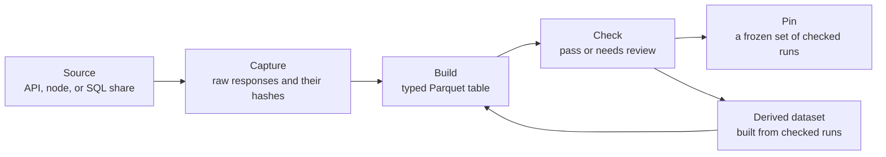

<!-- generated by scripts/milestone_pages.py; edit the data catalog or rebuild a dataset, then run: python scripts/milestone_pages.py build -->

This page documents every dataset the research uses: where it comes from, how it is transformed, and how its quality is measured. [1.1 Data Ingestion](/Phase-II/Milestones/Milestone-1/1-1-Data-Ingestion/) reports what the staking record holds. This page explains how each table in it, and each table of context data around it, is made and checked, so that any number in the research can be traced to the bytes it came from.

## Contract requirement

> Documentation of sources, transformations, quality metrics

Quoted from the [Signed Grant Agreement](/Phase-II/Milestones/Milestone-0/Signed-Grant-Agreement).

## Status

Delivered for the Foundation's review. Not yet accepted. The catalog declares 69 datasets from 16 sources, and 69 have a built run. The tables below are generated from the newest run of each dataset built on or before 8 October 2026 at 18:32:40 UTC.

## How a dataset is made

Every dataset passes through the same four steps, and every step leaves a **receipt**, a JSON file that records what the step read, what it wrote, and the SHA-256 hash of each file. A hash is a fixed-length fingerprint of a file's bytes: any change to the bytes changes it, so a receipt proves which bytes a later step used. Figure 1 shows the steps.

*Figure 1. The four steps from a source to a pinned run. A derived dataset is built from the checked runs of other datasets and passes through the same build and check.*

1. **Capture.** A **source** is a provider of data: an API, a public node, or the Snowflake share. A capture sends the requests or SQL queries the catalog declares for a dataset and stores each response unchanged, with its hash and the hash of the dataset's declared contract.
2. **Build.** A build loads the capture with the declared types and units and writes one Parquet table. This is the **transformation**: for a captured dataset it parses and types the response, and for a derived dataset it joins or aggregates other datasets' checked runs, which its receipt names with their hashes.
3. **Check.** A check reads the built rows and tests them: repeated keys, times outside their bounds, amounts outside the protocol's limits, outputs that do not sum to the declared stake, and agreement with a second source where one exists. It passes, or it records **findings** for review. The check of a derived dataset also rebuilds it from its inputs and compares the result.
4. **Pin.** A **pin** freezes a set of checked runs for a study or a model version, so every number in that study comes from the same bytes.

A capture and the build and check made from it form one **run**. Units are kept as the source serves them and converted once where the catalog says so: AVAX amounts are stored in nAVAX, a billionth of an AVAX, and times in UTC.

## Sources

Table 1 lists each source, how far its data is trusted, and how it is accessed. Trust is stated per source because the sources differ in kind: a node's response is the chain's own record, while a market data provider aggregates observations from elsewhere.

| Source | Kind | What it is and how far it is trusted | Access |
| --- | --- | --- | --- |
| Snowpeer API (`snowpeer`) | API | Snowpeer-curated Avalanche network observations. Use for discovery and cross-checking, not as raw on-chain truth. | none declared by the observed public API |
| CoinGecko public API (`coingecko`) | API | Third-party market observations aggregated across exchanges. Use for AVAX price, volume, and market capitalization context, not as exchange-level truth. | none; the keyless public API limits historical requests to the trailing 365 days (error code 10012). Full history requires a paid CoinGecko plan. |
| Binance public market data archive (`binance-public-data`) | API | Exchange candles published by Binance for its AVAX/USDT market, the full history since AVAX began trading on 2020-09-22. Third-party market observations, quoted in USDT, not USD; they establish nothing on chain. | none; static files served at data.binance.vision, each beside a CHECKSUM file carrying its SHA-256 |
| DefiLlama public API (`defillama`) | API | Third-party aggregates. The coins price series carries CoinGecko lineage (coingecko:avalanche-2) with a per-series confidence value; use it for daily price context, not as exchange-level truth. | none; the coins chart endpoint returns at most 500 points per request, so full history is captured as fixed 500-day windows |
| Avalanche Metrics API (`avalanche-metrics-api`) | API | Ava Labs' official derived metrics behind the Avalanche explorer. Authoritative for the aggregates it defines; definitions are endpoint-specific and units are not documented, so each series is reconciled against raw-data datasets where one exists. | none; the public endpoint answers keyless requests with a page limit of 2160 points, so each series is captured as fixed two-year windows |
| Avalanche Data API (`avalanche-data-api`) | API | Ava Labs' official indexed data behind the Avalanche explorer. Its supply endpoint reports current totals, while its C-Chain Primary Network transaction endpoint reports atomic imports and exports with AVAX input and output amounts. | optional; the x-glacier-api-key header, read from the AVALANCHE_DATA_API_KEY environment variable and sent only to glacier-api.avax.network, which accepts it (the data-api.avax.network alias rejects it). Keyless requests work at a lower limit. The key is never stored in the repository, a capture, or a receipt. |
| US Treasury daily par yield curve (`us-treasury`) | API | The US Department of the Treasury's published daily par yield curve rates. Authoritative for the benchmark rates it publishes; one yearly Atom feed per request. | none; the XML feed is public and keyless |
| Federal Reserve Bank of St. Louis FRED (`fred`) | API | FRED republishes the Board of Governors' H.15 release. DTB3 is the 3-month Treasury bill secondary-market rate on a discount basis, daily; TB3MS is its monthly average. | none; the fredgraph CSV download answers keyless requests |
| Avalanche P-Chain public RPC (`avalanche-p-chain-rpc`) | API | Direct response of a public Avalanche node. Authoritative for current protocol state at the observation instant, for its record of one transaction by hash, which carries every input and output amount and so settles burns the share cannot, and for accepted blocks by height, which carry every transaction and make the node a source independent of the Snowflake share. | none; the public endpoint at api.avax.network answers JSON-RPC POST requests |
| Avalanche X-Chain public RPC (`avalanche-x-chain-rpc`) | API | Direct response of a public Avalanche node about accepted X-Chain blocks by height, which carry every transaction with its inputs and outputs. A source of X-Chain burns independent of the Snowflake share. | none; the public endpoint at api.avax.network answers JSON-RPC POST requests |
| Avalanche C-Chain public JSON-RPC (`avalanche-c-chain-rpc`) | API | Direct public C-Chain block, transaction-receipt, and atomic-transaction responses, retained only for explicitly identified gaps in the Snowflake share and the Data API. | none; the public endpoint at api.avax.network answers JSON-RPC POST requests |
| Tenderly public Avalanche C-Chain JSON-RPC gateway (`tenderly-c-chain-rpc`) | API | A third-party archive node's C-Chain block headers and transaction receipts. Not an Avalanche indexer: a node's own responses, so a fee computed from its receipts is independent of the Data API and the Snowflake share. Used only for the gap blocks, and checked against the Data API to the wei on every block both hold. | none; the public gateway answers JSON-RPC POST requests, including batches and eth_getBlockReceipts |
| Avalanche Primary Network Data Snowflake share (`avalanche-snowflake`) | SQL share | Avalanche-published SQL share of observed C-Chain, P-Chain, and X-Chain records. Authoritative for the rows it exposes, not for economic interpretation. | Named Snowflake connection resolved by snowflake-connector-python from its connections.toml file. No credential enters this repository, a capture, or a receipt. |
| Avalanche Builder Hub validator explorer (`avalanche-builder-hub`) | API | Ava Labs' Builder Hub, which proxies a validator-metrics service fed by the nodes Ava Labs runs. Its uptime is the hourly median across those observers: one observer set, beside the public P-Chain RPC node and the Data API, and not the protocol's own stake-weighted vote at period end. | none |
| Derived datasets (`derived`) | built from other datasets | No external authority. A derived dataset is a deterministic transformation of built runs of other datasets in this catalog, and inherits their authority and limits. Its receipt records the exact input runs and their hashes. | none; built locally from data/runs |
| AVAX exchange-traded product issuers (`etf-issuers`) | API | Each issuer's own published figures for its product: Bitwise for BAVA, VanEck for VAVX, 21Shares for its Avalanche product and two baskets that hold AVAX, and Grayscale's filings with the SEC for GAVA. The issuer is the authority for its own NAV, shares outstanding, and AVAX held. None of these is an on-chain observation. | none; VanEck's blocks answer a browser User-Agent and the capture keeps one cookie jar for them, and SEC EDGAR requires a User-Agent that names a contact |

*Table 1. Sources. Source: `data/data-catalog.json`.*

## Datasets and transformations

Table 2 lists each dataset with the request, SQL query, or input datasets it is made from, and the number of fields it declares. For a derived dataset, the inputs are those its newest run read, as its capture receipt records them. Each field's type, unit, and derivation is recorded in the catalog and in the build receipt.

| Dataset | Name | Source | Made from | Fields |
| --- | --- | --- | --- | ---: |
| `snowpeer.network-summary` | Snowpeer network-wide summary | `snowpeer` | 6 GET requests, the first to `https://api.snowpeer.io/v1/stats/subnets/total-market-cap` | 7 |
| `snowflake.primary-validator-stakes` | Primary Network validator staking transactions | `avalanche-snowflake` | SQL `queries/primary-validator-stakes.sql` | 20 |
| `snowflake.primary-delegator-stakes` | Primary Network delegation transactions | `avalanche-snowflake` | SQL `queries/primary-delegator-stakes.sql` | 18 |
| `snowflake.primary-staking-rewards` | Primary Network staking reward outcomes | `avalanche-snowflake` | SQL `queries/primary-staking-rewards.sql` | 16 |
| `snowflake.primary-staking-supply` | Primary Network staking supply context | `avalanche-snowflake` | SQL `queries/primary-staking-supply.sql` | 10 |
| `snowflake.primary-burn-events` | P- and X-Chain AVAX burn events | `avalanche-snowflake` | SQL `queries/primary-burn-events.sql` | 7 |
| `snowflake.c-chain-evm-burn-daily` | C-Chain EVM fee burns by UTC date | `avalanche-snowflake` | SQL `queries/c-chain-evm-burn-daily.sql` | 16 |
| `snowflake.primary-burn-daily` | P- and X-Chain AVAX burns by UTC date | `avalanche-snowflake` | SQL `queries/primary-burn-daily.sql` | 12 |
| `snowflake.c-chain-block-gaps` | C blocks the Snowflake share cannot account for | `avalanche-snowflake` | SQL `queries/c-chain-block-gaps.sql` | 5 |
| `snowflake.subnet-validator-transactions` | Subnet and L1 validator transactions | `avalanche-snowflake` | SQL `queries/subnet-validator-transactions.sql` | 10 |
| `coingecko.avax-market-daily` | AVAX daily market observations | `coingecko` | GET `https://api.coingecko.com/api/v3/coins/avalanche-2/market_chart` | 8 |
| `binance.avax-usdt-daily` | AVAX daily candles, full history | `binance-public-data` | 2 GET requests, the first to `https://data.binance.vision/data/spot/monthly/klines/AVAXUSDT/1d/` | 10 |
| `defillama.avax-price-daily` | AVAX daily price history | `defillama` | 5 GET requests, the first to `https://coins.llama.fi/chart/coingecko:avalanche-2` | 7 |
| `c-chain-rpc.receipt-gap-repairs` | Archived C-Chain receipt-gap repairs | `avalanche-c-chain-rpc` | GET `https://api.avax.network/ext/bc/C/rpc` | 8 |
| `p-chain-rpc.current-validators` | Primary Network current validator snapshot | `avalanche-p-chain-rpc` | POST `https://api.avax.network/ext/bc/P` | 16 |
| `p-chain-rpc.transactions` | P-Chain transactions by hash from a public node | `avalanche-p-chain-rpc` | POST `https://api.avax.network/ext/bc/P` | 7 |
| `p-chain-rpc.blocks` | P-Chain blocks by height from a public node | `avalanche-p-chain-rpc` | 6 POST requests, the first to `https://api.avax.network/ext/bc/P` | 12 |
| `x-chain-rpc.blocks` | X-Chain blocks by height from a public node | `avalanche-x-chain-rpc` | 4 POST requests, the first to `https://api.avax.network/ext/bc/X` | 12 |
| `data-api.p-chain-staking-transactions` | Data API records of the staking transactions a P-Chain walk sees end | `avalanche-data-api` | GET `https://glacier-api.avax.network/v1/networks/mainnet/blockchains/p-chain/transactions` | 9 |
| `p-chain-rpc.reward-utxos` | Reward outputs a P-Chain node paid for the staking periods a walk sees end | `avalanche-p-chain-rpc` | 2 POST requests, the first to `https://api.avax.network/ext/bc/P` | 3 |
| `data-api.c-chain-block-list` | Every C-Chain block from a UTC date, from the Data API's block list | `avalanche-data-api` | GET `https://glacier-api.avax.network/v1/chains/43114/blocks` | 8 |
| `data-api.p-chain-block-list` | Every P-Chain block from a UTC date, from the Data API's block list | `avalanche-data-api` | GET `https://glacier-api.avax.network/v1/networks/mainnet/blockchains/p-chain/blocks` | 9 |
| `c-chain-rpc.atomic-transactions` | C-Chain atomic transactions by hash from a public node | `avalanche-c-chain-rpc` | POST `https://api.avax.network/ext/bc/C/avax` | 8 |
| `defillama.pool-yields` | DeFi pool yields on Avalanche and proof-of-stake staking products | `defillama` | GET `https://yields.llama.fi/pools` | 27 |
| `defillama.pool-history` | DefiLlama daily yield history for declared liquid staking and lending pools | `defillama` | 9 GET requests, the first to `https://yields.llama.fi/chart/3790c3e5-8644-4f6b-8feb-12434d8b99f9` | 13 |
| `defillama.lend-borrow` | DefiLlama lending and borrowing rates on Avalanche, snapshot | `defillama` | 2 GET requests, the first to `https://yields.llama.fi/pools` | 16 |
| `defillama.avalanche-fees-daily` | DefiLlama Avalanche fees and revenue, daily | `defillama` | GET `https://api.llama.fi/overview/fees/avalanche` | 3 |
| `us-treasury.par-yield-daily` | US Treasury daily par yields | `us-treasury` | 7 GET requests, the first to `https://home.treasury.gov/resource-center/data-chart-center/interest-rates/pages/xml` | 5 |
| `fred.tbill-3m-daily` | 3-month Treasury bill discount rate, daily | `fred` | GET `https://fred.stlouisfed.org/graph/fredgraph.csv` | 2 |
| `metrics-api.primary-staking-daily` | Primary Network daily staking metrics | `avalanche-metrics-api` | 12 GET requests, the first to `https://metrics.avax.network/v2/networks/mainnet/metrics/validatorCount` | 7 |
| `metrics-api.c-chain-activity-daily` | C-Chain daily activity and fees | `avalanche-metrics-api` | 15 GET requests, the first to `https://metrics.avax.network/v2/chains/43114/metrics/activeAddresses` | 6 |
| `data-api.avax-supply` | AVAX supply snapshot | `avalanche-data-api` | GET `https://glacier-api.avax.network/v1/avax/supply` | 12 |
| `data-api.validators-active` | Active Primary Network validations from the Data API | `avalanche-data-api` | GET `https://data-api.avax.network/v1/networks/mainnet/validators` | 28 |
| `data-api.validators-completed` | Completed Primary Network validations from the Data API | `avalanche-data-api` | GET `https://data-api.avax.network/v1/networks/mainnet/validators` | 18 |
| `data-api.validators-completed-recent` | Recently completed Primary Network validations from the Data API | `avalanche-data-api` | GET `https://data-api.avax.network/v1/networks/mainnet/validators` | 18 |
| `data-api.c-chain-atomic-burn` | C-Chain atomic AVAX burn events | `avalanche-data-api` | GET `https://glacier-api.avax.network/v1/networks/mainnet/blockchains/c-chain/transactions` | 8 |
| `data-api.c-chain-block-fees` | C-Chain block fees for the share's gap blocks | `avalanche-data-api` | GET `https://glacier-api.avax.network/v1/chains/43114/blocks` | 8 |
| `c-chain-rpc.block-receipt-fees` | C-Chain gap-block fees from a public node's receipts | `tenderly-c-chain-rpc` | POST `https://avalanche-mainnet.gateway.tenderly.co` | 8 |
| `c-chain-rpc.token-supply-monthly` | Month-end supply of stablecoins and holder products on the C-Chain | `tenderly-c-chain-rpc` | POST `https://avalanche-mainnet.gateway.tenderly.co` | 14 |
| `derived.staking-periods` | Primary Network staking periods | `derived` | derived from `derived.seamed-validator-stakes`, `derived.seamed-delegator-stakes`, `derived.seamed-staking-rewards`, `derived.seamed-staking-supply`, `derived.p-chain-staking-cycles` | 28 |
| `derived.node-table` | Primary Network validator nodes | `derived` | derived from `derived.staking-periods`, `derived.seamed-validator-stakes`, `derived.seamed-delegator-stakes`, `p-chain-rpc.current-validators`, `data-api.validators-active` | 38 |
| `derived.validator-weeks` | Validator-week panel | `derived` | derived from `derived.staking-periods`, `derived.seamed-validator-stakes`, `derived.seamed-delegator-stakes`, `derived.seamed-staking-supply` | 33 |
| `derived.observed-delegations` | Observed delegations of the validator-week window | `derived` | derived from `derived.staking-periods`, `snowflake.primary-validator-stakes`, `snowflake.primary-delegator-stakes`, `snowflake.primary-staking-supply` | 24 |
| `derived.market-weeks` | Delegation market weeks | `derived` | derived from `derived.staking-periods`, `snowflake.primary-validator-stakes`, `snowflake.primary-delegator-stakes`, `snowflake.primary-staking-supply`, `derived.avax-monetary-daily`, `binance.avax-usdt-daily`, `defillama.avax-price-daily` | 21 |
| `derived.opportunity-costs-daily` | Opportunity costs beside the native staking rate, daily | `derived` | derived from `derived.avax-monetary-daily`, `fred.tbill-3m-daily`, `us-treasury.par-yield-daily`, `defillama.pool-history` | 9 |
| `derived.avax-monetary-daily` | AVAX monetary daily ledger | `derived` | derived from `derived.seamed-burn-daily`, `derived.seamed-staking-rewards`, `derived.staking-periods`, `derived.seamed-staking-supply`, `p-chain-rpc.transactions`, `snowflake.c-chain-evm-burn-daily`, `derived.seamed-c-chain-evm-burn-daily`, `snowflake.c-chain-block-gaps`, `data-api.c-chain-block-fees`, `c-chain-rpc.block-receipt-fees`, `c-chain-rpc.receipt-gap-repairs`, `data-api.c-chain-atomic-burn`, `c-chain-rpc.atomic-transactions`, `data-api.avax-supply` | 23 |
| `derived.monetary-periods` | The monetary ledger by network upgrade period | `derived` | derived from `derived.avax-monetary-daily`, `derived.seamed-staking-rewards` | 17 |
| `builder-hub.validator-uptime` | Builder Hub hourly validator uptime, one capture | `avalanche-builder-hub` | 2 GET requests, the first to `https://build.avax.network/api/validators` | 4 |
| `derived.validator-uptime-hourly` | Hourly validator uptime across every Builder Hub capture | `derived` | derived from `builder-hub.validator-uptime` | 7 |
| `derived.helicon-commitments` | Validation cycles started after Helicon | `derived` | derived from `derived.staking-periods`, `p-chain-rpc.current-validators` | 15 |
| `etf-issuers.avax-fund-snapshot` | AVAX exchange-traded products, current figures per issuer | `etf-issuers` | 8 GET requests, the first to `https://bavaetf.com/` | 14 |
| `etf-issuers.avax-fund-history` | AVAX exchange-traded products, published valuation histories | `etf-issuers` | 5 GET requests, the first to `https://bavaetf.com/` | 13 |
| `derived.subnet-validation` | Subnet and L1 validation by node | `derived` | derived from `snowflake.subnet-validator-transactions`, `derived.staking-periods` | 14 |
| `derived.operators` | Operators and fleets of validator nodes | `derived` | derived from `derived.node-table` | 13 |
| `derived.operator-attributions` | Classed attributions of operators and funding addresses | `derived` | derived from `derived.operators` | 18 |
| `derived.p-chain-validator-stakes` | Validator stakes rebuilt from a P-Chain block walk | `derived` | derived from `p-chain-rpc.blocks`, `data-api.p-chain-staking-transactions`, `p-chain-rpc.reward-utxos`, `p-chain-rpc.current-validators`, `data-api.validators-completed-recent` | 20 |
| `derived.p-chain-delegator-stakes` | Delegator stakes rebuilt from a P-Chain block walk | `derived` | derived from `p-chain-rpc.blocks`, `data-api.p-chain-staking-transactions`, `p-chain-rpc.reward-utxos`, `p-chain-rpc.current-validators`, `data-api.validators-completed-recent` | 18 |
| `derived.p-chain-staking-rewards` | Staking rewards rebuilt from a P-Chain block walk | `derived` | derived from `p-chain-rpc.blocks`, `data-api.p-chain-staking-transactions`, `p-chain-rpc.reward-utxos`, `p-chain-rpc.current-validators`, `data-api.validators-completed-recent` | 16 |
| `derived.p-chain-staking-supply` | Supply counter at each stake, rebuilt from a P-Chain block walk | `derived` | derived from `p-chain-rpc.blocks`, `data-api.p-chain-staking-transactions`, `p-chain-rpc.reward-utxos`, `p-chain-rpc.current-validators`, `data-api.validators-completed-recent` | 10 |
| `derived.p-chain-staking-cycles` | Cycles of ACP-236 auto-renewed validators, from a P-Chain walk | `derived` | derived from `p-chain-rpc.blocks`, `data-api.p-chain-staking-transactions`, `p-chain-rpc.reward-utxos`, `p-chain-rpc.current-validators`, `data-api.validators-completed-recent` | 16 |
| `derived.c-chain-evm-burn-daily` | C-Chain EVM burn per UTC day from the Data API's block list | `derived` | derived from `data-api.c-chain-block-list` | 16 |
| `derived.primary-burn-daily` | P- and X-Chain burns per UTC day from the nodes' own blocks | `derived` | derived from `p-chain-rpc.blocks`, `x-chain-rpc.blocks`, `data-api.p-chain-block-list` | 12 |
| `derived.seamed-validator-stakes` | Validator stakes: the share before the seam, the P-Chain walk from it | `derived` | derived from `snowflake.primary-validator-stakes`, `snowflake.primary-delegator-stakes`, `snowflake.primary-staking-rewards`, `snowflake.primary-staking-supply`, `derived.p-chain-validator-stakes` | 21 |
| `derived.seamed-delegator-stakes` | Delegator stakes: the share before the seam, the P-Chain walk from it | `derived` | derived from `snowflake.primary-validator-stakes`, `snowflake.primary-delegator-stakes`, `snowflake.primary-staking-rewards`, `snowflake.primary-staking-supply`, `derived.p-chain-delegator-stakes` | 19 |
| `derived.seamed-staking-rewards` | Staking rewards: the share before the seam, the P-Chain walk from it | `derived` | derived from `snowflake.primary-validator-stakes`, `snowflake.primary-delegator-stakes`, `snowflake.primary-staking-rewards`, `snowflake.primary-staking-supply`, `derived.p-chain-staking-rewards` | 17 |
| `derived.seamed-staking-supply` | Supply counter at each stake: the share before the seam, the P-Chain walk from it | `derived` | derived from `snowflake.primary-validator-stakes`, `snowflake.primary-delegator-stakes`, `snowflake.primary-staking-rewards`, `snowflake.primary-staking-supply`, `derived.p-chain-staking-supply` | 11 |
| `derived.seamed-burn-daily` | P- and X-Chain burns per day: the share before the seam date, the nodes' blocks from it | `derived` | derived from `snowflake.primary-burn-daily`, `derived.primary-burn-daily` | 13 |
| `derived.seamed-c-chain-evm-burn-daily` | C-Chain EVM burn per day: the share before the seam date, the Data API's block list from it | `derived` | derived from `snowflake.c-chain-evm-burn-daily`, `derived.c-chain-evm-burn-daily` | 17 |
| `derived.gci-monthly` | Gross Chain Income inputs by month | `derived` | derived from `c-chain-rpc.token-supply-monthly`, `fred.tbill-3m-daily`, `defillama.avalanche-fees-daily`, `derived.avax-monetary-daily`, `binance.avax-usdt-daily` | 23 |

*Table 2. Datasets and the transformation that makes each one. Source: `data/data-catalog.json` and the capture receipts of derived runs.*

## Quality metrics

Table 3 gives the quality metrics of each dataset's newest run: its rows, the dates it covers, the checks it ran and their result, and the counts its build records for review. A **finding** is a check that did not pass and needs review. A recorded count is not a failure: it marks rows that lack a value or need care in use, such as periods still in progress when the data was captured.

69 of 69 datasets have a built run. 64 passed every check, and 5 have findings to review: `snowflake.c-chain-evm-burn-daily`, `snowflake.primary-burn-daily`, `metrics-api.primary-staking-daily`, `metrics-api.c-chain-activity-daily`, `data-api.validators-completed`.

| Dataset | Rows | Dates covered | Checks | Findings | Counts recorded for review |
| --- | ---: | --- | --- | --- | --- |
| `snowpeer.network-summary` | not counted | not dated | all 7 passed | none | none |
| `snowflake.primary-validator-stakes` | 57,560 | 2020-09-10 to 2026-09-22 | all 13 passed | none | rows without a potential reward: 1 rows without a reward outcome: 602 rows without a staked output: 2 |
| `snowflake.primary-delegator-stakes` | 7,058,519 | 2020-09-22 to 2026-09-22 | all 12 passed | none | rows without a reward outcome: 33,866 rows without a staked output: 75 rows funded from several addresses: 8,335 rows without a funding address: 75 |
| `snowflake.primary-staking-rewards` | 7,081,611 | 2020-10-06 to 2026-09-22 | all 12 passed | none | rewarded rows without a reward output: 954 rows without a reward output: 68,016 |
| `snowflake.primary-staking-supply` | 7,116,079 | 2020-09-10 to 2026-09-22 | all 9 passed | none | rows from the genesis block: 75 rows in blocks where the supply change differs from the staking changes: 2,676,285 rows in blocks where supply falls by more than the stakes removed: 199 rows without a block supply reading: 75 |
| `snowflake.primary-burn-events` | 2,938 | 2026-09-16 to 2026-09-16 | all 8 passed | none | none |
| `snowflake.c-chain-evm-burn-daily` | not counted | 2026-05-01 to 2026-09-21 | 2 findings from 16 checks | 1 rows do not connect to adjacent C block days 25 rows have absent C blocks, to read from the Data API block record | none |
| `snowflake.primary-burn-daily` | 4,408 | 2020-09-10 to 2026-09-22 | 1 finding from 11 checks | 2 rows carry unresolved burns to settle from the Data API transaction record | none |
| `snowflake.c-chain-block-gaps` | 14,627 | 2026-01-03 to 2026-09-20 | all 7 passed | none | none |
| `snowflake.subnet-validator-transactions` | 6,530 | 2020-10-25 to 2026-09-22 | all 9 passed | none | none |
| `coingecko.avax-market-daily` | 366 | 2025-09-30 to 2026-09-29 | all 10 passed | none | partial days: 1 rows without a 30-day volatility: 30 |
| `binance.avax-usdt-daily` | 2,195 | 2020-09-22 to 2026-09-25 | all 5 passed | none | none |
| `defillama.avax-price-daily` | 2,201 | 2020-09-23 to 2026-10-05 | all 9 passed | none | rows without a 30-day volatility: 30 dates with two observations: 343 dates skipped: 346 |
| `c-chain-rpc.receipt-gap-repairs` | not counted | not dated | all 6 passed | none | none |
| `p-chain-rpc.current-validators` | 587 | snapshot 2026-10-08 00:15 | all 10 passed | none | none |
| `p-chain-rpc.transactions` | 24 | not dated | all 5 passed | none | none |
| `p-chain-rpc.blocks` | 126,300 | 2026-09-15 to 2026-10-08 | all 7 passed | none | none |
| `x-chain-rpc.blocks` | 3,287 | 2026-09-14 to 2026-10-08 | all 7 passed | none | none |
| `data-api.p-chain-staking-transactions` | 337 | not dated | all 5 passed | none | none |
| `p-chain-rpc.reward-utxos` | 36,407 | not dated | all 6 passed | none | rows without a reward output: 407 |
| `data-api.c-chain-block-list` | 163,026 | not dated | all 4 passed | none | none |
| `data-api.p-chain-block-list` | 133,235 | not dated | all 4 passed | none | none |
| `c-chain-rpc.atomic-transactions` | 5 | not dated | all 6 passed | none | none |
| `defillama.pool-yields` | 319 | snapshot 2026-10-05 20:19 | all 8 passed | none | pools the provider flags as outliers: 55 |
| `defillama.pool-history` | 10,979 | not dated | all 7 passed | none | none |
| `defillama.lend-borrow` | 52 | snapshot 2026-10-05 20:19 | all 7 passed | none | none |
| `defillama.avalanche-fees-daily` | 2,059 | 2021-02-09 to 2026-09-29 | all 2 passed | none | none |
| `us-treasury.par-yield-daily` | 21,691 | 2020-01-02 to 2026-10-05 | all 9 passed | none | none |
| `fred.tbill-3m-daily` | 18,980 | 1954-01-04 to 2026-10-02 | all 3 passed | none | none |
| `metrics-api.primary-staking-daily` | 2,058 | 2021-01-01 to 2026-08-31 | 5 findings from 10 checks | 9 rows follow a gap of more than one day 823 of 2058 days differ from the Snowflake validator count by more than 2% 437 of 2058 days differ from the Snowflake validator weight by more than 2% 1571 of 2058 days differ from the Snowflake delegator count by more than 2% 1269 of 2058 days differ from the Snowflake delegator weight by more than 2% | dates skipped: 9 |
| `metrics-api.c-chain-activity-daily` | 2,087 | 2021-01-01 to 2026-09-18 | 1 finding from 9 checks | 3 rows lack one of the series before the last complete day | days with a missing series: 6 |
| `data-api.avax-supply` | 1 | snapshot 2026-10-08 02:15 | all 8 passed | none | none |
| `data-api.validators-active` | 587 | snapshot 2026-10-08 00:16 | all 11 passed | none | none |
| `data-api.validators-completed` | 56,963 | 2020-09-10 to 2026-09-22 | 1 finding from 9 checks | reward differs from the Snowflake capture on 1 validations | validations without a reward transaction: 1 |
| `data-api.validators-completed-recent` | 1,500 | 2026-05-17 to 2026-10-08 | all 10 passed | none | validations without a reward transaction: 4 |
| `data-api.c-chain-atomic-burn` | 199 | not dated | all 7 passed | none | none |
| `data-api.c-chain-block-fees` | 65,710 | 2025-03-07 to 2025-10-29 | all 6 passed | none | none |
| `c-chain-rpc.block-receipt-fees` | 127,977 | 2023-10-06 to 2023-12-14 | all 6 passed | none | none |
| `c-chain-rpc.token-supply-monthly` | 256 | 2024-01-01 to 2026-08-01 | all 3 passed | none | none |
| `derived.staking-periods` | 7,150,933 | 2020-09-10 to 2026-10-08 | all 8 passed | none | periods without a supply reading: 120 ended periods without a reward transaction: 1 |
| `derived.node-table` | 7,659 | not dated | all 7 passed | none | none |
| `derived.validator-weeks` | 385,922 | not dated | all 7 passed | none | none |
| `derived.observed-delegations` | 7,056,204 | not dated | all 7 passed | none | none |
| `derived.market-weeks` | 313 | not dated | all 6 passed | none | none |
| `derived.opportunity-costs-daily` | 35,272 | not dated | all 6 passed | none | none |
| `derived.avax-monetary-daily` | 2,219 | 2020-09-10 to 2026-10-07 | all 9 passed | none | none |
| `derived.monetary-periods` | 16 | not dated | all 3 passed | none | none |
| `builder-hub.validator-uptime` | 191,161 | 2026-09-22 to 2026-10-08 | all 9 passed | none | none |
| `derived.validator-uptime-hourly` | 385,876 | 2026-09-10 to 2026-10-08 | all 3 passed | none | none |
| `derived.helicon-commitments` | 262 | not dated | all 8 passed | none | none |
| `etf-issuers.avax-fund-snapshot` | 6 | not dated | all 11 passed | none | none |
| `etf-issuers.avax-fund-history` | 4,648 | not dated | all 9 passed | none | none |
| `derived.subnet-validation` | 4,257 | not dated | all 8 passed | none | none |
| `derived.operators` | 7,659 | not dated | all 7 passed | none | none |
| `derived.operator-attributions` | 10 | not dated | all 5 passed | none | none |
| `derived.p-chain-validator-stakes` | 356 | not dated | all 5 passed | none | none |
| `derived.p-chain-delegator-stakes` | 47,184 | not dated | all 5 passed | none | none |
| `derived.p-chain-staking-rewards` | 36,397 | not dated | all 5 passed | none | none |
| `derived.p-chain-staking-supply` | 47,495 | not dated | all 5 passed | none | none |
| `derived.p-chain-staking-cycles` | 68 | not dated | all 5 passed | none | none |
| `derived.c-chain-evm-burn-daily` | 23 | 2026-09-15 to 2026-10-07 | all 2 passed | none | none |
| `derived.primary-burn-daily` | 46 | 2026-09-15 to 2026-10-07 | all 2 passed | none | none |
| `derived.seamed-validator-stakes` | 57,803 | 2020-09-10 to 2026-10-08 | all 3 passed | none | none |
| `derived.seamed-delegator-stakes` | 7,093,130 | 2020-09-22 to 2026-10-08 | all 3 passed | none | none |
| `derived.seamed-staking-rewards` | 7,107,752 | 2020-10-06 to 2026-10-08 | all 3 passed | none | none |
| `derived.seamed-staking-supply` | 7,150,888 | 2020-09-10 to 2026-10-08 | all 3 passed | none | none |
| `derived.seamed-burn-daily` | 4,438 | 2020-09-10 to 2026-10-08 | all 3 passed | none | none |
| `derived.seamed-c-chain-evm-burn-daily` | 160 | 2026-05-01 to 2026-10-08 | all 3 passed | none | none |
| `derived.gci-monthly` | 32 | 2024-01-01 to 2026-08-01 | all 2 passed | none | none |

*Table 3. Quality metrics of the newest run of each dataset. Source: the build and check receipts of each run.*

## Latest runs

Table 4 identifies each run behind Table 3: when it was captured, its capture ID, the hash of its first raw responses, and the pins that freeze a run of the dataset. A pinned run can be older than the newest run: a study keeps the run it was made with.

| Dataset | Run | Captured (UTC) | Capture ID | Raw data hash | Pinned in |
| --- | --- | --- | --- | --- | --- |
| `snowpeer.network-summary` | network-summary-helicon-plus-7d | 2026-09-29 11:07 | `capture:snowpeer:2026-09-29T11:07:23Z:24c71dd3a646` | `7e34b240a7a2, 32dc66f3662b ...` | not pinned |
| `snowflake.primary-validator-stakes` | validator-stakes-helicon-plus-7d | 2026-09-29 10:56 | `capture:avalanche-snowflake:2026-09-29T10:56:01Z:47f80d1af6c2` | `28e2ceacfc5f` | not pinned |
| `snowflake.primary-delegator-stakes` | delegator-stakes-helicon-plus-7d | 2026-09-29 10:59 | `capture:avalanche-snowflake:2026-09-29T10:59:29Z:90e3fbf6c855` | `0e71435fa60a` | not pinned |
| `snowflake.primary-staking-rewards` | staking-rewards-helicon-plus-7d | 2026-09-29 11:03 | `capture:avalanche-snowflake:2026-09-29T11:03:56Z:eca881f30a11` | `d3de1d2a0533` | not pinned |
| `snowflake.primary-staking-supply` | staking-supply-helicon-plus-7d | 2026-09-29 11:06 | `capture:avalanche-snowflake:2026-09-29T11:06:58Z:851e5e10b68f` | `265d125271a7` | not pinned |
| `snowflake.primary-burn-events` | burn-events-2026-09-16 | 2026-09-21 19:36 | `capture:avalanche-snowflake:2026-09-21T19:36:28Z:794763e68b1c` | `b485cb61e77c` | not pinned |
| `snowflake.c-chain-evm-burn-daily` | c-evm-burn-2026b | 2026-09-23 19:05 | `capture:avalanche-snowflake:2026-09-23T19:05:56Z:16a07bde68f4` | `136923319074` | not pinned |
| `snowflake.primary-burn-daily` | burn-daily-2026-09-23 | 2026-09-23 18:02 | `capture:avalanche-snowflake:2026-09-23T18:02:06Z:ca935c033f10` | `e78fdab0ca66` | not pinned |
| `snowflake.c-chain-block-gaps` | c-block-gaps-2026 | 2026-09-23 19:11 | `capture:avalanche-snowflake:2026-09-23T19:11:21Z:df476c5856ee` | `550643755fdb` | not pinned |
| `snowflake.subnet-validator-transactions` | subnet-validator-transactions-2026-09-29 | 2026-09-29 10:09 | `capture:avalanche-snowflake:2026-09-29T10:09:40Z:71f3255c6a75` | `62a9898197c6` | not pinned |
| `coingecko.avax-market-daily` | avax-market-helicon-plus-7d | 2026-09-29 11:07 | `capture:coingecko:2026-09-29T11:07:26Z:a16cddddc815` | `20bc4c5c40be` | not pinned |
| `binance.avax-usdt-daily` | binance-avax-daily-2026-09-26 | 2026-09-26 23:16 | `capture:binance-public-data:2026-09-26T23:16:18Z:cb65b6215e13` | `5bcb42ce41a6, 06a7011750ac ...` | not pinned |
| `defillama.avax-price-daily` | avax-price-2026-10-05 | 2026-10-05 20:53 | `capture:defillama:2026-10-05T20:53:21Z:6316ac2eca63` | `152843f0c690, cdda7c86a7c4 ...` | `p4-opportunity-costs` (avax-price-2026-10-05, this run) |
| `c-chain-rpc.receipt-gap-repairs` | c-rpc-gap-95492477 | 2026-09-21 23:11 | `capture:avalanche-c-chain-rpc:2026-09-21T23:11:27Z:539af6d13fa7` | `e1897ce73ba2, b3da2328b942 ...` | not pinned |
| `p-chain-rpc.current-validators` | current-validators-2026-10-08 | 2026-10-08 00:15 | `capture:avalanche-p-chain-rpc:2026-10-08T00:15:01Z:a01129e739b4` | `398956acccb8` | `p3-helicon-etf` (current-validators-2026-09-22) |
| `p-chain-rpc.transactions` | p-transactions-unresolved-2026-09-23 | 2026-09-23 18:04 | `capture:avalanche-p-chain-rpc:2026-09-23T18:04:31Z:3044b620af14` | `19f3a076999f, 56bf7c47cea8 ...` | not pinned |
| `p-chain-rpc.blocks` | p-chain-blocks-2026-10-08 | 2026-10-08 02:38 | `capture:avalanche-p-chain-rpc:2026-10-08T02:38:14Z:c884efced4f2` | `a83f7e8895d4` | `p3-helicon-etf` (p-chain-blocks-2026-10-06) |
| `x-chain-rpc.blocks` | x-chain-blocks-2026-10-08 | 2026-10-08 02:39 | `capture:avalanche-x-chain-rpc:2026-10-08T02:39:36Z:859b13057231` | `c693057d9d2f` | not pinned |
| `data-api.p-chain-staking-transactions` | p-chain-staking-transactions-2026-10-08 | 2026-10-08 03:07 | `capture:avalanche-data-api:2026-10-08T03:07:28Z:3cadf1adfadd` | `24e0de211b28` | not pinned |
| `p-chain-rpc.reward-utxos` | reward-utxos-2026-10-08 | 2026-10-08 03:09 | `capture:avalanche-p-chain-rpc:2026-10-08T03:09:15Z:824633b8a4dc` | `5f7784ba7e38` | not pinned |
| `data-api.c-chain-block-list` | c-chain-block-list-2026-10-08 | 2026-10-08 03:05 | `capture:avalanche-data-api:2026-10-08T03:05:26Z:a452f8422db2` | `2c550fda50cb` | not pinned |
| `data-api.p-chain-block-list` | p-chain-block-list-2026-10-08 | 2026-10-08 02:53 | `capture:avalanche-data-api:2026-10-08T02:53:51Z:77daf2fcf2e9` | `205414e7a1b9` | not pinned |
| `c-chain-rpc.atomic-transactions` | c-atomic-transactions-2026-09-23 | 2026-09-23 23:56 | `capture:avalanche-c-chain-rpc:2026-09-23T23:56:27Z:e8bc4b007fdb` | `12b197058ea0, dca37282a1fa ...` | not pinned |
| `defillama.pool-yields` | pool-yields-2026-10-05 | 2026-10-05 20:19 | `capture:defillama:2026-10-05T20:19:46Z:cfa050ed295f` | `22468c48ad8a` | `p4-opportunity-costs` (pool-yields-2026-10-05, this run) |
| `defillama.pool-history` | pool-history-2026-10-05 | 2026-10-05 20:19 | `capture:defillama:2026-10-05T20:19:26Z:ee5dfd8b2d38` | `b1a572af8144, 41fbb8277419 ...` | `p4-opportunity-costs` (pool-history-2026-10-05, this run) |
| `defillama.lend-borrow` | lend-borrow-2026-10-05 | 2026-10-05 20:19 | `capture:defillama:2026-10-05T20:19:37Z:f1f3559bc24c` | `22468c48ad8a, 73aea41bb578` | `p4-opportunity-costs` (lend-borrow-2026-10-05, this run) |
| `defillama.avalanche-fees-daily` | avalanche-fees-daily-2026-09-29 | 2026-09-29 18:46 | `capture:defillama:2026-09-29T18:46:55Z:aaac291d6498` | `906401aac392, 992706315f1c` | not pinned |
| `us-treasury.par-yield-daily` | treasury-yields-2026-10-05 | 2026-10-05 20:53 | `capture:us-treasury:2026-10-05T20:53:16Z:8eeefbe16666` | `a7e98a4a91db, ab43e563ce1d ...` | `p4-opportunity-costs` (treasury-yields-2026-10-05, this run) |
| `fred.tbill-3m-daily` | tbill-3m-daily-2026-10-05 | 2026-10-05 20:50 | `capture:fred:2026-10-05T20:50:59Z:8b074e52777a` | `0ac82d37ae81, 631bc444a8c5` | `p4-opportunity-costs` (tbill-3m-daily-2026-10-05, this run) |
| `metrics-api.primary-staking-daily` | staking-metrics-2026-09-19 | 2026-09-19 11:04 | `capture:avalanche-metrics-api:2026-09-19T11:04:32Z:a23febb62f64` | `6912c7805ee1, 60bdb1f27928 ...` | not pinned |
| `metrics-api.c-chain-activity-daily` | cchain-activity-2026-09-19 | 2026-09-19 11:04 | `capture:avalanche-metrics-api:2026-09-19T11:04:34Z:84448c350671` | `f91849cccb43, a5cf17db4254 ...` | not pinned |
| `data-api.avax-supply` | avax-supply-2026-10-08 | 2026-10-08 02:30 | `capture:avalanche-data-api:2026-10-08T02:30:01Z:55600abcefe3` | `966747802bac` | not pinned |
| `data-api.validators-active` | validators-active-2026-10-08 | 2026-10-08 00:16 | `capture:avalanche-data-api:2026-10-08T00:16:09Z:b90cb67f9b36` | `dee17a0cf95a` | not pinned |
| `data-api.validators-completed` | validators-completed-2026-09-22 | 2026-09-22 18:59 | `capture:avalanche-data-api:2026-09-22T18:59:07Z:542f433b59ba` | `8fd45ff87ae7` | not pinned |
| `data-api.validators-completed-recent` | validators-completed-recent-2026-10-08 | 2026-10-08 00:17 | `capture:avalanche-data-api:2026-10-08T00:17:04Z:a33018bbf827` | `3874df2a9bfe` | not pinned |
| `data-api.c-chain-atomic-burn` | c-atomic-burn-2026-10-08 | 2026-10-08 03:09 | `capture:avalanche-data-api:2026-10-08T03:09:28Z:e2ef7658bb8a` | `e4d1de318e53, 75ca80c8ab04 ...` | not pinned |
| `data-api.c-chain-block-fees` | c-block-fees-2025 | 2026-09-25 14:42 | `capture:avalanche-data-api:2026-09-25T14:42:28Z:dd584b3a946f` | `3db3d9498d4c` | not pinned |
| `c-chain-rpc.block-receipt-fees` | c-block-receipt-fees-2023 | 2026-09-25 14:14 | `capture:tenderly-c-chain-rpc:2026-09-25T14:14:02Z:fcc957b3bf27` | `6818309f788e` | not pinned |
| `c-chain-rpc.token-supply-monthly` | token-supply-monthly-2026-09-29 | 2026-09-29 18:54 | `capture:tenderly-c-chain-rpc:2026-09-29T18:54:55Z:550940d00156` | `0e26f27febf7` | not pinned |
| `derived.staking-periods` | staking-periods-2026-10-08 | 2026-10-08 03:23 | `capture:derived:2026-10-08T03:23:13Z:69befc14a45b` | `6b7d0d28385f, 3fbf1ca5c0fc ...` | `p1-brief` (staking-periods-2026-10-02), `p2-model-v0.8` (staking-periods-2026-09-30), `p3-helicon-etf` (staking-periods-2026-10-06), `p5-v0.7-report` (staking-periods-2026-09-30), `p6-v0.7-report` (staking-periods-2026-09-30) |
| `derived.node-table` | node-table-2026-10-08 | 2026-10-08 03:23 | `capture:derived:2026-10-08T03:23:52Z:f248cb9f6c90` | `f93bbc8eee8b, 6b7d0d28385f ...` | `p5-v0.7-report` (node-table-2026-09-30), `p6-v0.7-report` (node-table-2026-09-30) |
| `derived.validator-weeks` | validator-weeks-2026-10-08 | 2026-10-08 03:26 | `capture:derived:2026-10-08T03:26:16Z:982b9bbe8a1b` | `f93bbc8eee8b, 6b7d0d28385f ...` | not pinned |
| `derived.observed-delegations` | observed-delegations-2026-09-28 | 2026-09-28 19:27 | `capture:derived:2026-09-28T19:27:38Z:76dc33135537` | `d37d01974ccf, e5b19da3089f ...` | not pinned |
| `derived.market-weeks` | market-weeks-2026-09-28 | 2026-09-28 19:29 | `capture:derived:2026-09-28T19:29:15Z:53e74d7702dc` | `d37d01974ccf, e5b19da3089f ...` | not pinned |
| `derived.opportunity-costs-daily` | opportunity-costs-daily-2026-10-06 | 2026-10-06 16:32 | `capture:derived:2026-10-06T16:32:49Z:be6b2cccf1fd` | `227a841f3f00, c9f2cd72b4df ...` | `p4-opportunity-costs` (opportunity-costs-daily-2026-10-06, this run) |
| `derived.avax-monetary-daily` | avax-monetary-daily-2026-10-08 | 2026-10-08 03:25 | `capture:derived:2026-10-08T03:25:45Z:0b2552e26a25` | `28d6cc146e6c, 8736edc20b5e ...` | `p2-model-v0.8` (avax-monetary-daily-2026-09-30), `p4-opportunity-costs` (avax-monetary-daily-2026-10-06), `p5-v0.7-report` (avax-monetary-daily-2026-09-30), `p6-v0.7-report` (avax-monetary-daily-2026-09-30) |
| `derived.monetary-periods` | monetary-periods-2026-10-08 | 2026-10-08 03:26 | `capture:derived:2026-10-08T03:26:00Z:b29585cfe6a1` | `e0764e21d7e2, 8736edc20b5e` | not pinned |
| `builder-hub.validator-uptime` | builder-hub-uptime-2026-10-08 | 2026-10-08 00:45 | `capture:avalanche-builder-hub:2026-10-08T00:45:10Z:dd86b5048bfc` | `a4f2d1582797, 856b69d3cfdd` | not pinned |
| `derived.validator-uptime-hourly` | validator-uptime-hourly-2026-10-08 | 2026-10-08 00:45 | `capture:derived:2026-10-08T00:45:37Z:bfba629eda92` | `ae25fd37b2e8, 9cd850ca31d5 ...` | not pinned |
| `derived.helicon-commitments` | helicon-commitments-2026-10-08 | 2026-10-08 00:15 | `capture:derived:2026-10-08T00:15:45Z:d1eabdf3b010` | `480efa4b1b50, ab19028b62d6 ...` | `p3-helicon-etf` (helicon-commitments-2026-10-06) |
| `etf-issuers.avax-fund-snapshot` | etf-snapshot-2026-10-08 | 2026-10-08 14:00 | `capture:etf-issuers:2026-10-08T14:00:04Z:e8f63afca662` | `f7ae44ff711f, 4466f1420b61 ...` | `p3-helicon-etf` (etf-snapshot-2026-10-06) |
| `etf-issuers.avax-fund-history` | etf-history-2026-10-08 | 2026-10-08 14:00 | `capture:etf-issuers:2026-10-08T14:00:07Z:e3386ec0dff2` | `f7ae44ff711f, 71d6d9484fdd ...` | `p3-helicon-etf` (etf-history-2026-10-06) |
| `derived.subnet-validation` | subnet-validation-2026-09-29 | 2026-09-29 10:09 | `capture:derived:2026-09-29T10:09:56Z:8fda5ac21955` | `58ebc07eed09, d37d01974ccf` | not pinned |
| `derived.operators` | operators-2026-10-08 | 2026-10-08 03:23 | `capture:derived:2026-10-08T03:23:57Z:6312ae706cd7` | `1f482f2e5f8b` | `p3-helicon-etf` (operators-2026-10-06), `p6-v0.7-report` (operators-2026-09-30) |
| `derived.operator-attributions` | operator-attributions-2026-10-08 | 2026-10-08 03:24 | `capture:derived:2026-10-08T03:24:01Z:97af8c62228a` | `271d82a57605` | `p3-helicon-etf` (operator-attributions-2026-10-06) |
| `derived.p-chain-validator-stakes` | p-chain-validator-stakes-2026-10-08 | 2026-10-08 03:10 | `capture:derived:2026-10-08T03:10:52Z:661340e6e3a1` | `6365a35f969b, 64e3d63d0221 ...` | not pinned |
| `derived.p-chain-delegator-stakes` | p-chain-delegator-stakes-2026-10-08 | 2026-10-08 03:12 | `capture:derived:2026-10-08T03:12:47Z:fab8e53054a8` | `6365a35f969b, 64e3d63d0221 ...` | not pinned |
| `derived.p-chain-staking-rewards` | p-chain-staking-rewards-2026-10-08 | 2026-10-08 03:15 | `capture:derived:2026-10-08T03:15:07Z:415bb283de50` | `6365a35f969b, 64e3d63d0221 ...` | not pinned |
| `derived.p-chain-staking-supply` | p-chain-staking-supply-2026-10-08 | 2026-10-08 03:17 | `capture:derived:2026-10-08T03:17:20Z:ff6ac8bbfd29` | `6365a35f969b, 64e3d63d0221 ...` | not pinned |
| `derived.p-chain-staking-cycles` | p-chain-staking-cycles-2026-10-08 | 2026-10-08 03:19 | `capture:derived:2026-10-08T03:19:33Z:924f2e0ddf76` | `6365a35f969b, 64e3d63d0221 ...` | not pinned |
| `derived.c-chain-evm-burn-daily` | c-chain-evm-burn-daily-2026-10-08 | 2026-10-08 03:20 | `capture:derived:2026-10-08T03:20:44Z:502eaf2c68ee` | `c73e1c960d16, f5d98d728c85 ...` | not pinned |
| `derived.primary-burn-daily` | primary-burn-daily-2026-10-08 | 2026-10-08 03:20 | `capture:derived:2026-10-08T03:20:13Z:a4952cdfdb9e` | `6365a35f969b, ae8c3fb8433c ...` | not pinned |
| `derived.seamed-validator-stakes` | seamed-validator-stakes-2026-10-08 | 2026-10-08 03:21 | `capture:derived:2026-10-08T03:21:11Z:d8f6ea20ed18` | `e5b19da3089f, 61d6adc2fd1b ...` | `p1-brief` (seamed-validator-stakes-2026-10-02), `p5-v0.7-report` (seamed-validator-stakes-2026-09-30), `p6-v0.7-report` (seamed-validator-stakes-2026-09-30) |
| `derived.seamed-delegator-stakes` | seamed-delegator-stakes-2026-10-08 | 2026-10-08 03:21 | `capture:derived:2026-10-08T03:21:32Z:6dc8de7aa47b` | `e5b19da3089f, 61d6adc2fd1b ...` | not pinned |
| `derived.seamed-staking-rewards` | seamed-staking-rewards-2026-10-08 | 2026-10-08 03:22 | `capture:derived:2026-10-08T03:22:03Z:07f96bcb3a2e` | `e5b19da3089f, 61d6adc2fd1b ...` | not pinned |
| `derived.seamed-staking-supply` | seamed-staking-supply-2026-10-08 | 2026-10-08 03:22 | `capture:derived:2026-10-08T03:22:33Z:f91522c73bbf` | `e5b19da3089f, 61d6adc2fd1b ...` | not pinned |
| `derived.seamed-burn-daily` | seamed-burn-daily-2026-10-08 | 2026-10-08 03:22 | `capture:derived:2026-10-08T03:22:47Z:51109fefd399` | `dc007119c86c, c35e0f33fa86` | not pinned |
| `derived.seamed-c-chain-evm-burn-daily` | seamed-c-chain-evm-burn-daily-2026-10-08 | 2026-10-08 03:22 | `capture:derived:2026-10-08T03:22:53Z:cd9d78041b72` | `76c60876c7fb, 8c4b28743f4f` | not pinned |
| `derived.gci-monthly` | gci-monthly-2026-09-29 | 2026-09-29 18:55 | `capture:derived:2026-09-29T18:55:12Z:3eb5fec8bc23` | `3e2062d6853b, 5e691da6e1b2 ...` | not pinned |

*Table 4. The run behind each row of Table 3, and the pins that hold a run of the dataset. Source: the capture receipts and `data/pins/`.*

Captures are working data and are not committed, so rebuilding this page needs the runs first. `data/README.md` gives the commands that produce each one: `avalanche data fetch` captures a dataset, `avalanche data build` builds it, and `avalanche data check` checks it. `scripts/milestone_pages.py build --as-of 2026-10-08T18:32:40Z` then generates this page from the receipts, and it stops without writing when a quantity of the agreement has no built run. [Data](/Phase-II/Wiki/Reference/Data) explains how to list, load, and pin runs.
