## The Foundation's thresholds choose ACP-285's minimum rate

Avalanche pays validators a reward that rises with a protocol parameter, the minimum consumption rate, and the Foundation's thresholds, the least outcome it accepts on each goal, choose how far to lower it. ACP-285, the Avalanche Community Proposal activated at the Helicon upgrade of 22 September 2026, lowers the rate from 10% to 7.5% over 90 days, cutting a 48-hour stake's annualized reward rate from about 5.5% to 4.1% a year. Model v0.8.0 compares each design run with its twin, a run on the same random draws under the chain's rule, which adopts ACP-285 at Helicon. The one-year runs start ACP-285's ramp on 18 November 2025, so they price an earlier start of ACP-285. The five- and ten-year runs compare ACP-285 with the rule before it, because after 398 days the chain's rule is ACP-285 itself.

The central case sets the outside yield, the return available elsewhere, at 5% a year. It uses the measured responses, the rises per percentage point of extra annualized reward rate in the log-odds of renewing, 0.025, and in the log rate of new validators, 0.04. There ACP-285's ramp saves a median 12.8% of one year's issuance to validators' own stake and keeps 98.7% of that stake. Over responses from 0 to 0.1, combined utility, a weighted score of five goals, peaks at minimum rates of 6% to 6.5%, about 3.3% to 3.6% of stake a year for a 48-hour stake. At least 90% of runs meet every threshold at once only at 9% to 9.5%, about 4.9% to 5.2% of stake a year. Over ten years of paired model scenarios, ACP-285 issues 16.1% less than the rule before it and keeps 89.4% of validators' own stake.

## Introduction

The Avalanche Foundation's grant proposal asks under what governance configurations Avalanche's staking incentives sustain validator and delegator participation across bull markets, bear markets and competing DeFi yields, while maintaining the security guarantees required by a multi-billion dollar network. A validator is a node whose owner locks AVAX as stake to help agree on transactions. A delegator locks AVAX behind a validator without running one, and a governance configuration is a set of reward parameters the community can change by vote.

A change tried on the live network shows its effect only over months and reaches every validator at once, leaving no untreated group to compare against. Parameter Selection Under Uncertainty, or PSUU, instead tries each change in a model tested against the network's history (Paruch and Shorish, 2021). It sweeps the parameters the Foundation controls against the conditions it does not and reports which values meet the network's goals across them.

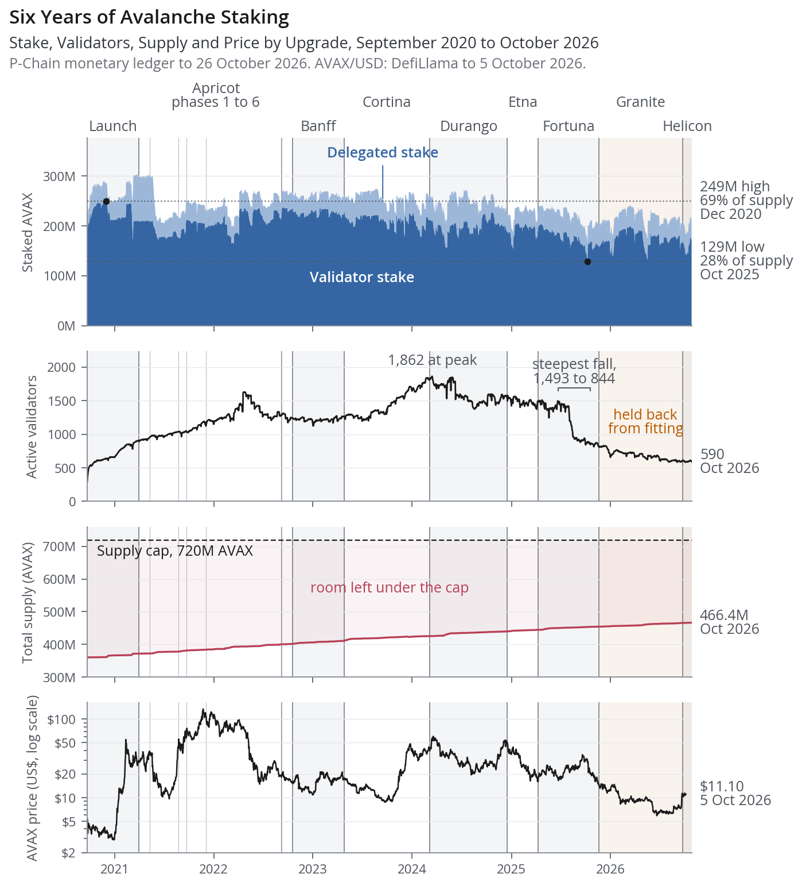
*Figure 1. Over six years and eight named upgrades, Avalanche's supply grew by 30% while the share held as validators' own stake fell from its peak of 69% of supply on 1 December 2020 to 37% in October 2026. Active validators fell by two thirds, from 1,862 in March 2024 to 590 in October 2026, and stake barely followed a 46-fold swing in the AVAX price. A reward rule must therefore be judged both by how much stake it holds and by how many validators hold it.*

## Avalanche prices security by issuing AVAX from the room under its cap

Avalanche pays validators in new AVAX at a reward fixed when each staking period starts, and the reward per AVAX shrinks as supply nears its cap. Since Helicon a staking period lasts 48 hours to one year, against 14 days before. Let $S_{\max}$ be the supply cap of 720 million AVAX and $S$ the supply counter of the P-Chain, the chain that records stakes, when the staking period starts. Let $s$ be the stake in AVAX, $d$ the duration in days and $T_{\text{mint}}$ one year of 365 days. A validator that meets the protocol's uptime requirement, a minimum share of the period spent online and responsive, receives

$$
R(s, d, S) = \min\left\{ S_{\max} - S, \; (S_{\max} - S) \frac{s}{S} \frac{d}{T_{\text{mint}}} r(d) \right\}, \qquad r(d) = r_{\min} + (r_{\max} - r_{\min}) \frac{d}{T_{\text{mint}}},
$$

where the minimum and maximum consumption rates $r_{\min}$ and $r_{\max}$ are the annual shares of the stake's portion of the room under the cap, $S_{\max} - S$, that a stake earns (AvalancheGo, `vms/platformvm/reward/calculator.go`). The annualized reward rate (ARR), as a fraction of stake a year, is

$$
\text{ARR}(d, S) = r(d) \, \kappa(S), \qquad \kappa(S) = \frac{S_{\max} - S}{S}.
$$

The scarcity factor $\kappa(S_0)$ was 0.548 at the supply counter $S_0$ of 465 million AVAX on 18 November 2025, when total supply was 454.1 million AVAX. The counter runs ahead of total supply because it adds each promised reward when the stake starts, and every annualized reward rate beside a consumption rate uses $\kappa(S_0)$.
Let $I$ be the AVAX issued as rewards over a horizon of $h$ days, counting in the model only rewards to validators' own stake, and $K$ the mean AVAX staked over those days. Over one year, $h = T_{\text{mint}}$, the cost of security $I/K$ is the average of $\text{ARR}$ over the stake held. What the issuance buys is the cost of attack, the AVAX an attacker must lock to hold more than a third of all stake weight, and that cost falls in proportion to the stake a design loses.

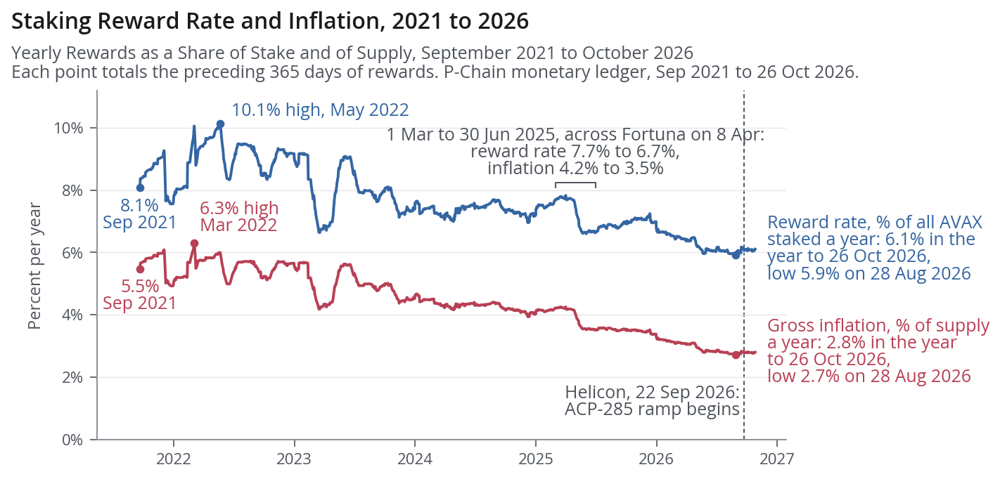
*Figure 2. The AVAX that Avalanche issues as staking rewards is one quantity read two ways. Against all AVAX staked, delegations included, it is the cost of security $I/K$, 6.1% of stake a year in the year to 26 October 2026, and against total supply it is gross inflation, 2.8% of supply a year. Since 2021 inflation has halved while $I/K$ fell by a quarter, because the AVAX staked fell from 68% to 46% of total supply.*

ACP-285 keeps $r_{\max}$ at 12% and lowers $r_{\min}$ linearly from 10% at Helicon to 7.5% for stakes started on or after 21 December 2026 (ACP-285, and Avalanche Builder Hub, Helicon Upgrade). Each stake keeps the $r_{\min}$ of its start day. The full cut in annualized reward rate, as a fraction of stake a year, is

$$
\Delta\text{ARR}(d) = 0.025 \left( 1 - \frac{d}{T_{\text{mint}}} \right) \kappa(S_0).
$$

The cut is 1.36 percentage points a year at 48 hours, 1.32 at 14 days, 1.03 at 90 days, 0.69 at 180 days and zero at one year.

Stakes of 14 to 90 days carried 83% of the stake validators started in 2025. They give 75% of the saving from 40% of the AVAX-days, where an AVAX-day is one AVAX staked for one day and rewards accrue per AVAX-day. The mean cut weighted by stake started is 2.04 percentage points of consumption rate, or 1.12 percentage points of annualized reward rate a year. With 2025's durations and no response from validators, the full cut saves 10.6% of the reward the rule before ACP-285 would pay.

The central case saves more, 12.8% of validators' issuance over the year, because the model's starts, mostly renewals, average about 51 days weighted by stake against 67 in 2025, and short stakes lose the largest share of their reward. A lower reward per AVAX started gives 11.5 points of that saving and less stake started gives 1.6.

## The model prices rewards exactly and fits validators' choices to the record

Model v0.8.0 prices every reward with the protocol's own arithmetic and advances validators one day at a time from its origin on 18 November 2025 as the stochastic system

$$
x_{t+1} = f(x_t, \pi_t, y_t, \omega_t \mid \lambda, \theta),
$$

in which the state $x_t$ on day $t$ holds the open staking periods, the nodes out of the validator set and the supply counter. The input $\pi_t$ is the reward rule in force, $y_t$ the outside yield in percent of stake a year, constant within a run, and $\omega_t$ the day's random draws. The fitted behavioural parameters are $\lambda$, the responses of renewal and entry to reward are $\theta = (\theta_R, \theta_E)$, and a reward design changes only $\pi_t$.

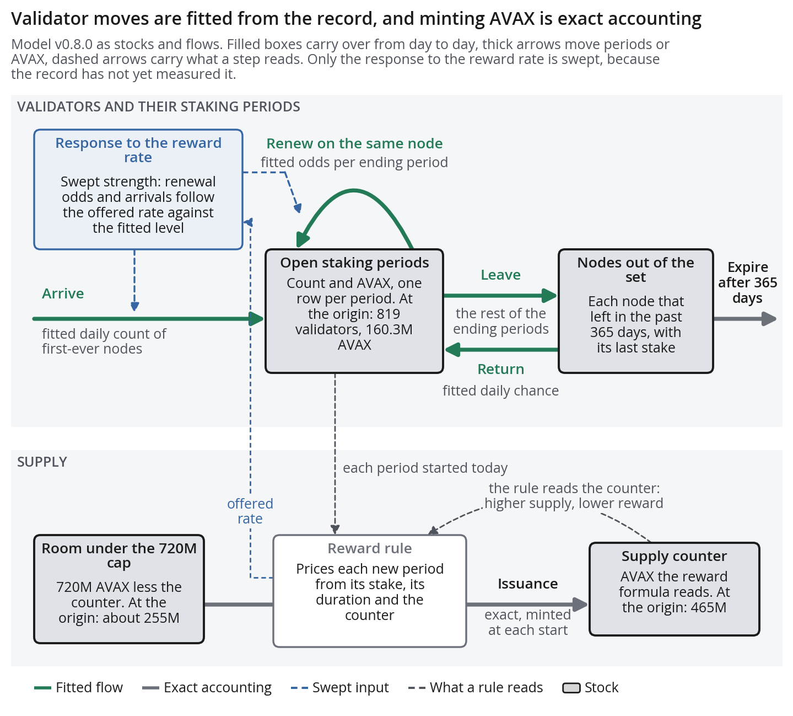
*Figure 3. Model v0.8.0 holds validators as two stocks, open staking periods and nodes out of the set, moved by four flows, arrivals, renewals, exits and re-entries, whose rates and the duration and stake of each new period come from five parts fitted to the chain record. Supply is a counter that the reward rule raises by exact protocol arithmetic. At the origin of 18 November 2025 the open periods held 819 validators and 160.3M AVAX, and the counter stood at 465M AVAX, about 255M AVAX below the 720M AVAX cap.*

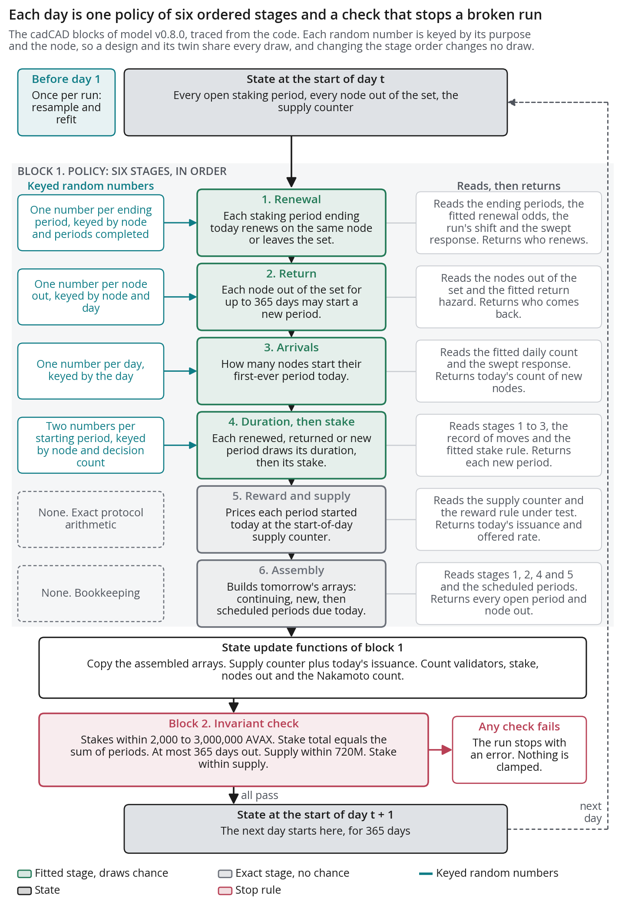
*Figure 4. Each simulated day runs six stages in a fixed order, four drawing chance and two exact, then updates the state and checks five invariants, such as every stake lying between 2,000 and 3,000,000 AVAX, and any failure stops the run with nothing clamped. Every random number is keyed by its purpose and the node, so a design and its twin under the chain's rule share the seed, parameter draw, scenario and every keyed draw. The two differ only in the reward rule. All 1,024 design runs at zero response kept exactly their twin's stake.*

The reward stage reproduces the rewards of 3,769,919 of the 3,769,920 stakes started before 19 November 2025 to the last nAVAX, a billionth of an AVAX, and misses one delegation by 31 nAVAX.

The model leaves out delegations, which held 20.8% of all stake at the origin and were promised 16.7% of the rewards for stakes started in the year before, fees to validators included. Every issuance saving is therefore a share of validators' issuance, and it carries over to delegations if delegators behave as before.

Validators' choices come from five parts fitted on the record before the origin, and each run refits the first three on a resample by node, so the spread across runs carries fit uncertainty as well as chance.

| Part | Process, fit and window | Held-out evidence |
| --- | --- | --- |
| Renewal | Ridge-penalised logit, 365 days | Log loss 0.4505 against 0.4916 for one constant probability |
| Re-entry | Daily hazard in six bins of days out, 730 days | 90-day stake forecast's scaled CRPS, section 2.4, lower by 0.652 |
| Arrivals | Negative binomial count, 365 days | Daily counts vary 3.7 to 13.5 times as much as Poisson allows |
| Duration | Draw from past moves of similar previous duration, 365 days | A parametric alternative forecast the count worse |
| Stake | Hurdle that keeps or rescales the stake, 365 days | 90-day stake forecast's scaled CRPS lower by 0.172 |

A staking period that ends on day $t$ renews within 7 days with probability

$$
P(\text{renew} = 1 \mid z) = \sigma(z' \beta + \theta_R g_t + \nu), \qquad \sigma(v) = \frac{1}{1 + e^{-v}},
$$

where $z$ holds thirteen indicators of the period's tenure, duration and stake, $\beta$ is their weights fitted on the 14,977 endings by 2,968 nodes before the origin, and $\nu$ is a shift drawn once per run for drift between quarters. The fitted probability for a small node is 0.50 after its first period and 0.81 after its second, so tenure moves renewal more than any reward change in the sweeps.
First-ever arrivals on day $t$ are a negative binomial count,

$$
n_t \sim \text{NegBin}(\mu_t, \kappa), \qquad \mu_t = \min\left\{ 100, \, \mu_0 e^{\theta_E g_t} \right\}, \qquad \operatorname{Var}(n_t) = \mu_t + \frac{\mu_t^2}{\kappa},
$$

with fitted mean $\mu_0 = 3.89$ nodes a day and dispersion $\kappa = 0.49$.

A design reaches behaviour only through the reward gap in percentage points,

$$
g_t = 100 \bigl[ \text{ARR}_D(30) - \text{ARR}_F(30) \bigr] - (y_t - y_0),
$$

where $\text{ARR}_D(30)$ is the design's annualized reward rate on a 30-day stake started on day $t$ and $\text{ARR}_F(30)$ the annualized reward rate under the rule before ACP-285, in force through the fitting window, both priced at $S_0$, and $y_0$ is the outside yield over that window.

The response $\theta_R$ is in log-odds of renewing and $\theta_E$ in log arrival rate, each per percentage point of $g_t$. The record from October 2020 to the origin gives a renewal response of 0.025 from 51,707 decisions by 7,216 nodes, with a 95% interval of about 0 to 0.06. It gives an entry response of 0.04, about 0 to 0.09, from 6,825 first commitments. At 0.025 ACP-285's full ramp lowers the renewal share from 80% by about 0.5 percentage points.

Both measurements rest on swings in the AVAX price, whose quarterly mean ran from \$3.65 to \$87.50. They assume that a validator weighs a 1% rise in its dollar reward from the price like a 1% rise from the rate. A rise of 0.129 in the log AVAX price, about 14%, therefore counts as one percentage point on an annualized reward rate of 7.29% a year. Market sentiment specific to AVAX is the main threat to that assumption. With time effects, trends, two outside yields and the Bitcoin price held fixed, the renewal response is 0.035 to 0.057, and the AVAX price 90 days after a decision no longer predicts renewal. Holding the Ether price fixed instead gives 0.09 to 0.11. A stronger response costs more stake, so the central case's 0.025, below these controlled estimates, puts a design's stake cost at the low end of the measured range. These measurements correct Milestone 1, which treated the response as not yet measured.

Every design run has a twin on the same draws under the chain's rule, the rule before ACP-285 until Helicon, day 308 of a run, and ACP-285's ramp after it. A ratio of the two removes their shared variation. Issuance saved is $s_I = 1 - I/\tilde I$ and stake kept is $s_W = W/\tilde W$, where $W$ is validators' own stake at the horizon and a tilde marks the twin.

## 2.1 PSUU Infrastructure

The PSUU infrastructure builds every run from five inputs and ties every result to them. The inputs are a governance lever such as ACP-285's minimum consumption rate, a scenario such as the outside yield, a draw of $\lambda$, a value of $\theta$ and a seed for $\omega_t$. Within each design and outside yield, the lever and the two responses come from a scrambled Sobol sequence in Saltelli's arrangement, which fills their range more evenly than independent draws and lets each result's variance be divided among them.

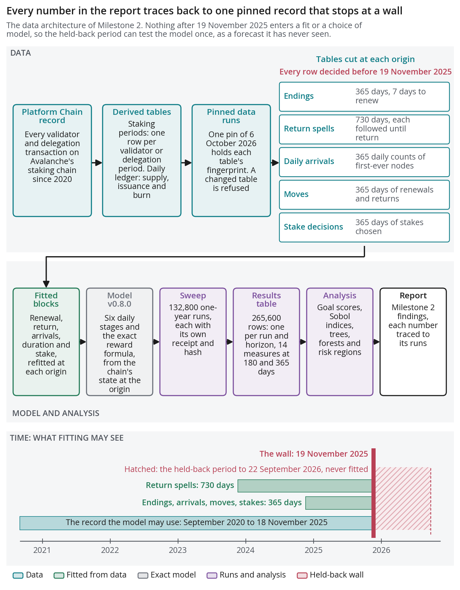
*Figure 5. Every table the model is fitted on comes from one pinned copy of the P-Chain record, and nothing dated on or after 19 November 2025 enters a fit or the choice of model. The held-back period to 22 September 2026 can therefore test the model once on data it has never seen, and each number in the analysis traces through the sweep to that pin.*

A design file lists every run's inputs before any run starts. Each run's output carries a SHA-256 hash, a digest that changes under any change to the file. A receipt names the code commit, the pinned input tables and every hash, so the analysis refuses any output whose hash differs. The second sweep's market shifts are on the Foundation repository's branch `m2-market-sweep`.

## 2.2 Simulation Execution

The two one-year sweeps ran 199,887 runs against the 50,000 the agreement asks for. A ramp floor is the minimum consumption rate at which a ramp like ACP-285's ends. The quadratic duration curve raises the rate with the square of duration as a share of a year, so it pays short stakes less and a one-year stake the same.

| Sweep | Size | Horizon | What varies |
| --- | ---: | --- | --- |
| First | 132,800 runs | 1 year | Four designs, outside yields of 3% to 10% a year, responses 0 to 0.1 |
| Second | 67,087 runs | 1 year | Four parameters of the reward formula, three markets |
| Central case | 50 pairs | 1 year | Ramp floors of 6%, 7.5% and 9%, measured responses |
| Five-year | 4,096 pairs | 5 years | Ramp floor 5% to 10%, responses 0 to 0.1, outside yields 3% and 5% a year |
| Ten-year | 8,192 pairs | 10 years | Ramp floor and quadratic duration curve, outside yields 3% and 5% a year |

## 2.3 KPI Computation

Every run is scored at 180 and 365 days by five goals built on fourteen measures, nine of which carry a utility score.

| Goal and weight | Measures against the twin | A run passes when |
| --- | --- | --- |
| G1 Security holds, 1 | Stake kept, weighted 2, and worst 30-day stake fall | $s_W \ge 0.95$, and the fall is at most 2 percentage points of stake deeper |
| G2 Validators stay and stay spread, 1 | Validators kept, Nakamoto coefficient, return margin | At least 95% kept, with at most one node fewer and 1 percentage point of stake a year of margin lost |
| G3 Holders pay less, 1 | Issuance saved, weighted 2, and net inflation | $s_I > 0$, and net inflation at most 5% of supply a year |
| G4 Security per AVAX issued, 1 | $s_W/(1 - s_I)$ | At least 1 |
| G5 Longer commitments, 0.5 | Stake-weighted commitment length | At least 99% of the twin's |

The Nakamoto coefficient is the fewest validators holding over a third of validators' own stake. The return margin is $M = 100 \overline{\text{ARR}} - y - c$ percentage points a year, where $\overline{\text{ARR}}$ is the annualized reward rate validators earn and $c$ is an operating cost of 1.5% of stake a year. Net inflation is a year's issuance less fees burned, as a share of total supply.

Each measure $m$ scores the clipped-linear utility $u(m) = \min\{1, \max\{0, (m - m_0)/(m_1 - m_0)\}\}$, which is 0 at a lower bound $m_0$ and 1 at a target $m_1$. Figure 6 and the goal specification give each measure's $m_0$ and $m_1$. Goal utilities average their measures' utilities by weight, and the combined utility averages the goals by the table's weights.

A run passes when it meets every measure's pass line in all five goals at once. A half-point cell $k$ of the minimum rate, holding at least 30 runs, meets the goals when at least 90% of its runs pass, pooling the outside yields and the swept responses, each response weighted equally.

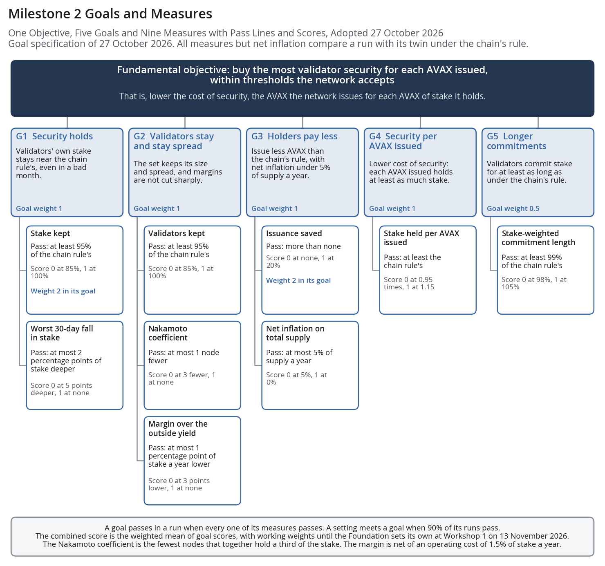
*Figure 6. Every run is scored against one objective, to buy the most validator security for each AVAX issued, through five goals and nine scored measures, each with a pass line, a lower bound where its utility is 0 and a target where it is 1. Every measure except net inflation compares a run with its twin under the chain's rule, so a design is judged by what it changes. The goal weights of 1 for G1 to G4 and 0.5 for G5 hold until Workshop 1 on 13 November 2026.*

## 2.4 Validation Confirmation

Model v0.8.0 forecasts validators' own stake with lower scores than six benchmarks at 30, 90 and 180 days, significantly so at 180 days, so its level of stake is credible. Forecast skill on stake does not test the response to reward, which sets the comparison of designs. At each of 19, 18 and 17 origins $t_0$ from July 2022 to October 2025, every behavioural part is refitted on the earlier record and $J = 200$ runs are simulated $h$ days forward.

The continuous ranked probability score, CRPS, scores the runs $W^{(j)}$ of a forecast against the realised stake $W$ at the horizon as

$$
\text{CRPS} = \frac{1}{J}\sum_{j=1}^{J} \left| W^{(j)} - W \right| - \frac{1}{2J^2}\sum_{j, j'=1}^{J} \left| W^{(j)} - W^{(j')} \right|,
$$

divided by $\bar\delta_{t_0}$, the mean absolute one-day change of the series up to the origin.

At 180 days the model's stake score is 27% below the best benchmark's, with a one-sided p-value of 0.04 on $O = 17$ origins in a Diebold-Mariano test for overlapping windows with the Harvey, Leybourne and Newbold correction.

The model forecasts the validator count worse than the best benchmark does, partly because it draws new validators at about twice their late-2025 rate, mostly pool nodes that move the count far more than the stake. Goals G1 and G2 compare each design with its twin on the same draws, so both runs share the error in level.

A selection rule fixed before any score admitted three of eight candidate changes to behavioural parts, each lowering held-out log loss without significantly worsening a system forecast.

The held-back test, frozen on 27 October 2026, covers the period from the Granite upgrade on 19 November 2025 to Helicon on 22 September 2026, which no fit or choice used. The mean forecast $\hat W$ from each of eight monthly origins is scored at $h = 90$ days by the mean absolute scaled error $\mathrm{MASE} = |\hat W - W|/\bar\delta_{t_0}$. The model passes if it beats persistence, drift and the autoregression, each at a corrected p-value below 0.05, fails if any scores as well or better, and is otherwise inconclusive.

Forecast skill replaces the agreement's 90% correlation criterion because stake sums its daily changes, and in one simulated pair two independent random walks correlate at 0.85 on levels and 0.01 on daily changes.

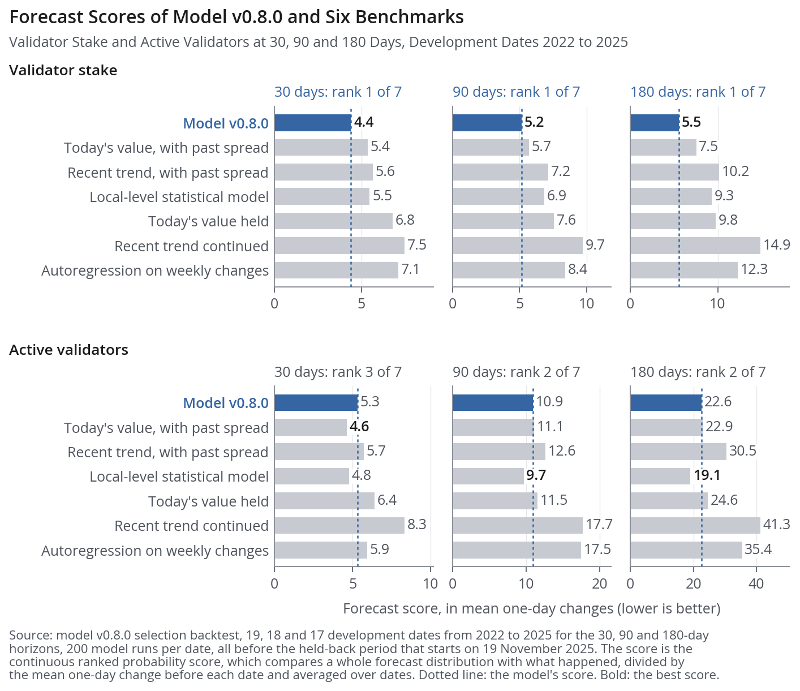
*Figure 7. Model v0.8.0 forecasts validator stake better than six benchmarks at 30, 90 and 180 days, scoring 4.41, 5.15 and 5.54 against the best benchmark's 5.38, 5.69 and 7.54. It forecasts the validator count third best at 30 days and second best at 90 and 180 days, scoring 5.32, 10.95 and 22.58 against the best benchmark's 4.63, 9.67 and 19.07. The benchmarks are persistence, recent drift, a weekly autoregression, the first two spread by past changes, and a local-level model. Each score is the mean CRPS over 19, 18 and 17 forecast origins before 19 November 2025, in units of the mean one-day change in stake or count before each origin.*

## 2.5 Sensitivity Analysis

The minimum consumption rate decides almost all of the variation in the issuance a reward design saves, while the validator stake it keeps depends on the rate, the renewal response and chance together. Within each outside yield, the variance of each paired outcome of the first sweep is divided among three inputs, the design's setting and the responses $\theta_R$ and $\theta_E$.

| Method | Question | Ramp at one year |
| --- | --- | --- |
| Spearman correlation, 1,000 bootstrap resamples | Direction of effect | −0.98, minimum rate with issuance saved |
| Sobol indices, $N = 512$ base points | Share of variance | Minimum rate 0.954 to 0.967 of issuance saved |
| Random forest, 300 trees, 25% of runs held out | Ranking of inputs | Minimum rate, then renewal response, explaining 0.71 of held-out variance in combined utility on one seed |

The first-order Sobol index $\mathcal{S}_i = \mathrm{Var}(\mathrm{E}[Y \mid X_i]) / \mathrm{Var}(Y)$ is the share of the variance of an outcome $Y$ that input $X_i$ explains alone. Saltelli's estimator computes it from $N$ base points, and a group, the indices of every input for one design, outside yield, horizon and measure, converges when $\max_i |\hat{\mathcal{S}}_i^{(512)} - \hat{\mathcal{S}}_i^{(256)}| \le 0.02$, the superscript giving $N$. Of 512 groups, 310 converged, 190 failed and 12 were undefined, and only converged groups rank inputs.

For issuance saved at one year, the ramp's minimum rate has an index of 0.954 to 0.967 across the four outside yields, converged at 3% and 7% a year, and missed the convergence tolerance by at most 0.007 at the other two. At 180 days it converged at all four, at 0.920 to 0.942. None of the 32 groups for stake kept converged, so stake kept carries no Sobol split. Running 64 design points eight times each shows that chance accounts for 0.40 to 0.52 of the variance of stake kept.

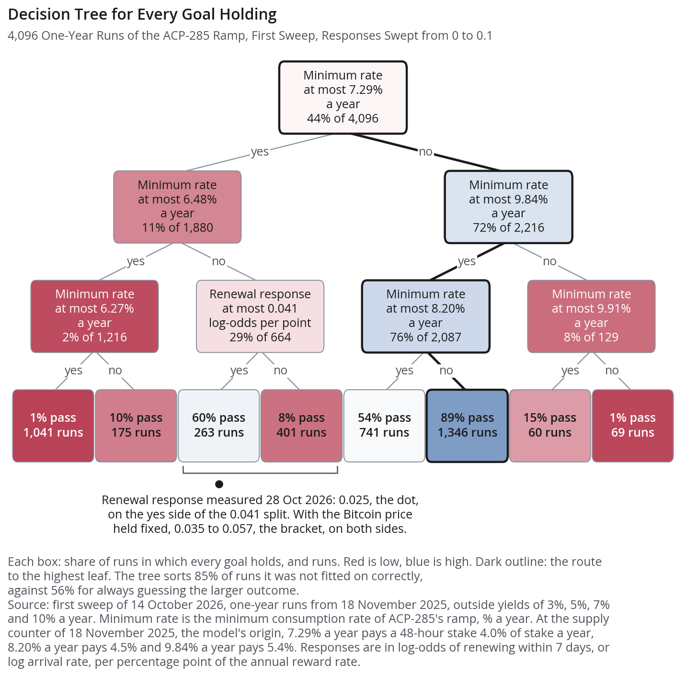
*Figure 8. A classification tree fitted to 4,096 one-year runs of the ramp splits on the minimum consumption rate at six of its seven splits, and every goal holds in 89% of runs with a rate above 8.20% and at most 9.84%, about 4.5% to 5.4% of stake a year for a 48-hour stake. Between rates of 6.48% and 7.29%, about 3.6% to 4.0% of stake a year, the renewal response splits the runs at 0.041 log-odds per percentage point, a value above the central 0.025 and inside the 0.035 to 0.057 measured with the Bitcoin price held fixed. The tree sorts 85% of held-out runs correctly, against 56% for always guessing the larger outcome.*

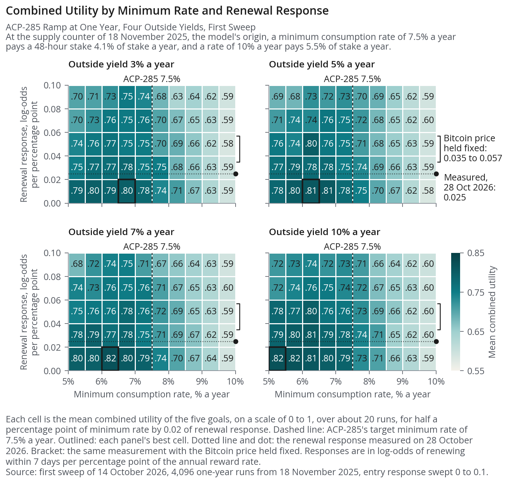
*Figure 9. Mean combined utility of the five goals, from 0 to 1, by half-point cell of minimum consumption rate and 0.02 band of renewal response, in one panel for each outside yield of 3%, 5%, 7% and 10% a year. Each panel's best cell, a mean over the runs of one rate and one response band, lies at rates of 5% to 7%, about 2.7% to 3.8% of stake a year for a 48-hour stake, with utility 0.80 to 0.82, and the column at 9.5% to 10% scores 0.58 to 0.60 in every row. The central renewal response of 0.025 falls in the row from 0.02 to 0.04, where utility at rates of 5% to 7.5%, about 2.7% to 4.1% of stake a year, is 0.75 to 0.81.*

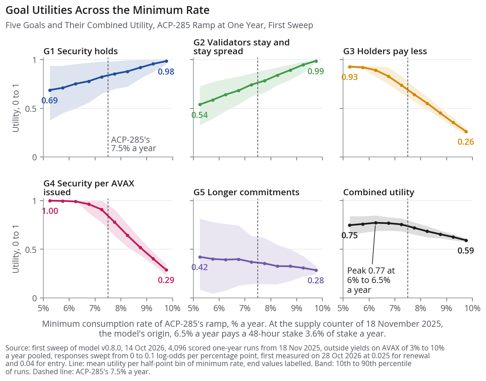
*Figure 10. A higher minimum consumption rate raises the utilities of G1, security holds, and G2, validators stay and stay spread, and lowers those of G3 to G5, with bands from the 10th to the 90th percentile of runs. Combined utility, the mean over every swept response in each rate cell, peaks at 0.77 at rates of 6% to 6.5%, about 3.3% to 3.6% of stake a year for a 48-hour stake, and falls to 0.59 at 9.5% to 10%.*

## 2.6 Risk Surface Map

At the measured responses, ACP-285's ramp to a 7.5% minimum rate, about 4.1% of stake a year for a 48-hour stake, saves a median 12.8% of the year's issuance to validators. The ramp keeps a median 98.7% of validators' stake. Over the central case's 50 paired runs, the 10th to 90th percentiles are 11.6% to 15.4% and 95.3% to 99.9%. The bootstrap 95% interval of the median saving, 12.5% to 13.2%, is narrow against the gaps of about 8 percentage points to the ramp floors of 6% and 9%, but the interval of the median stake kept, 97.9% to 99.3%, overlaps the 6% floor's. Halving both intervals needs 200 paired runs.

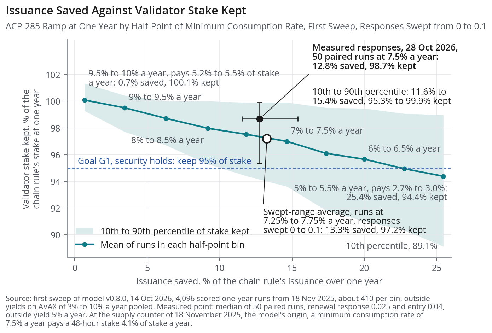
*Figure 11. Mean issuance saved against mean validator stake kept for each half-point cell of the ramp's minimum consumption rate, both as shares of the paired one-year run under the chain's rule, with the 10th to 90th percentile of stake kept shaded and G1's pass line of 95% dashed. Each percentage point off the rate, about 0.55 points of a 48-hour stake's annualized reward rate a year, saves about 5.5 points more of the year's issuance and gives up about 1.3 points of stake, and the 10th percentile of stake kept crosses 95% near a rate of 8%, about 4.4% of stake a year. The ring marks the sweep's cell centred on ACP-285's 7.5%, from 7.25% to 7.75%, about 4.0% to 4.2% of stake a year, at 13.3% saved and 97.2% kept.*

With each response from 0 to 0.1 weighted equally, combined utility peaks at 0.77 at minimum rates of 6% to 6.5%, which pay a 48-hour stake 3.3% to 3.6% of stake a year. The acceptable range $\mathcal{A} = \{k : P(\text{pass} \mid k) \ge 0.9\}$, the cells that meet the goals, holds only 9% to 9.5%, paying 4.9% to 5.2%, where 93.1% of runs pass. The range stays at 9% to 9.5% when G1's threshold for stake kept rises from 95% to 97%, and widens to 8.5% to 9.5% when it falls to 90% or the pass rule falls to 80% of runs. Validators kept and commitment length set its lower edge. Issuance saved sets its upper edge, passing in only 72.0% of runs at 9.5% to 10%, about 5.2% to 5.5% of stake a year, because from Helicon, day 308, the chain's own ramp pays new stakes less than such a design.

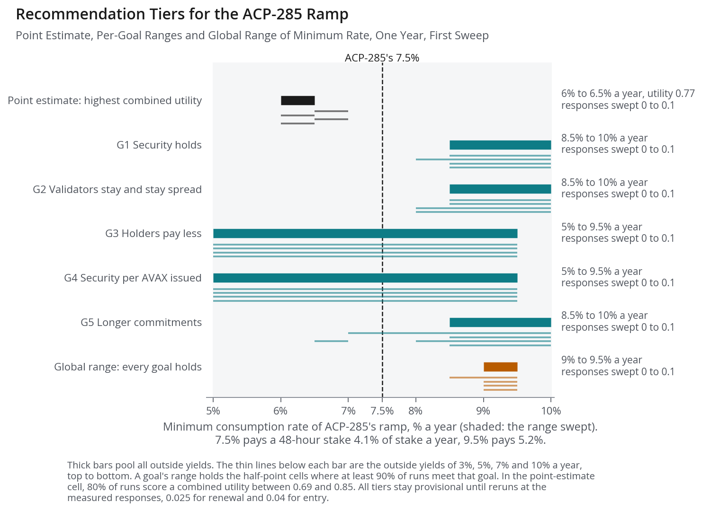
*Figure 12. The point estimate with the highest combined utility, each goal's range in which at least 90% of runs meet that goal, and the global range in which every goal holds in at least 90% of runs, on one axis of minimum consumption rate, with thin lines for outside yields of 3%, 5%, 7% and 10% a year. The point estimate at rates of 6% to 6.5%, about 3.3% to 3.6% of stake a year for a 48-hour stake, lies below the global range of 9% to 9.5%, about 4.9% to 5.2%, and ACP-285's 7.5%, about 4.1%, falls between them. At an outside yield of 3% a year the global range widens to 8.5% to 9.5%, about 4.7% to 5.2% of stake a year.*

The return margin $M$ is negative in every run at outside yields of 7% and 10% a year and in at least 91% of runs at 5% a year. The margin is a diagnostic, because v0.8.0 validators respond only to the gap $g_t$, so the margin's level enters no choice.

Model v0.8.0 has no AVAX price, so a bear or bull market shifts the log-odds of renewal and the log arrival rate by the same constants in a design's run and its twin. The four designs therefore keep one ranking in all 24 cells of market, outside yield and horizon largely by construction until v0.9 adds the price.

Beyond one year the runs are paired model scenarios with no forecast score. Model v0.8.0 holds validators' 2024 and 2025 behaviour fixed, so stake falls under every rule, and the paired shares remove that shared fall. The central case's twins end the year between 89.6 million and 174.4 million AVAX, yet the ramp keeps a median 99.2% of stake where the twin ends below the median and 97.9% where it ends above, and saves 12.8% in both. Against the rule before it, ACP-285 issues 13.8% less over five years with 92.5% of stake kept, and 16.1% less over ten years with 89.4% kept. Ramp floors of 9% to 10% rise above their twins under the chain's rule after the first year, because that rule reaches its 7.5% floor at day 398 and then pays new stakes less. The band keeps a median 102.5% of its twin's stake at two years and 106.9% at five while issuing a median 5.5% and 12.5% more.

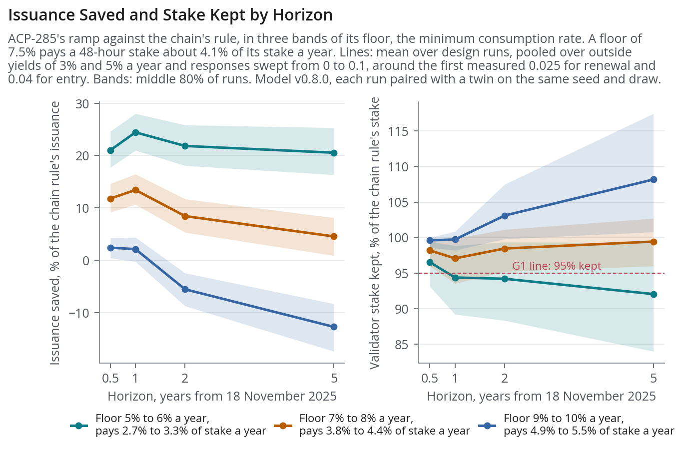
*Figure 13. Mean issuance saved and mean validator stake kept by the ramp against its twin under the chain's rule, at 180 days and 1, 2 and 5 years from 18 November 2025, for ramp floors of 5% to 6%, 7% to 8% and 9% to 10%, each point the mean of about 820 paired runs with the middle 80% shaded. The bands stay close until Helicon and then spread, and the 7% to 8% band around ACP-285's 7.5% keeps 97.1% to 99.4% of stake at every horizon while its saving shrinks from 13.4% at one year to 4.6% at five. Outside yields of 3% and 5% a year are pooled, and responses are swept from 0 to 0.1, a range that holds the central measured values.*

## 2.7 Workshop #1

Workshop 1, on Friday 13 November 2026, replaces the working goals, thresholds and weights of section 2.3 with the Foundation's own. The Foundation sets the thresholds first, because they decide which reward settings are acceptable at all, and the weights then rank only the settings that pass. The order changes the answer, because section 2.6 places the setting that meets every threshold at a higher minimum consumption rate than the setting with the best weighted score.


## 2.8 Collaborative Mechanism Design

Any reward rule the Foundation proposes enters the model by replacing parts of the chain's reward formula. A rule can set the minimum and maximum consumption rates on each date, as ACP-285's ramp does, change how the rate rises with duration, as the quadratic curve does, or scale a reward by the node's completed periods, as a tenure bonus does. At its neutral setting each rule must equal the chain's rule to the nAVAX before any sweep. Revenue-funded rewards, proposed by Eric Lu on 28 August 2026, are evaluated first, from 2 to 6 November 2026, with the revenue pool's share of each reward swept.


## Milestone 3 scores reward settings against the Foundation's thresholds by 15 January 2027

Milestone 3 runs in working blocks from 1 to 11 December 2026 and from 4 to 15 January 2027. From 3 to 6 November 2026 a renewal fit that compares each node with itself across months tests the measured responses against market sentiment specific to AVAX. It checks that the effect scales with stake and that the price 90 days after a decision does not predict renewal. The duration part is compared with the record, because the model's starts are shorter than those of 2025. The held-back test of section 2.4 is scored by 13 November. Model v0.8.1 adds delegations and keeps total stake below the AVAX that holders own, v0.9 adds the AVAX price and holder types, and v0.10 lets duration respond to reward. The long scenarios are rerun on these versions. The Milestone 3 code reaches the Foundation on 11 December, and Workshop 2 is on Friday 8 January 2027.

Model v0.8.0 is tagged at commit b18a4a2 on the Foundation repository's `milestone-2` branch, and these commands install and test it:

```sh
git clone --branch milestone-2 git@github.com:AVL-Foundation/ext-bcrg-validator-research.git
cd ext-bcrg-validator-research
uv sync --locked --group model --group notebook
uv run pytest -q
```

The input snapshots needed to repeat a simulation are not yet distributed with the repository.
