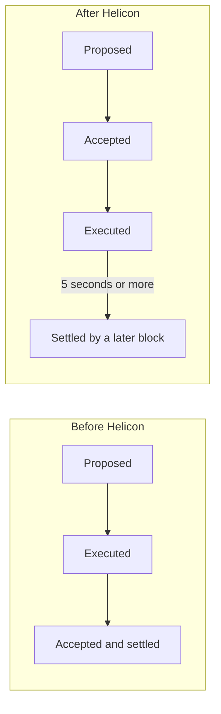

ACP-194 changes how the C-Chain executes transactions, not how staking is rewarded. It is in this collection because it activated with Helicon at the same instant as the four staking changes. Any comparison of the network before and after 2026-09-22 15:00 UTC mixes its effects on C-Chain throughput and fees with the staking effects, and the research has to keep the two apart.

<!-- overview-table:start -->

| | |
| --- | --- |
| **Authors** | Arran Schlosberg, Stephen Buttolph |
| **Published** | May 12, 2025 |
| **Source** | Avalanche Community Proposal, [original](https://github.com/avalanche-foundation/ACPs/blob/main/ACPs/194-continuous-execution/README.md), [full text](/Phase-II/Wiki/Collections/Economic-ACPs/ACP-194-Continuous-Execution/Source-Proposal) |
| **Topics** | [fees and value capture](/tags/fees-and-value-capture) |
| **Key terms** | continuous execution, execution queue, settlement delay, gas limit, [AVAX burned](/Phase-II/Wiki/Reference/Glossary-and-Notation), [Helicon](/Phase-II/Wiki/Reference/Glossary-and-Notation) |
| **Serves deliverables** | Background only |

<!-- overview-table:end -->

The full text of the ACP-194 proposal is replicated on the [Source Proposal](/Phase-II/Wiki/Collections/Economic-ACPs/ACP-194-Continuous-Execution/Source-Proposal) page.

## What it changes

Before Helicon a C-Chain block was executed before consensus accepted it, so acceptance also settled its results. After Helicon consensus accepts a block once every transaction in it can pay for its gas, a queue executes accepted blocks, and a later block records the results and settles them.

*Figure 1. The C-Chain block lifecycle before and after ACP-194. Acceptance and settlement become separate events.*

| Parameter | Value | Economic effect |
| --- | --- | --- |
| Delay from execution to settlement, τ | 5 seconds | Sets how far settled state lags accepted state |
| Gas charged per transaction | The larger of gas used and half the gas limit, λ = 2 | A transaction with an inflated gas limit pays for at least half of it |

The gas-charging rule is the part with direct fee consequences. A transaction that sets a gas limit far above its use now pays for half of the limit, which raises fees for such transactions and the AVAX burned with them.

## Status and activation

| Item | Value |
| --- | --- |
| Authors | Arran Schlosberg, Stephen Buttolph |
| Repository status | Implementable, Standards track |
| Discussion | Titled "Streaming Asynchronous Execution", opened 2025-05-12, last updated 2025-06-23, 2 comments |
| Mainnet activation | 2026-09-22 15:00 UTC, with Helicon in AvalancheGo v1.15.0 |
| Implementation | The C-Chain moves from the Coreth virtual machine to a new one built for this proposal. The switch is configured ten seconds before the Helicon time so the transition block is valid on both sides. |

## How it enters the staking model

It does not enter the staking model directly. Neither the proposal nor the discussion names a channel from C-Chain execution to validator duration, stake, or reward. Its effect on the research runs through fees: C-Chain fees are burned, and burns reduce the realized total supply used in the net issuance series. The reward formula itself reads the P-Chain supply counter, not the realized total supply.

## What our data can measure

The C-Chain fee and burn datasets record fees per block. Once a capture that extends past activation is built, they show whether burned AVAX per day changes at Helicon. They do not separate this proposal from ACP-283, which changed the gas price floor at the same instant. AvalancheGo v1.15.0 exposes separate accepted, executed, and settled heights and queue metrics, but we do not capture them.

## Open questions

1. Did daily C-Chain burn change at Helicon, and can the effect of the gas-charging rule be told apart from ACP-283's floor?
2. Does any staking outcome depend on C-Chain performance? Until a supported channel is shown, the model keeps the two apart.

## Public links

- Proposal: [ACP-194, Continuous Execution](https://github.com/avalanche-foundation/ACPs/blob/main/ACPs/194-continuous-execution/README.md)
- Discussion: [Discussion 196](https://github.com/avalanche-foundation/ACPs/discussions/196)
