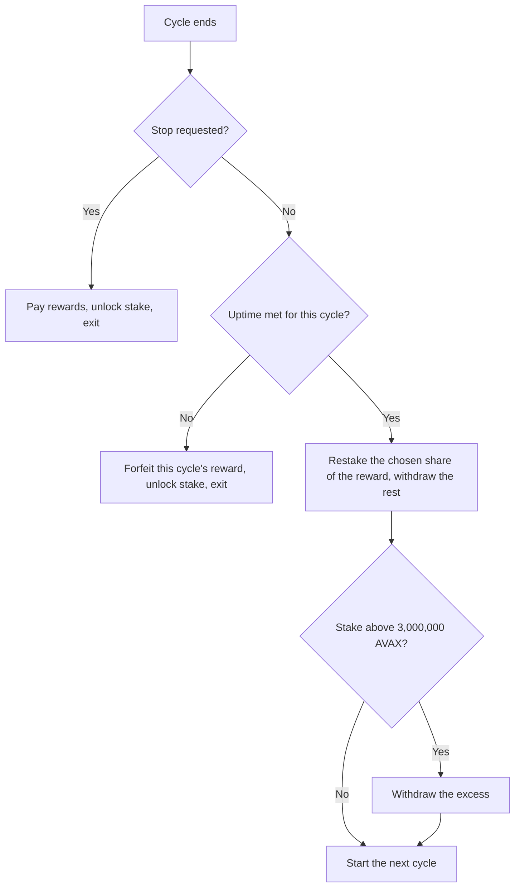

ACP-236 removes the manual step between one validator commitment and the next. Before Helicon a validator restaked by issuing a new transaction after its period ended, and its stake sat idle in between. The restake rate is one of the three behavioral state variables the staking model must carry, and this proposal changes how restaking happens. The question for the research is whether lower renewal friction moves validators toward short, repeated cycles, and what that does to delegation and to the reward they earn.

<!-- overview-table:start -->

| | |
| --- | --- |
| **Authors** | Razvan Angheluta |
| **Published** | November 11, 2025 |
| **Source** | Avalanche Community Proposal, [original](https://github.com/avalanche-foundation/ACPs/blob/main/ACPs/236-auto-renewed-staking/README.md), [full text](/Phase-II/Wiki/Collections/Economic-ACPs/ACP-236-Auto-Renewed-Staking/Source-Proposal) |
| **Topics** | [staking duration and liquidity](/tags/staking-duration-and-liquidity), [issuance and rewards](/tags/issuance-and-rewards) |
| **Key terms** | [auto-renewed staking](/Phase-II/Wiki/Reference/Glossary-and-Notation), cycle, restake rate, restaked reward share, compounding, [uptime requirement](/Phase-II/Wiki/Reference/Glossary-and-Notation) |
| **Serves deliverables** | [1.3](/Phase-II/Milestones/Milestone-1/1-3-Staking-Model-Spec/), [1.4](/Phase-II/Milestones/Milestone-1/1-4-Behavioral-Calibration/) |

<!-- overview-table:end -->

The full text of the ACP-236 proposal is replicated on the [Source Proposal](/Phase-II/Wiki/Collections/Economic-ACPs/ACP-236-Auto-Renewed-Staking/Source-Proposal) page.

## What it changes

| Item | Before Helicon | After Helicon |
| --- | --- | --- |
| Validation form | One fixed period per transaction | Fixed periods, or an auto-renewed validator that runs in cycles until stopped |
| Cycle length | Not applicable | Between the minimum and maximum duration, 48 hours to 365 days on Mainnet |
| Reward handling at period end | Reward paid out, stake unlocked | A chosen share of each cycle's reward is restaked, from 0 to 1,000,000 millionths, and the rest withdrawn |
| Reward duration | The period | Each cycle separately, not the accumulated time across cycles |
| Uptime | Judged over the period | Judged over each cycle and reset at renewal |
| Delegation | Must fit inside the validator's period | Must fit inside one cycle, so no delegation spans cycles |
| Stake above the 3,000,000 AVAX maximum | Not applicable | Withdrawn at the cycle end |

Figure 1 shows the end of a cycle as the proposal specifies it and AvalancheGo implements it.

*Figure 1. The decision at the end of each auto-renewed cycle. A cycle that fails the uptime requirement ends the validation rather than renewing.*

## Status and activation

| Item | Value |
| --- | --- |
| Author | Razvan Angheluta |
| Repository status | Proposed, Standards track |
| Discussion | Titled "Continuous Staking", opened 2025-11-11, last updated 2025-12-05, 10 comments |
| Mainnet activation | 2026-09-22 15:00 UTC, with Helicon in AvalancheGo v1.15.0 |
| New transaction types | `AddAutoRenewedValidatorTx`, `SetAutoRenewedValidatorConfigTx`, `RewardAutoRenewedValidatorTx` |

The proposal text describes cycle lengths under the pre-Helicon 14-day minimum. ACP-273, in the same upgrade, lowered that minimum to 48 hours, and cycles follow the current minimum. The discussion shaped the final design. The reward share, the changeable next-cycle length, and the stop authority were suggested in comments. Participants also asked for continuous delegation, fungible validator shares, and partial withdrawals. None of these is in the shipped mechanism.

## How it enters the staking model

In the [1.3 Staking Model Spec](/Phase-II/Milestones/Milestone-1/1-3-Staking-Model-Spec/) auto-renewal is a transition for the restake rate: a validator can keep its stake committed without a new decision each period. In [1.4 Behavioral Calibration](/Phase-II/Milestones/Milestone-1/1-4-Behavioral-Calibration/) restake behavior is estimated from a history in which every renewal was manual, so post-Helicon restaking lies outside that data. The protocol kernel does not yet implement cycles.

Auto-renewal also changes the yield comparison across durations. ACP-285 reports that a 2-day cycle that restakes its whole reward for a year earns 4.08%, against 4.00% without compounding and 6.38% for a single 365-day period, after its ramp. We reproduce these compounding values at a constant rate: 4.08% for 2-day cycles and 4.16% for 14-day cycles. The proposal's authors state that without ACP-285, rolling 2-day cycles would cost about 0.50 percentage points against a 90-day commitment. That figure is attributed.

## What our data can measure

The derived dataset `derived.helicon-commitments` identifies an auto-renewed validation when the same staking transaction appears with a new start time in a later snapshot. By 2026-09-29 00:15 UTC it had observed 2 auto-renewed transactions with 3 renewal cycles between them. A transaction still in its first cycle is not yet identifiable as auto-renewed, and the snapshots were up to 40 hours apart, so both counts are lower bounds. A staking capture taken after activation should record the new transaction types directly, with each cycle's reward and restaked share, if the data share carries them. We have not yet confirmed that it does.

## Open questions

1. What share of new validators choose auto-renewal, and at what cycle length? The early count is too small to say.
2. What share of each cycle's reward do auto-renewed validators restake, and does it differ from the historical manual restake rate?
3. How much delegation do auto-renewed validators lose, since a delegation cannot span cycles?
4. How often does a failed uptime check end an auto-renewed validation, especially on short cycles under the 90% requirement of ACP-267?

## Public links

- Proposal: [ACP-236, Auto-Renewed Staking](https://github.com/avalanche-foundation/ACPs/blob/main/ACPs/236-auto-renewed-staking/README.md)
- Discussion: [Discussion 244](https://github.com/avalanche-foundation/ACPs/discussions/244)
