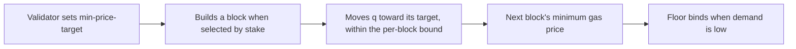

ACP-283 is the second C-Chain change in Helicon. It gives validators a new economic control, the C-Chain price floor, and it changes how much AVAX is burned when the chain is quiet. It is in this collection because it activated at the same instant as the staking changes and because burns enter the net issuance measures the research reports. It does not change any staking parameter.

The full text of the ACP-283 proposal is replicated on the [Source Proposal](/Phase-II/Wiki/Collections/Economic-ACPs/ACP-283-Dynamic-Minimum-Gas-Price/Source-Proposal) page.

## What it changes

| Parameter | Before Helicon | After Helicon |
| --- | --- | --- |
| Minimum gas price | Fixed at 1 wei | $M = e^{q/D}$ wei, where $q$ is carried in each block header |
| Initial value at activation | Not applicable | $q = 0$, so the floor starts at 1 wei |
| Who moves it | Nobody without a network upgrade | Each block builder moves $q$ toward its configured `min-price-target` |
| Speed limit | Not applicable | 3,600 maximum-size moves double or halve the floor, about one hour at one-second blocks |
| Validator that sets no target | Not applicable | Leaves the floor unchanged |

Figure 1 shows the loop by which the floor moves.

*Figure 1. The dynamic minimum gas price. The proposal states that repeated block production drives the floor toward the median of validators' targets weighted by stake.*

The proposal cites spam at near-zero prices as the motivation. It reports that the lowest observed C-Chain gas prices were about 100,000 wei, and that the price before ACP-176 was about 25 nAVAX. Both figures are attributed and not reproduced by us. During congestion the existing ACP-176 fee mechanism sets the price, and the floor has no effect.

## Status and activation

| Item | Value |
| --- | --- |
| Authors | Stephen Buttolph, Martin Eckardt |
| Repository status | Proposed, Standards track |
| Discussion | Opened 2026-04-10, no comments |
| Mainnet activation | 2026-09-22 15:00 UTC, with Helicon in AvalancheGo v1.15.0 |
| Precedent | The same validator-preference mechanism as ACP-176 for the gas target and ACP-226 for the minimum block delay |

The implementation reaches the median only through repeated block production. It does not tally preferences, so no public record lists each validator's target.

## How it enters the staking model

It does not enter the staking model directly. Its channel into the research is the burn: a higher floor raises the fee on low-demand transactions and the AVAX burned with them, which lowers the realized total supply and net issuance, the measure behind ACP-285's inflation projection. The staking reward formula reads the P-Chain supply counter, which does not subtract C-Chain burns.

## What our data can measure

Block headers record the floor's exponent after activation, so its path can be read from any C-Chain block source, including the public RPC we already query. The C-Chain fee datasets give burned AVAX per block, which can be compared across activation once a capture that extends past it is built. We have not yet read the floor's path since activation.

## Open questions

1. Where has the floor moved since activation, and how many validators set a target?
2. How much of any change in daily burn at Helicon comes from this floor rather than from ACP-194's gas-charging rule?
3. Does the floor deter low-value spam without pricing out ordinary use? The proposal asserts it, and no one commented on the discussion.

## Public links

- Proposal: [ACP-283, Dynamic Minimum Gas Price](https://github.com/avalanche-foundation/ACPs/blob/main/ACPs/283-dynamic-minimum-gas-price/README.md)
- Discussion: [Discussion 284](https://github.com/avalanche-foundation/ACPs/discussions/284)
