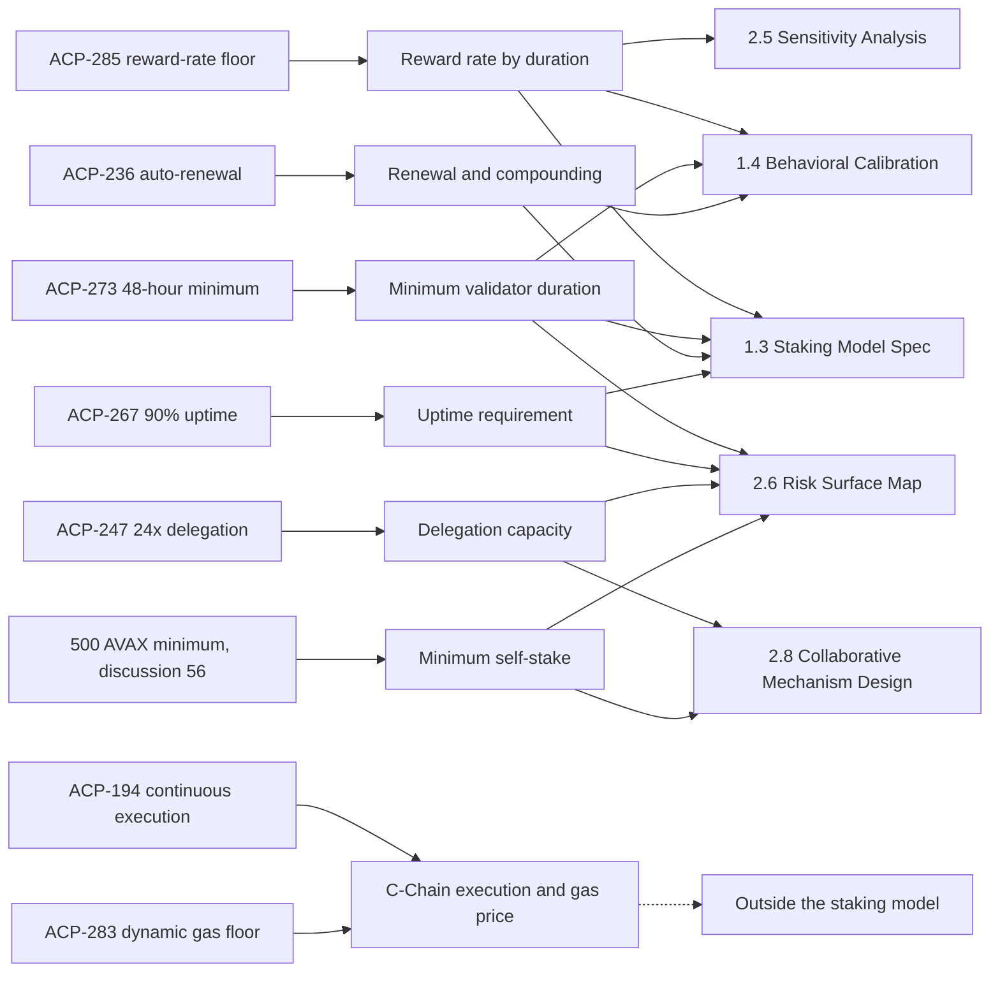

The staking model has to reproduce the rules validators and delegators actually face, and four of those rules changed at one instant: Helicon activated on Mainnet at 2026-09-22 15:00 UTC. This collection records each Avalanche Community Proposal, or ACP, that changes Primary Network staking economics, with the exact parameter values before and after, the time each change applies, and which contract deliverable it informs. It answers one question for every later result: which protocol rules were in force for the commitments being measured or simulated. Two further Helicon ACPs change the C-Chain rather than staking. They are kept here because they activated at the same time and must be separated from the staking changes in any before-and-after comparison.

Every ACP page links the public proposal and its discussion in the [avalanche-foundation/ACPs](https://github.com/avalanche-foundation/ACPs) repository. The proposal texts were read at repository revision `b80ea34`, which was still the head of the main branch on 2026-09-29. Activation times and parameters were checked against AvalancheGo v1.15.0 and the project's [protocol kernel](/Phase-II/Wiki/Reference/Glossary-and-Notation), its reimplementation of the reward and staking rules in integer arithmetic.

## Mechanisms and deliverables

Figure 1 maps each proposal to the staking mechanism it changes and each mechanism to the deliverable that must represent it. The 500 AVAX minimum stake has no ACP number and is shown with its public discussion instead.

*Figure 1. Each Economic ACP, the mechanism it changes, and the contract deliverable that mechanism informs. The dashed edge marks the two C-Chain proposals, which enter no staking deliverable directly.*

## The proposals

Values are Mainnet values. A consumption rate is the protocol's reward-rate parameter before the remaining-supply factor is applied, so a 10% rate is not a 10% yield.

| ACP | What it changes | Status and activation | Informs |
| --- | --- | --- | --- |
| [ACP-285 Minimum Consumption Rate](/Phase-II/Wiki/Collections/Economic-ACPs/ACP-285-Minimum-Consumption-Rate) | Minimum consumption rate 10% to 7.5%, ramped linearly over 90 days by stake start time. Maximum rate stays 12%. | Activated with Helicon, 2026-09-22 15:00 UTC. The ramp ends 2026-12-21 15:00 UTC. | 1.3, 1.4, 2.5 |
| [ACP-273 Minimum Validator Duration](/Phase-II/Wiki/Collections/Economic-ACPs/ACP-273-Minimum-Validator-Duration) | Minimum validator duration 14 days to 48 hours. Delegator minimum stays 14 days. | Activated with Helicon, 2026-09-22 15:00 UTC | 1.3, 1.4, 2.6 |
| [ACP-236 Auto-Renewed Staking](/Phase-II/Wiki/Collections/Economic-ACPs/ACP-236-Auto-Renewed-Staking) | Adds auto-renewed validation in repeated cycles that restake 0% to 100% of each cycle's reward. Before Helicon every period was fixed-term. | Activated with Helicon, 2026-09-22 15:00 UTC | 1.3, 1.4 |
| [ACP-267 Uptime Requirement](/Phase-II/Wiki/Collections/Economic-ACPs/ACP-267-Uptime-Requirement) | Uptime needed for any reward 80% to 90%, for validations starting at or after activation | Activated with Helicon, 2026-09-22 15:00 UTC | 1.3, 2.6 |
| [ACP-247 Delegation Multiplier](/Phase-II/Wiki/Collections/Economic-ACPs/ACP-247-Delegation-Multiplier) | Maximum delegated stake 4 to 24 times self-stake, under the unchanged 3,000,000 AVAX weight cap | Implementable. Not in AvalancheGo v1.15.0 and not scheduled. | 2.6, 2.8 |
| [Minimum validator stake of 500 AVAX](/Phase-II/Wiki/Collections/Economic-ACPs/Minimum-Validator-Stake-500-AVAX) | Minimum self-stake 2,000 AVAX to 500 AVAX, as suggested in a public discussion | No ACP exists. A brainstorming discussion from 2023-12-16. | 2.6, 2.8 |
| [ACP-194 Continuous Execution](/Phase-II/Wiki/Collections/Economic-ACPs/ACP-194-Continuous-Execution) | C-Chain execution moves from inside consensus to a queue executed after acceptance | Activated with Helicon, 2026-09-22 15:00 UTC | None directly |
| [ACP-283 Dynamic Minimum Gas Price](/Phase-II/Wiki/Collections/Economic-ACPs/ACP-283-Dynamic-Minimum-Gas-Price) | C-Chain minimum gas price from a fixed 1 wei to a floor set by stake-weighted validator preferences | Activated with Helicon, 2026-09-22 15:00 UTC | None directly |

## How the collection was assembled

The Helicon membership comes from the AvalancheGo v1.15.0 release notes and the Builder Hub [Helicon upgrade page](https://build.avax.network/docs/primary-network/helicon-upgrade). ACP-236, 247, 267, 273, and 285 are the proposals that pass a screen of all 36 ACPs in the repository for a direct change to a Primary Network validator or delegator choice, reward, eligibility condition, or capacity limit. The 500 AVAX minimum is included because our [brief of 2026-09-25](/Phase-II/Wiki/Briefs/2026-09-25-sprint-8/) discussed it under the label ACP-49. That label has no public source, and its page records what does exist.

Several activated ACPs changed staking before Helicon and appear in the [protocol upgrades table](/Phase-II/Wiki/Reference/Glossary-and-Notation) of the glossary: ACP-41 and ACP-62 at Durango, and ACP-77 and ACP-103 at Etna. They set the rules for the historical data but do not change a parameter the staking model varies, so they have no page here.

The proposal's repository status and its activation are separate facts. Five of the six Helicon ACPs still carry the status Proposed in the repository although their mechanisms shipped in AvalancheGo v1.15.0 and are active on Mainnet. Each page states both.
