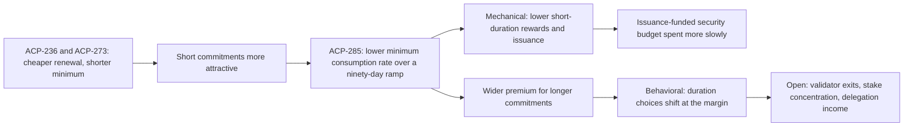

Read the [source](/Phase-II/Wiki/Collections/Essential-Readings/ACP-285-Avalanche-Community-Call-Staking-Reward-Curve-Adjustment/Source-Video).

*The argument of the presentation and the questions it raised. The recording has no figure in this collection, so this diagram is drawn from the reading view.*

## Question

The call was held on June 29, 2026 and published on July 7, 2026, running 1:13:03. Eric Lu presents ACP-285 and the community questions it. The call asks what lowering the minimum consumption rate does to issuance and to staking choices, given that ACP-236 and ACP-273 have made short commitments cheaper to hold.

## Argument

The presentation starts from three observations, at 0:43. Realized inflation remains material even as it declines with remaining supply. The reward difference between short and long commitments has narrowed. Auto-renewal and a shorter minimum make short-duration staking relatively more attractive. Shorter commitments keep liquidity and the option to change position, so the question is what reward compensates for giving up that flexibility.

The proposal serves three goals, at 9:15: reduce net AVAX inflation, conserve the finite issuance-funded security budget, and restore a stronger relative reward for longer commitments. The presentation calls these intended outcomes, not guarantees.

The reward formula, at 13:00, scales a linear interpolation between minimum and maximum consumption rates by a remaining-supply factor. Lowering the minimum changes only the short end. The change in realized annualized reward is smaller than the change in the parameter because the remaining-supply factor is below one. The presentation then separates the mechanical effect on inflation and supply, at 15:25, from the behavioral response, which comes from a structural model of validator and delegator preferences, at 22:00. The rate moves over a ninety-day ramp, at 23:35, so that two similar positions do not lock in different rates because they start on either side of one instant.

## Main results

The reading view records no projected numbers. Quantitative outputs shown in the presentation remain attributed to the presenter until its materials are recovered. The discussion adds four points for the research.

1. Validator count is not stake-weighted security, at 26:25. One large exit changes secured stake more than many small ones.
2. Observed durations cluster, and the expected shift is at the margin, at 32:00. The effect on concentration of delegated stake is stated as a hypothesis to test.
3. Delegation changes were kept out of ACP-285 on purpose, at 37:00, although validator choices respond to expected delegation fee income.
4. Security funding must move from issuance toward value captured from activity, at 47:10. Who receives that value and how it reaches validators is unresolved.

## What it gives this research

1. A two-layer structure for deliverable [1.3](/Phase-II/Milestones/Milestone-1/1-3-Staking-Model-Spec/). The mechanical layer reproduces rewards and issuance under a parameter path with choices held fixed. The behavioral layer lets choices respond. Each result can then report how much of an effect comes from each layer.
2. The ramp as a protocol rule. The rate is fixed at each stake's start and moves over the ramp, so the model has to track the start time of every commitment.
3. KPIs for deliverable [2.3](/Phase-II/Milestones/Milestone-2/2-3-KPI-Computation/). The call supports reporting both validator count and stake-weighted measures, and the concentration of delegated stake, as separate outputs.
4. A separate mechanism for deliverable [2.8](/Phase-II/Milestones/Milestone-2/2-8-Collaborative-Mechanism-Design/). Delegation changes such as the multipliers of ACP-247 were excluded from ACP-285 and should be evaluated as their own mechanism, holding the ACP-285 curve fixed.
5. Questions for deliverable [2.7](/Phase-II/Milestones/Milestone-2/2-7-Workshop-1/). The concerns raised on small validators, moving from validation to delegation, and operational constraints omitted by structural models are the ones a model walkthrough should answer with results.

## Limits and open questions

The reading view is an analytical summary located with automatic captions that were not verified word for word. Protocol rules come from the versioned ACP files, not from the call. The structural model's counterfactuals were shown but are not in the reading view. Recovering the presentation materials would give the projected inflation and duration changes as targets to reproduce.
