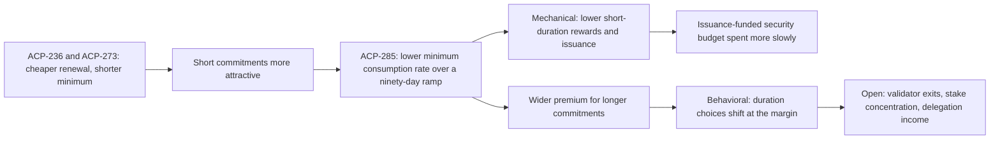

At the ACP-285 community call, Eric Lu presents the lower minimum consumption rate as a response to shorter and auto-renewed commitments, separates its mechanical effect on issuance from the behavioral response, and hears community concerns about security, concentration, and delegation.

<!-- overview-table:start -->

| | |
| --- | --- |
| **Authors** | Avalanche |
| **Published** | July 7, 2026 |
| **Source** | YouTube, [original](https://www.youtube.com/watch?v=sx4-AW7HcSU) |
| **Topics** | [issuance and rewards](/tags/issuance-and-rewards), [staking duration and liquidity](/tags/staking-duration-and-liquidity), [mechanism design](/tags/mechanism-design), [protocol governance](/tags/protocol-governance) |
| **Key terms** | minimum consumption rate, [auto-renewed staking](/Phase-II/Wiki/Reference/Glossary-and-Notation), remaining-supply factor, mechanical effect, behavioral response, ninety-day ramp |
| **Serves deliverables** | [1.3](/Phase-II/Milestones/Milestone-1/1-3-Staking-Model-Spec/), [2.3](/Phase-II/Milestones/Milestone-2/2-3-KPI-Computation/), [2.7](/Phase-II/Milestones/Milestone-2/2-7-Workshop-1/), [2.8](/Phase-II/Milestones/Milestone-2/2-8-Collaborative-Mechanism-Design/) |

<!-- overview-table:end -->

Avalanche held the call on June 29, 2026, while ACP-285 was in community discussion, and published the recording on July 7, 2026. It runs 1:13:03. Eric Lu, one of the proposal's four authors, presents, and an open discussion follows. ACP-285 lowers the **minimum consumption rate**, the reward-formula parameter that sets the reward for the shortest commitments, from 10% to 7.5%. The call explains the reasoning and records what community members asked. Timestamps below point into the recording.

The presentation starts from three observations, at 0:43. Realized inflation remains material, even though it declines as the remaining supply falls. The reward difference between short and long commitments has narrowed over time. **Auto-renewal** under ACP-236 and the shorter minimum of ACP-273 make short commitments relatively more attractive. Shorter commitments keep liquidity and the option to change position, so the question is what reward compensates a staker for giving up that flexibility. The proposal serves three goals, at 9:15: reduce net AVAX inflation, conserve the finite **security budget** that issuance funds, and restore a stronger relative reward for longer commitments. The presentation calls these intended outcomes, not guarantees.

The reward formula, at 13:00, multiplies a linear interpolation between the minimum and maximum consumption rates by a **remaining-supply factor**. Lowering the minimum changes only the short end of the curve. The realized reward changes less than the parameter because the factor is below one. The presentation then separates two effects. The **mechanical effect**, at 15:25, compares reward and inflation paths under the old and new rate with staking choices held fixed. The **behavioral response**, at 22:00, comes from a structural model of validator and delegator preferences estimated from historical choices. The rate moves over a **ninety-day ramp**, at 23:35, so that two similar positions do not lock in very different rates because they start just before or just after one instant. The ramp also gives dependent applications time to adjust.

The summary of the recording records no projected numbers. The proposal's own figures are on the [ACP-285 page](/Phase-II/Wiki/Collections/Economic-ACPs/ACP-285-Minimum-Consumption-Rate/): inflation about 0.5 point lower with behavior fixed, 0.5 to 1 point lower once durations respond, and a stake-weighted average duration about two months longer. The discussion adds five points. Validator count is not stake-weighted security, at 26:25, because one large exit changes secured stake more than many small ones. Observed durations cluster, and the expected shift is at the margin, at 32:00, so the effect on concentration of delegated stake remains a hypothesis to test. Delegation changes were kept out of ACP-285 on purpose, at 37:00, to keep the duration incentive easy to understand. Community members described moving from validation to delegation, at 40:40, and participants acknowledged that structural models may omit such operational constraints. Finally, security funding must move from issuance toward value captured from activity, at 47:10, and who receives that value is unresolved.

*The argument of the presentation and the questions it raised. Read it left to right: the two companion proposals make short commitments more attractive, and ACP-285 responds through a mechanical path and a behavioral path. The last box holds what the discussion left open. The recording has no figure in this collection, so this diagram is drawn from the summary of the recording.*

## How it relates to our research

**Two layers in the staking model.** The split between mechanical and behavioral effects sets the structure of the [1.3 Staking Model Spec](/Phase-II/Milestones/Milestone-1/1-3-Staking-Model-Spec/). The mechanical layer reproduces rewards and issuance under a parameter path with choices held fixed. The behavioral layer lets choices respond. Each result can then report how much of an effect comes from each layer, as the proposal does when it gives 0.5 point with behavior fixed and 0.5 to 1 point with it.

**The ramp is a protocol rule the model must track.** Each stake locks in the rate at its start and keeps it for its whole duration. The model therefore tracks the start time of every commitment. The released ramp runs from 2026-09-22 15:00 UTC to 2026-12-21 15:00 UTC, and the ACP-285 page tabulates the rate a stake locks in on selected days. Starting one day earlier during the ramp locks in about 0.028 percentage points more for the full term.

**Security and concentration become separate outputs.** The KPIs of [2.3 KPI Computation](/Phase-II/Milestones/Milestone-2/2-3-KPI-Computation/) include validator count and decentralization. The call supports reporting validator count, stake-weighted measures, and the concentration of delegated stake as separate outputs. The clustering the call describes is visible in the record. Of the 401 validator periods started in the 30 days before Helicon, 304 ran 14 to 30 days, as the [ACP-273 page](/Phase-II/Wiki/Collections/Economic-ACPs/ACP-273-Minimum-Validator-Duration/) shows.

**Delegation is its own mechanism.** Delegation changes such as the multipliers of [ACP-247](/Phase-II/Wiki/Collections/Economic-ACPs/ACP-247-Delegation-Multiplier/) were excluded from ACP-285. In [2.8 Collaborative Mechanism Design](/Phase-II/Milestones/Milestone-2/2-8-Collaborative-Mechanism-Design/) they should be evaluated on their own, with the ACP-285 curve held fixed. The boundary matters because validator choices respond to expected delegation fee income, which is how the [validator rewards article](/Phase-II/Wiki/Collections/Essential-Readings/How-Do-Avalanche-Validators-Actually-Think-About-Staking-Rewards/) models validators.

**Questions for the first workshop.** The concerns raised about small validators, the move from validation to delegation, and operational constraints are the ones a model walkthrough in [2.7 Workshop 1](/Phase-II/Milestones/Milestone-2/2-7-Workshop-1/) should answer with results. The closing discussion of security funding connects to [Why Avalanche Validator Economics Need a Redesign](/Phase-II/Wiki/Collections/Essential-Readings/Why-Avalanche-Validator-Economics-Need-a-Redesign/) and to the [Gross Chain Income article](/Phase-II/Wiki/Collections/Essential-Readings/From-Gross-Chain-Product-to-Gross-Chain-Income-Where-the-Value-Goes/), which measures how little value AVAX captures from activity today.

**Open question for the Foundation.** The structural model's counterfactuals were shown but are not in the summary of the recording. Can the Foundation share the presentation materials, so the projected inflation and duration changes can serve as targets to reproduce?

## Source

Avalanche. 2026. ACP 285 - Avalanche Community Call - Staking Reward Curve Adjustment. YouTube video, held June 29, 2026, published July 7, 2026, 1:13:03. <https://www.youtube.com/watch?v=sx4-AW7HcSU>. The collection holds a [timestamped summary of the recording](/Phase-II/Wiki/Collections/Essential-Readings/ACP-285-Avalanche-Community-Call-Staking-Reward-Curve-Adjustment/Source-Video) rather than a transcript. Automatic captions were used to locate its sections and were not verified word for word. Protocol rules on this page come from the ACP text, not from the call.
