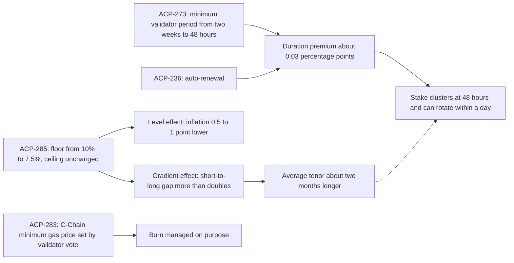

Read the [source](/Phase-II/Wiki/Collections/Essential-Readings/From-Static-Constants-to-Dynamic-Variables-Where-Avalanches-Economics-Are-Headed/Source-Article). The collection holds a guide to this article. Section and figure references below are to the author edition it links.

*How the article connects the three proposals. The dotted arrow marks the risk that ACP-285 is meant to offset. Drawn from the article's text.*

## Question

Matias Antonio published the article on July 2, 2026. It asks how Avalanche should set economic parameters when "there is no right value for them in the abstract," because the right value depends on an objective and on network conditions that change.

## Argument

The reward curve, the issuance schedule, and the fee floor were fixed at launch. An optimum "is not a constant, not in a dynamic system." The article reads three proposals as the start of managing these parameters deliberately.

1. ACP-273, merged, cuts the minimum validator period from two weeks to 48 hours. The operational case is institutional: shorter lock-ups let products such as ETFs stake more of their holdings. The section "Why ACP-273 created a gap" states the cost. At the current curve a 48-hour stake earns "roughly three hundredths of a percentage point" less than a two-week stake. With auto-renewal, stake could concentrate at 48 hours, and "a large share of the entities securing the network could rotate within a single day."
2. ACP-285 lowers the floor parameter from 10 percent to 7.5 percent and leaves the ceiling unchanged. The article asks that 273 and 285 be read "as one decision rather than two."
3. ACP-283, merged, makes the C-Chain minimum gas price adjustable by validator vote. The article argues the floor, "well under a cent per transaction," can rise without losing users, up to the point where it costs usage.

The section "How the staking reward actually works" warns that the floor parameter is not the reward a validator receives, because the formula scales it by the remaining-supply ratio. Figure 1 shows the reward rate at two weeks and at one year since genesis.

## Main results

The expected effects of ACP-285, in the section "What ACP-285 proposes":

1. Inflation falls by "between half a point and a full point," close to a 20 percent reduction against current rates.
2. The gap between short and long reward rates "more than doubles."
3. The author's "internal validator choice model expects this to extend average tenors by around two months."
4. The elasticity of stake amounts to the reward rate is low, so total participation is expected to hold.

The article calls the tenor extension "a modeled central case with real dispersion around it."

## What it gives this research

1. Governance parameters for deliverable [1.3](/Phase-II/Milestones/Milestone-1/1-3-Staking-Model-Spec/). Minimum duration, the floor and its ramp, and the gas price floor are separate levers. The model computes the rate a validator receives from the floor and the remaining-supply factor, never the floor alone.
2. Targets for deliverable [2.4](/Phase-II/Milestones/Milestone-2/2-4-Validation-Confirmation/). After Helicon, three predictions can be checked: inflation 0.5 to 1 point lower, average tenor about two months longer, and total stake unchanged.
3. A risk measure for deliverables [2.3](/Phase-II/Milestones/Milestone-2/2-3-KPI-Computation/) and [2.6](/Phase-II/Milestones/Milestone-2/2-6-Risk-Surface-Map/). The share of stake whose commitment can end within 24 hours states the rotation risk directly.
4. A frame for deliverable [3.2](/Phase-II/Milestones/Milestone-3/3-2-Scenario-Playbook/). A parameter that should move with conditions is what a playbook of "if this condition, then this adjustment" supplies.

## Limits and open questions

The article describes the ramp as "a linear ramp over 30 days." The rule activated at Helicon ramps the floor over 90 days, keyed to each stake's start, as the [glossary](/Phase-II/Wiki/Reference/Glossary-and-Notation) records. The model should follow the protocol code.

The inflation, tenor, and participation figures are projections. The article publishes no elasticity estimate behind the claim that participation holds, and the two-month extension comes from an internal model that the article does not describe. The closest published model is in the [validator-rewards article](/Phase-II/Wiki/Collections/Essential-Readings/How-Do-Avalanche-Validators-Actually-Think-About-Staking-Rewards/Overview).

The burn effect of ACP-283 depends on how fee demand responds to price. The staking model does not estimate that response, so the gas price floor enters only as a scenario on the burn.
