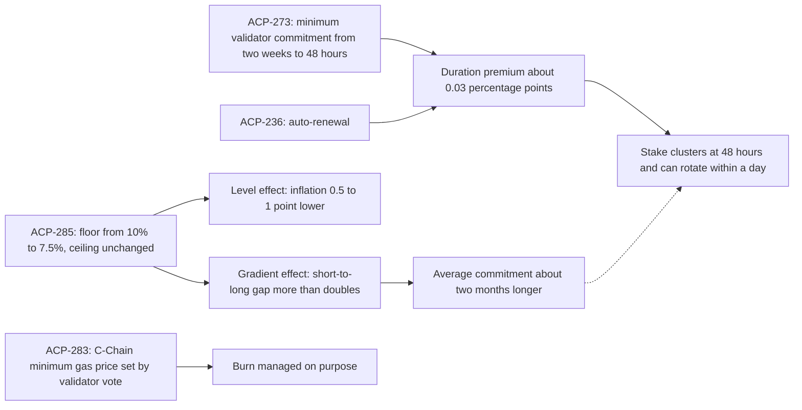

Matias Antonio argues that Avalanche is starting to treat its reward curve and fee floor as variables to measure and adjust on purpose rather than constants fixed at launch, and reads ACP-273, ACP-285, and ACP-283 as the first three steps.

<!-- overview-table:start -->

| | |
| --- | --- |
| **Authors** | Matias Antonio |
| **Published** | July 2, 2026 |
| **Source** | LinkedIn, [original](https://www.linkedin.com/pulse/from-static-constants-dynamic-variables-where-avalanches-matias-a-xh02e) |
| **Topics** | [issuance and rewards](/tags/issuance-and-rewards), [protocol governance](/tags/protocol-governance), [staking duration and liquidity](/tags/staking-duration-and-liquidity) |
| **Key terms** | reward formula, floor rate, remaining-supply factor, level effect, gradient effect, [auto-renewed staking](/Phase-II/Wiki/Reference/Glossary-and-Notation), minimum gas price |
| **Serves deliverables** | [1.3](/Phase-II/Milestones/Milestone-1/1-3-Staking-Model-Spec/), [2.3](/Phase-II/Milestones/Milestone-2/2-3-KPI-Computation/), [2.4](/Phase-II/Milestones/Milestone-2/2-4-Validation-Confirmation/), [2.6](/Phase-II/Milestones/Milestone-2/2-6-Risk-Surface-Map/), [2.8](/Phase-II/Milestones/Milestone-2/2-8-Collaborative-Mechanism-Design/), [3.2](/Phase-II/Milestones/Milestone-3/3-2-Scenario-Playbook/) |

<!-- overview-table:end -->

Matias Antonio, Chief Investment Officer of the Avalanche Foundation, published the article on LinkedIn on July 2, 2026. It opens with a claim about every blockchain: none yet pays for its own security out of its own activity. Security still runs on **issuance**, new supply paid to stakers. The reward curve, the issuance schedule, and the fee floor were set at launch, and the article says there is "no right value for them in the abstract." The right value depends on the objective and on network conditions that shift, so "an optimum is not a constant, not in a dynamic system." The article reads three proposals as the start of managing these parameters deliberately. The article describes ACP-273 and ACP-283 as merged and ACP-285 as in community discussion. All three activated with the Helicon upgrade on September 22, 2026.

The background is the Primary Network **reward formula**. A validator's annualized reward rate rises linearly with commitment length, from a **floor rate** at the shortest allowed commitment to a **ceiling rate** at one year. The formula then multiplies that rate by a **remaining-supply ratio**, the unminted part of the 720 million AVAX cap divided by current supply. The gap between floor and ceiling is the protocol's tool for rewarding longer commitments. The article's main warning to modelers is that the floor parameter is not the rate a validator receives, because the ratio scales it down: "Conflating the parameter with the realized rate is the most common way to get this analysis wrong."

The argument joins ACP-273 and ACP-285. ACP-273 cut the minimum validator commitment from two weeks to 48 hours. The operational case is institutional. An exchange-traded fund can stake more of its holdings because it no longer has to hold back as large a reserve for a 24-hour redemption window. The cost is that at the current curve a 48-hour stake earns "roughly three hundredths of a percentage point" a year less than a two-week stake. With **auto-renewal** under ACP-236, the rational choice tilts toward the shortest commitment that still compounds, and "a large share of the entities securing the network could rotate within a single day." The article calls ACP-273 "operationally right and, on its own, economically incomplete," and asks that it and ACP-285 be read "as one decision rather than two," activated together.

ACP-285 lowers the floor parameter from 10% to 7.5% and leaves the ceiling unchanged. The article expects two effects. The **level effect** is less issuance to short commitments, which it expects to cut inflation by "between half a point and a full point," close to a 20% reduction against current rates, and to slow the spending of the finite security budget. The **gradient effect** is that the gap between short and long reward rates "more than doubles." The author's internal validator choice model expects this to lengthen average commitments by about two months, which the article calls "a modeled central case with real dispersion around it." It adds that historical data show a low elasticity of stake amounts to the reward rate, so total participation should hold. It describes the change as phased in through "a linear ramp over 30 days," to avoid a rush to stake just before activation. On the burn side, ACP-283 makes the C-Chain **minimum gas price** adjustable by validator vote. The article argues that today's floor, "well under a cent per transaction," could sit higher, but only up to the point where it starts to cost usage, because the burn is fee times activity.

*How the article connects the three proposals. ACP-273 and auto-renewal leave almost no reward for committing longer, which creates the rotation risk on the right. ACP-285 steepens the curve, and the dotted arrow marks the risk it is meant to offset. ACP-283 acts on the burn rather than on issuance. The article has no figure of this, so the diagram is drawn from its text.*

## How it relates to our research

**The model computes the rate a validator receives.** The article's warning is a rule for the [1.3 Staking Model Spec](/Phase-II/Milestones/Milestone-1/1-3-Staking-Model-Spec/), which names the minimum and maximum commitment length and the yield at each length as governance parameters. The model computes each commitment's yield from the floor, the ceiling, the duration, and the remaining-supply ratio, never from the floor alone. The [ACP-285 page](/Phase-II/Wiki/Collections/Economic-ACPs/ACP-285-Minimum-Consumption-Rate/) shows the size of the difference. The ratio was about 0.53 at the supply the proposal uses, so the 2.5-point cut in the parameter lowers the 14-day rate from 5.36% to 4.08%, a fall of about 1.3 points.

**The ramp follows the protocol, not the article.** The article's 30-day ramp is not what activated. The ACP-285 specification and the Helicon release ramp the floor over 90 days, and each stake locks in the rate at its start time, as the [glossary](/Phase-II/Wiki/Reference/Glossary-and-Notation#protocol-upgrades) records. The floor falls from 10% for stakes starting on 2026-09-22 at 15:00 UTC to 7.5% for stakes starting on or after 2026-12-21 at 15:00 UTC. The model follows the released code. It also keeps the minimum duration, the floor and its ramp, and the gas price floor as separate levers, so each can be switched on alone.

**Three predictions we can check.** The article's expected effects are targets for [2.4 Validation Confirmation](/Phase-II/Milestones/Milestone-2/2-4-Validation-Confirmation/): inflation 0.5 to 1 point lower, average commitments about two months longer, and total stake unchanged. The ACP-285 proposal gives the same inflation and duration figures from a structural model. The article's premise that stake clusters near the short end already holds in the record. Of the 401 validator periods started in the 30 days before Helicon, 304 ran 14 to 30 days, as the [ACP-273 page](/Phase-II/Wiki/Collections/Economic-ACPs/ACP-273-Minimum-Validator-Duration/) shows. In the first six days after activation, 12 of 78 validation cycles were shorter than 14 days. That is too early to test the tenor prediction, which needs commitments started through the whole ramp.

**Rotation risk becomes a measure.** The share of stake whose commitment can end within 24 hours states the article's risk directly. It belongs among the KPIs of [2.3 KPI Computation](/Phase-II/Milestones/Milestone-2/2-3-KPI-Computation/), and the settings where that share is high belong on the [2.6 Risk Surface Map](/Phase-II/Milestones/Milestone-2/2-6-Risk-Surface-Map/). ACP-273's own security section gives the scale of concern: a validator could move from 1% to 20% of network stake within hours. [BENQI told us](/Phase-II/Interviews/BENQI-2026-08-31/) that it holds 10% to 12% of all stake and was leaning toward two-day commitments after Helicon.

**The fee floor and the playbook.** The burn effect of ACP-283 depends on how fee demand responds to price. The staking model does not estimate that response, so the gas price floor, described on the [ACP-283 page](/Phase-II/Wiki/Collections/Economic-ACPs/ACP-283-Dynamic-Minimum-Gas-Price/), enters only as a scenario on the burn. The article's larger idea, parameters that move with conditions by a published rule, is the form of the [3.2 Scenario Playbook](/Phase-II/Milestones/Milestone-3/3-2-Scenario-Playbook/), whose contract requirement reads "If X market condition, then Y parameter adjustment." Its sketch of a reward curve open to proposed improvements fits the interface of [2.8 Collaborative Mechanism Design](/Phase-II/Milestones/Milestone-2/2-8-Collaborative-Mechanism-Design/).

**Open questions for the Foundation.** The article publishes no elasticity estimate behind its claim that participation holds, and it does not describe the internal model behind the two-month extension. The closest published model is the [validator rewards article](/Phase-II/Wiki/Collections/Essential-Readings/How-Do-Avalanche-Validators-Actually-Think-About-Staking-Rewards/), which fixes each validator's stake size and so estimates no response of stake amount at all. Can the Foundation share the elasticity estimate, and is the internal model the one in that article?

## Source

Matias Antonio. 2026. From Static Constants to Dynamic Variables: Where Avalanche's Economics Are Headed. LinkedIn article, July 2, 2026. <https://www.linkedin.com/pulse/from-static-constants-dynamic-variables-where-avalanches-matias-a-xh02e>. The collection holds a [guide to the article](/Phase-II/Wiki/Collections/Essential-Readings/From-Static-Constants-to-Dynamic-Variables-Where-Avalanches-Economics-Are-Headed/Source-Article) rather than a copy. This overview follows a dated capture of the article text.
