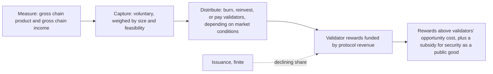

Eric Lu explains the Foundation's research agenda in his own words: measure the value the Avalanche ecosystem creates, capture part of it with the consent of those who create it, and distribute it so that protocol revenue, rather than new issuance, comes to pay the validators who secure the network.

<!-- overview-table:start -->

| | |
| --- | --- |
| **Authors** | Siyu (Eric) Lu, Avalanche Team1, BKL1023 |
| **Published** | August 17, 2026 |
| **Source** | Team1 blog, [original](https://www.team1.blog/p/growing-the-avalanche-economy-a-conversation), [full text](/Phase-II/Wiki/Collections/Essential-Readings/Growing-the-Avalanche-Economy-A-Conversation-with-Eric-Lu/Source-Article) |
| **Topics** | [fees and value capture](/tags/fees-and-value-capture), [security budget](/tags/security-budget), [validator economics](/tags/validator-economics), [distributional effects](/tags/distributional-effects) |
| **Key terms** | measure, capture, distribute, gross chain income, voluntary value capture, distribution policy, opportunity cost of staking, positive externality |
| **Serves deliverables** | [2.2](/Phase-II/Milestones/Milestone-2/2-2-Simulation-Execution/), [2.8](/Phase-II/Milestones/Milestone-2/2-8-Collaborative-Mechanism-Design/), [3.2](/Phase-II/Milestones/Milestone-3/3-2-Scenario-Playbook/) |

<!-- overview-table:end -->

Team1, the Avalanche community's blog, published the interview on August 17, 2026, two and a half weeks after the Foundation's [research agenda](/Phase-II/Wiki/Collections/Essential-Readings/The-Avalanche-Foundation-Unveils-its-Economic-Research-Agenda/) and five days after the [Gross Chain Income article](/Phase-II/Wiki/Collections/Essential-Readings/From-Gross-Chain-Product-to-Gross-Chain-Income-Where-the-Value-Goes/). The interviewers put to Eric, the Foundation's Lead Economist, the questions the community had been raising about the **Economics of Blockchain** series, the Foundation's public research series. The interview closes with a list of the series' eight articles, which is how several of them can still be found after the Foundation removed them from its blog.

The agenda rests on one sequence, **measure, capture, distribute**. Eric calls it first-principle thinking: nothing can be captured until the value is measured, and nothing can be distributed until it is captured. Measurement uses two tools. **Gross chain product** measures the value the ecosystem produces on chain, and separates real activity from price changes. **Gross chain income** adds value that originates outside the chain but flows to people and balances inside it, such as the yield on assets backing stablecoins and tokenized funds. Eric names the link between ecosystem value and AVAX as the weakest point in the chain, and says most of the work to close it "has no working precedents".

On **capture**, Eric argues that the usual sources of protocol revenue, transaction fees, MEV, and stablecoin yield, give the protocol too little exposure to the value the ecosystem creates. The Foundation weighs each possible revenue base by its size and by how feasible capture is. Its design principle is **voluntary value capture**: a mechanism both sides benefit from, which he calls the only kind that lasts, in contrast to a tax a state imposes. On **distribution**, he draws on corporate finance. Burning revenue, or buying back and burning, has the lowest agency cost but is often not the value-maximizing policy. A booming market favors reinvesting more and distributing less, and a slow market favors direct distribution. The agenda therefore gives no fixed prescription, only an understanding of the trade-offs.

On **validators after issuance**, Eric says rewards will be funded more and more by real protocol revenue instead of emissions. Rewards must exceed validators' **opportunity cost of staking**, which is the supply side of validation. Validation is also a public good with a **positive externality**, so a competitive market supplies too little of it. His sketch of a lasting design is a market mechanism that reveals validators' costs and the network's demand for security, topped up by a protocol subsidy for the externality. He also reports that the Foundation's research grant program, of up to \$50,000 per grant, drew close to 200 submissions. About a third concern validator incentives, cost of capital, and required returns, a third concern cryptoasset pricing, and the rest cover emission policy, fee optimization, L1 mechanisms, and MEV.

*The sequence Eric describes, and where validator rewards sit in it. The interview has no figure, so this diagram is drawn from its text.*

## How it relates to our research

**It is the clearest statement of what the Foundation wants the research to serve.** Our agreement is about staking parameters, but Eric frames staking as one end of a longer chain: measured value, captured revenue, and a distribution policy that decides how much reaches validators. Our proposal treats fee revenue as a scenario input rather than something the model simulates. The interview says that input is where the Foundation's design effort is going, so the share of protocol revenue paid to validators belongs among the environment settings of deliverable [2.2](/Phase-II/Milestones/Milestone-2/2-2-Simulation-Execution/), alongside market conditions and outside yields.

**It states the condition our model has to test.** "The level of rewards needs to be higher than some kind of opportunity cost of staking for validators to validate." That is the participation condition in [Competitive Equilibria Between Staking and On-Chain Lending](/Phase-II/Wiki/Collections/Supplementary-Research-Papers/2020-Staking-and-Lending-Equilibria/), and it needs two inputs we do not yet have in full: the outside yields that set the opportunity cost, and validators' operating costs. The [validator rewards article](/Phase-II/Wiki/Collections/Essential-Readings/How-Do-Avalanche-Validators-Actually-Think-About-Staking-Rewards/) measures one part of that cost, about 0.8 percentage points of annualized yield per extra week of commitment. Operating costs are recorded nowhere on chain, so they have to come from validators or the Foundation.

**It sets two rules for the mechanisms of deliverable [2.8](/Phase-II/Milestones/Milestone-2/2-8-Collaborative-Mechanism-Design/).** First, capture should be voluntary, so a fee-sharing or revenue-sharing mechanism we evaluate should be one that protocols would choose to join, and its effect on their activity should be part of the evaluation. Second, a mechanism that pays validators from protocol revenue should be judged by whether it covers their opportunity cost, which is the gap the [Redesign reading](/Phase-II/Wiki/Collections/Essential-Readings/Why-Avalanche-Validator-Economics-Need-a-Redesign/) diagnoses.

**Its distribution policy is a scenario rule.** Eric's view that the best policy depends on market conditions, reinvesting in a boom and distributing in a slow market, has the same form as the Scenario Playbook of deliverable [3.2](/Phase-II/Milestones/Milestone-3/3-2-Scenario-Playbook/): if a given market condition holds, adjust a given parameter. The playbook can carry distribution settings as well as staking parameters, if the Foundation wants them evaluated.

**Open questions for the Foundation.** Which revenue sources has the Foundation ranked highest for capture, and at what size, so our scenarios use the same ones? Can we see the validator-economics proposals from the research grant program once winners are chosen, so our work complements theirs rather than duplicating it?

## Source

Avalanche Team1 and BKL1023, with Siyu (Eric) Lu. 2026. Growing the Avalanche Economy: A Conversation with Eric Lu. Team1 blog, August 17, 2026. <https://www.team1.blog/p/growing-the-avalanche-economy-a-conversation>. Read the [full interview](/Phase-II/Wiki/Collections/Essential-Readings/Growing-the-Avalanche-Economy-A-Conversation-with-Eric-Lu/Source-Article).
