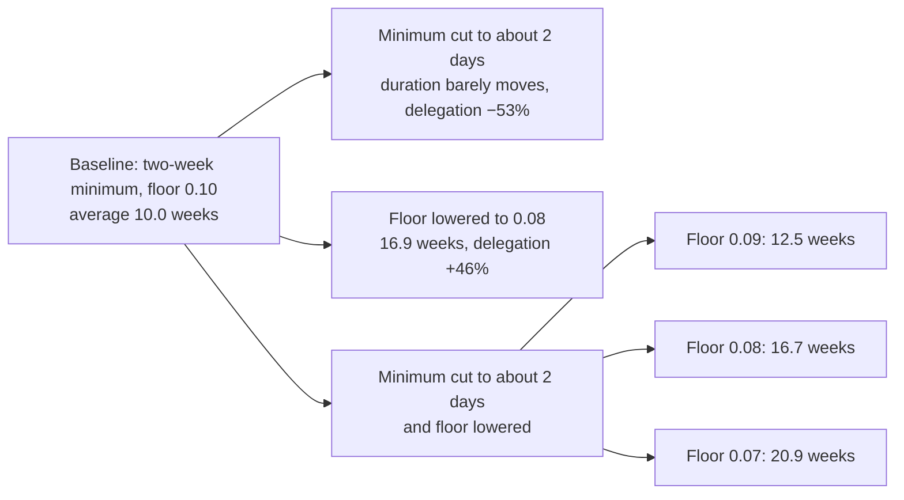

Eric Lu estimates from 278 weeks of P-Chain data that Avalanche validators choose their commitments by annualized yield rather than total income, so lowering the reward floor, not shortening the minimum commitment, is the lever that lengthens commitments.

<!-- overview-table:start -->

| | |
| --- | --- |
| **Authors** | Siyu (Eric) Lu |
| **Published** | April 28, 2026 |
| **Source** | LinkedIn, [original](https://www.linkedin.com/pulse/how-do-avalanche-validators-actually-think-staking-rewards-lu-phd-q9igc), [full text](/Phase-II/Wiki/Collections/Essential-Readings/How-Do-Avalanche-Validators-Actually-Think-About-Staking-Rewards/Source-Article) |
| **Topics** | [structural estimation](/tags/structural-estimation), [staking duration and liquidity](/tags/staking-duration-and-liquidity), [delegation market](/tags/delegation-market) |
| **Key terms** | two-sided market, annualized yield, period yield, optionality cost, marginal rate of substitution, conditional logit, inversion |
| **Serves deliverables** | [1.3](/Phase-II/Milestones/Milestone-1/1-3-Staking-Model-Spec/), [1.4](/Phase-II/Milestones/Milestone-1/1-4-Behavioral-Calibration/), [2.4](/Phase-II/Milestones/Milestone-2/2-4-Validation-Confirmation/) |

<!-- overview-table:end -->

Eric Lu of the Avalanche Foundation published the article on LinkedIn on April 28, 2026. It applies the Foundation's practice of recovering preferences from on-chain data and using them "to inform decisions before they are implemented." The decisions were two proposals then under discussion: a shorter minimum staking duration and a lower reward floor under ACP-285. The article names the first proposal ACP-275, but its link opens the discussion of ACP-273, the proposal that shortened the minimum. The article asks how delegators trade off rewards, fees, and duration, and how validators trade off staking income, delegation fee income, and duration.

The model treats staking as a **two-sided market**. **Delegators** stake with a validator and pay it a fee. They choose among validator-duration "products" by yield, lock-up length, validator size, and track record, and their preferences are recovered from weekly market shares with the **inversion** of [Berry (1994)](/Phase-II/Wiki/Collections/Supplementary-Research-Papers/1994-Discrete-Choice-Demand-Estimation). **Validators** choose their commitment length and delegation fee by the [conditional logit](/Phase-II/Wiki/Collections/Supplementary-Research-Papers/1973-Conditional-Logit-Analysis) of McFadden. Each picks the configuration that maximizes yield income plus fee income minus the **optionality cost** of locked capital, measured as duration times volatility. Validators forecast their delegation with the estimated delegator model. Validators stake a fixed amount, so stake size is not a choice. The data cover 278 weeks of P-Chain history, roughly 375,000 delegator observations, and 1.5 million validator choice-set alternatives. The article compares two ways a validator might judge a commitment: by **annualized yield**, or by **period yield**, the total income over the commitment.

Delegators value yield and dislike long lock-ups. With coefficients of +0.44 on log yield and −0.64 on log weeks, a 1% longer duration needs roughly a 1.5% higher net yield. They prefer larger validators, with +0.29 on log stake, and avoid long lock-ups when volatility is high, with −0.62 on that interaction. The delegator model's R-squared is 0.202. For validators, the annualized-yield specification has roughly three times the pseudo R-squared of the period-yield one with the same number of parameters. Its coefficient on log yield income is 36.6 and on renewal cost 5.4. Fee income enters negatively, which the article reads as fees being a secondary consideration. The **marginal rate of substitution** at the median point of 9 weeks, 2,000 AVAX, and a 10% fee is 0.80 to 0.84 percentage points of annual yield per extra week across three price and volatility settings. Under the period-yield specification it flips sign and exceeds 180.

Six policy scenarios follow from this. The baseline has a two-week minimum and floor and ceiling parameters of 0.10 and 0.12. Cutting the minimum to 2/7 of a week, about two days, barely moves average duration and cuts delegation 53%, because delegators cannot delegate to validators staking for less than two weeks. Lowering the floor to 0.08 alone lengthens average duration 68%, from 10.0 to 16.9 weeks, and raises delegation 46%. With both changes, average duration is 12.5 weeks at a floor of 0.09, 16.7 at 0.08, and 20.9 at 0.07, and delegation falls in every case, by 40% in the primary scenario. The article recommends a floor of about 0.08. It calls the results "directional, not precise," because both levers lie outside the historical data and the log-linear form may exaggerate responses there.

*The article's policy scenarios and the average validation duration each predicts. Notice that cutting the minimum alone barely changes duration, while every lower floor lengthens it. The combined scenarios also reduce delegation. The diagram is drawn from the article's text and Appendix D. The article's own chart of the duration distributions is on the source page.*

## How it relates to our research

**It is the target for our behavioral calibration.** [1.4 Behavioral Calibration](/Phase-II/Milestones/Milestone-1/1-4-Behavioral-Calibration/) fits response functions with confidence intervals. Our estimate uses the same P-Chain record, so it must match or explain the article's coefficients, its comparison of the two specifications, its marginal rate of substitution, and its six scenario durations. The article's model is static. A validator's choice at the end of each commitment, to renew or exit, is the dynamic decision that [Rust (1987)](/Phase-II/Wiki/Collections/Supplementary-Research-Papers/1987-Optimal-Replacement-of-Bus-Engines) estimates. Until post-Helicon data accumulate, a static duration logit like the article's is the simpler choice.

**Duration choice is the validator response the model carries.** The [1.3 Staking Model Spec](/Phase-II/Milestones/Milestone-1/1-3-Staking-Model-Spec/) names the yield at each commitment length as a governance parameter. The article's finding that validators respond to annualized yield sets how that parameter reaches behavior, beside the stake, unstake, and restake rates. The 0.8 points per extra week is also the price of giving up liquidity. The overview of [Competitive Equilibria Between Staking and On-Chain Lending](/Phase-II/Wiki/Collections/Supplementary-Research-Papers/2020-Staking-and-Lending-Equilibria/) cites it as the reason a longer commitment must pay more when a holder compares staking with an outside yield.

**Helicon is an out-of-sample test.** Helicon activated on 2026-09-22 with a 48-hour minimum, close to the article's two-day scenario, and a floor that ramps from 0.10 to 0.075 over 90 days, ending on 2026-12-21. The activated floor lies between the combined scenarios at 0.08 and 0.07, which predict average durations of 16.7 and 20.9 weeks. Commitments started after the ramp can confirm or reject that range in [2.4 Validation Confirmation](/Phase-II/Milestones/Milestone-2/2-4-Validation-Confirmation/). This is the design of [Keane and Wolpin](/Phase-II/Wiki/Collections/Supplementary-Research-Papers/2007-Nonrandom-Holdout-Validation), who fit a model under one set of rules and test it on a different one. Auto-renewal under [ACP-236](/Phase-II/Wiki/Collections/Economic-ACPs/ACP-236-Auto-Renewed-Staking/) and a 90% uptime requirement arrived in the same upgrade, so the test is of the joint change.

**The delegation constraint still holds.** The 53% fall in delegation rests on the two-week limit for delegation. The [ACP-273 page](/Phase-II/Wiki/Collections/Economic-ACPs/ACP-273-Minimum-Validator-Duration/) confirms that Helicon left the delegator minimum at 14 days, so a validator that commits for less than 14 days cannot accept delegation. [BENQI told us](/Phase-II/Interviews/BENQI-2026-08-31/) that for this reason it could shorten its commitments only through validators it runs itself. The delegator preference for larger validators, +0.29 on log stake, also matters for [Why Avalanche Validator Economics Need a Redesign](/Phase-II/Wiki/Collections/Essential-Readings/Why-Avalanche-Validator-Economics-Need-a-Redesign/), because it pushes stake toward the consolidation that article describes.

**Stake amounts need another source.** Validator stake is fixed in the model, so it estimates no response of stake amount to reward. The contract's stake and unstake functions need that response from elsewhere. The [Static Constants article](/Phase-II/Wiki/Collections/Essential-Readings/From-Static-Constants-to-Dynamic-Variables-Where-Avalanches-Economics-Are-Headed/) reports the elasticity as low but publishes no estimate. [The Tokenomics of Staking](/Phase-II/Wiki/Collections/Supplementary-Research-Papers/2025-The-Tokenomics-of-Staking) supplies a model in which the staking ratio responds to the reward rate.

**Open questions for the author.** Which scenario is the primary scenario with the 40% fall in delegation? Why does fee income enter validator utility with a negative sign, beyond the reading that fees are secondary? Have active validators confirmed that they think in annualized terms, the check the article itself names?

## Source

Siyu (Eric) Lu. 2026. How Do Avalanche Validators Actually Think About Staking Rewards? LinkedIn article, April 28, 2026. <https://www.linkedin.com/pulse/how-do-avalanche-validators-actually-think-staking-rewards-lu-phd-q9igc>. Read the [full article](/Phase-II/Wiki/Collections/Essential-Readings/How-Do-Avalanche-Validators-Actually-Think-About-Staking-Rewards/Source-Article), with its tables and figures.
