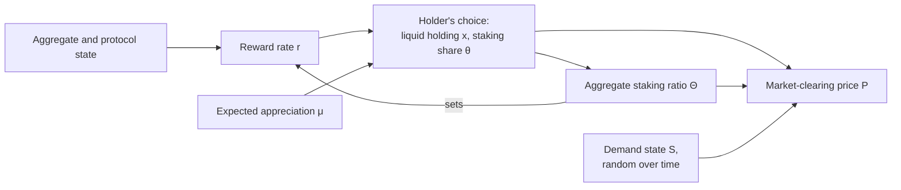

Three January images attributed to Eric Lu set out a staking and price equilibrium in which holders split AVAX between liquid holdings and staking, the staking ratio and the reward rate solve a fixed point, a market-clearing condition sets the price, and a random demand state moves all three.

<!-- overview-table:start -->

| | |
| --- | --- |
| **Authors** | Siyu (Eric) Lu |
| **Published** | Unpublished |
| **Source** | Slides shown during the scoping of Phase II, [full text](/Phase-II/Wiki/Collections/Essential-Readings/January-Staking-and-Price-Model-A-Three-Image-Reconstruction/Source-Model-Artifact) |
| **Topics** | [token valuation](/tags/token-valuation), [model structure](/tags/model-structure), [market conditions](/tags/market-conditions) |
| **Key terms** | [staking ratio](/Phase-II/Wiki/Reference/Glossary-and-Notation), reward rate, fixed point, market clearing, transaction convenience, demand state |
| **Serves deliverables** | [1.3](/Phase-II/Milestones/Milestone-1/1-3-Staking-Model-Spec/), [2.2](/Phase-II/Milestones/Milestone-2/2-2-Simulation-Execution/) |

<!-- overview-table:end -->

The artifact is three slide images of model work attributed to Eric Lu of the Avalanche Foundation. A recap dated January 13, from the scoping of Phase II, records that Hash captured them from work Eric had presented. The original deck, its date, and its purpose have not been recovered. The images give the structure of a model and one price equation. They give no data, parameter values, or results. The collection's source page reconstructs the smallest model the images support and lists what is missing.

The model asks how individual staking choices, the aggregate **staking ratio**, the **reward rate**, and the AVAX price determine one another, and how a shift in demand moves them. The first image states the **agent problem**. "Given the aggregate states," each holder trades off three things. **Convenience utility** is "the utility flow from holding liquid tokens." **Convenience loss** is "the disutility flow from locking tokens in staking." The third is staking rewards. The image shows no utility function, budget constraint, or time horizon.

The second image gives the solution. First-order conditions give each holder's holding $x_t$ and staking ratio $\theta_t$ as functions of the reward rate $r_t$ and the expected price appreciation $\mu_t$. Holders are identical, so the individual ratio equals the aggregate ratio $\Theta_t$, which in turn determines the reward rate. The equilibrium staking ratio $\Theta_t^*$ and reward rate $r_t^*$ therefore solve a **fixed point**, a pair of values that reproduce each other. Holdings follow, and the price is set by a **market-clearing condition**:

$$P_t = \frac{S_t}{Q_t}\int_0^1 x^*_{i,t}\,di = \frac{(1-\Theta_t)S_tA_t}{Q_t^*}\left(\frac{1-\alpha}{r^f-\mu_t-\Gamma_t}\right)^{1/\alpha}.$$

The third image adds a **demand shock**. A demand state follows $dS_t/S_t = \mu^S\,dt + \sigma^S\,dZ_t^S$, and the image notes that the drift and volatility "can be time-varying" and "can depend on aggregate endogenous or exogenous state variables."

The images leave the model incomplete. The reconstruction lists what is absent: the utility function, the reward rule $R$ that maps $\Theta_t$ to $r_t$, and the definitions and units of $S_t$, $Q_t$, $Q_t^*$, $A_t$, $r^f$, $\Gamma_t$, and $\alpha$. The equations were transcribed from the images by eye and have not been checked against an original source. The reconstruction writes the equilibrium as a root of $F(\Theta) = \theta^*\!\left(R(\Theta; z), \mu\right) - \Theta$ on $[0,1]$, where $z$ is the aggregate and protocol state. It also gives an exact step for $S_t$ as geometric Brownian motion, valid only when the drift and volatility are constant over the step.

*The model in the three images as one loop. Notice the arrow from the staking ratio back to the reward rate. The equilibrium is the staking ratio at which holders' choices and the reward rate agree. Price then follows from holdings, the staking ratio, and the demand state. The diagram is drawn from the source page's summary. The images themselves are on the source page.*

## How it relates to our research

**A small function to build first.** The fixed point is the computational core of this model for the [1.3 Staking Model Spec](/Phase-II/Milestones/Milestone-1/1-3-Staking-Model-Spec/). Written as the root of $F(\Theta)$ on $[0,1]$, it is a small function that can be tested on its own before any dynamics are added. It should report every admissible root rather than silently pick one, because the images do not show that a root exists or is unique.

**The reward rule is where Avalanche differs.** The images assume the aggregate staking ratio sets the reward rate. On Avalanche each commitment's reward is fixed at its start by its stake, its duration, and the supply remaining to the 720,000,000 AVAX cap, as the [reward formula](/Phase-II/Wiki/Reference/Glossary-and-Notation) shows. The reward rate therefore depends on the staking ratio only through the supply counter, unless the rule changes, and the fixed point has to be rewritten with Avalanche's formula. The images also assume identical holders with no commitment length. The [validator rewards article](/Phase-II/Wiki/Collections/Essential-Readings/How-Do-Avalanche-Validators-Actually-Think-About-Staking-Rewards/) estimates the choices this leaves out: separate validator and delegator decisions, and the choice of duration.

**A driver for the simulation sweeps.** The demand state $S_t$, stepped as geometric Brownian motion when its drift and volatility are constant over a step, is a candidate driver for the market conditions each trajectory samples in [2.2 Simulation Execution](/Phase-II/Milestones/Milestone-2/2-2-Simulation-Execution/). That deliverable's scenarios vary market conditions across bull, neutral, and bear, and network growth across low, medium, and high.

**It matches the Foundation's reference model.** The factor $(1-\Theta_t)A_t$ in the price equation matches the market-clearing price of Cong, He, and Tang, summarized in [The Tokenomics of Staking](/Phase-II/Wiki/Collections/Supplementary-Research-Papers/2025-The-Tokenomics-of-Staking). In that paper, price is proportional to $(1-\Theta)A$, scaled by an external demand shock and divided by token supply. The paper defines most of the symbols the images leave open: $S_t$ is the demand shock, $Q_t$ is total token supply, $A_t$ is platform productivity, $r^f$ is the risk-free rate, and $\alpha$ sets the curvature of transaction convenience. $Q_t^*$ and $\Gamma_t$ remain undefined. The [value accrual article](/Phase-II/Wiki/Collections/Essential-Readings/Value-Accrual-as-Equilibrium-How-We-Think-About-AVAX-Tokenomics/), published on March 19, 2026, adopts that paper's model by name. The images therefore appear to be an early version of the model the Foundation later adopted. This reading is ours and needs the author's confirmation.

**Open questions for the author.** Is there an original deck, note, or code, and what date and purpose did it serve? What distinguishes $Q_t$ from $Q_t^*$, and what is $\Gamma_t$? Which reward rule $R$ was intended for Avalanche? How does this model relate to the later two-sided model of the validator rewards article: is one meant to supply prices and the other staking choices?

## Source

Siyu (Eric) Lu, attributed. Staking and price model, three slide images. Observed in a January 13 recap during the scoping of Phase II. Unpublished, with no public URL. The collection holds a [reconstruction of the three images](/Phase-II/Wiki/Collections/Essential-Readings/January-Staking-and-Price-Model-A-Three-Image-Reconstruction/Source-Model-Artifact), with each image, the transcribed equations, and a map of every symbol.
