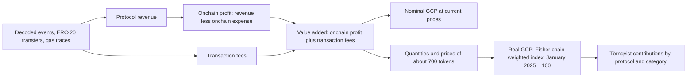

Read the [source](/Phase-II/Wiki/Collections/Essential-Readings/Measuring-Blockchain-Economies-Introducing-Gross-Chain-Product/Source-Article). The collection holds a guide to this article. Section and figure numbers below refer to the author edition it links.

*How the article builds gross chain product from on-chain flows. Drawn from Part 2 of the article.*

## Question

Eric Lu published the article on May 7, 2026. It asks "how much genuine economic value is being created on-chain, and is that number growing or contracting?" Total value locked, market capitalization, and one protocol's revenue each answer a different question.

## Method

**Gross chain product**, GCP, applies the income approach of national accounts. A protocol's value added is its onchain profit, revenue less the part paid to supply-side participants, plus the transaction fees it generates. GCP sums value added across protocols on the C-Chain.

Flows are recorded per token with the price at the time of the transaction. Nominal GCP values them at current prices. Real GCP uses the Fisher index, the geometric mean of Laspeyres and Paasche growth, chained month to month and anchored at 100 in January 2025. Törnqvist weights attribute real growth to protocols and categories.

## Main results

Part 3 reports the C-Chain from January 2025 to March 2026.

1. A liquidation cascade on April 7, 2025 produced over $13M of GMX V1 fees in one day, and the real index for April reached 238. The article reads this as a one-off, not an expansion.
2. From May to October 2025 the real index rose from 96 to 196, and nominal GCP rose from $9.5M to a peak of $21.0M.
3. Real GCP fell 30% in November 2025, to 137. By March 2026 nominal GCP was 60% below the January 2025 base while the real index stood at 75, shown in Figure 2.
4. In the Fisher decomposition of Figure 3, WAVAX and AVAX gas quantities rose 42% and 35%, USDT fell 19%, and USDC fell 51%.
5. Lending and DEXs account for "well over 80%" of protocol revenue since January 2025. The lending category's real index fell 68%, shown in Figure 4. Real-world assets rose more than 7x by November 2025 and stood about 1.6x the base in March 2026.
6. Over the history since February 2021, the 2021 decline was 87% and the current cycle 69% from the April 2025 peak. The active token basket fell from 227 tokens to 102, a 55% reduction.

## What it gives this research

1. An activity path for the environments of deliverables [2.2](/Phase-II/Milestones/Milestone-2/2-2-Simulation-Execution/) and [3.2](/Phase-II/Milestones/Milestone-3/3-2-Scenario-Playbook/). Network growth is one of the proposal's market conditions. Real GCP is a measured series for it that is separate from the AVAX price.
2. A units rule for deliverable [2.3](/Phase-II/Milestones/Milestone-2/2-3-KPI-Computation/). Rewards are paid in AVAX. A KPI reported in USD mixes a price change with a quantity change, and the article's comparison of a 60% nominal fall with a 25% real fall shows how large that mixing can be. KPIs should be reported in AVAX, with USD values labelled as price-dependent.
3. The transaction-fee term of value added. C-Chain fees are burned in full, so this term is the one part of GCP that already reaches AVAX holders. Net inflation, one of the proposal's KPIs, needs the burn as its outflow.

## Limits and open questions

The article measures the C-Chain only. It states that the approach extends to L1s with sufficient on-chain data but does not measure them.

GCP measures production. Value added covers C-Chain protocol profit and transaction fees, not P-Chain staking rewards or issuance, so the article gives no link from GCP to validator income or to staking choices. The research treats GCP as an external input unless a relation is estimated.

Single events move the real index. April 2025 at 238 came from one day of liquidations, so a scenario built on the series should use a smoothed or event-adjusted path and say which.

The series here ends in March 2026. The [GCP to GCI article](/Phase-II/Wiki/Collections/Essential-Readings/From-Gross-Chain-Product-to-Gross-Chain-Income-Where-the-Value-Goes/) reports NGCP monthly from January 2024 to June 2026. Whether the two articles use the same vintage of the series is not stated.
