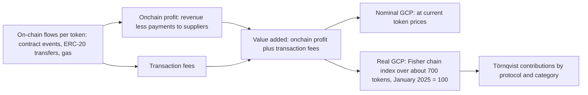

Eric Lu defines gross chain product, a GDP-style measure of on-chain value added, and shows that the C-Chain's real output fell 25% from January 2025 to March 2026, while its nominal output, which also moves with token prices, fell 60%.

<!-- overview-table:start -->

| | |
| --- | --- |
| **Authors** | Siyu (Eric) Lu |
| **Published** | May 7, 2026 |
| **Source** | LinkedIn, [original](https://www.linkedin.com/pulse/measuring-blockchain-economies-introducing-gross-chain-lu-phd-juj3c), [full text](/Phase-II/Wiki/Collections/Essential-Readings/Measuring-Blockchain-Economies-Introducing-Gross-Chain-Product/Source-Article) |
| **Topics** | [economic measurement](/tags/economic-measurement), [market conditions](/tags/market-conditions) |
| **Key terms** | gross chain product, value added, income approach, nominal GCP, real GCP, Fisher index, Törnqvist weights |
| **Serves deliverables** | [1.1](/Phase-II/Milestones/Milestone-1/1-1-Data-Ingestion/), [2.2](/Phase-II/Milestones/Milestone-2/2-2-Simulation-Execution/), [2.3](/Phase-II/Milestones/Milestone-2/2-3-KPI-Computation/), [3.2](/Phase-II/Milestones/Milestone-3/3-2-Scenario-Playbook/) |

<!-- overview-table:end -->

Eric Lu of the Avalanche Foundation published the article on May 7, 2026. It is the Foundation's first economy-wide measure of output on a blockchain, and the Foundation's [research agenda](/Phase-II/Wiki/Collections/Essential-Readings/The-Avalanche-Foundation-Unveils-its-Economic-Research-Agenda/), published in July, builds its measure step on it. The article asks "how much genuine economic value is being created on-chain, and is that number growing or contracting?" It argues that common metrics answer other questions. Total value locked measures a stock of capital, some of it idle. Market capitalization reflects sentiment and speculation. One protocol's revenue does not add up to a picture of the whole economy.

**Gross chain product** (GCP) applies the **income approach** of national accounts. A protocol's **value added** is its onchain profit, which is revenue less the part paid to supply-side participants such as oracles and incentives, plus the transaction fees its users pay on the C-Chain. GCP sums value added across all protocols. Flows come from decoded contract events, ERC-20 transfers, and gas traces, and each is recorded per token at its price at the time of the transaction. **Nominal GCP** values output at current prices. **Real GCP** removes price changes. It uses the **Fisher index**, the geometric mean of Laspeyres growth, at last period's prices, and Paasche growth, at this period's prices, across roughly 700 tokens. The index is chained month to month and anchored at 100 in January 2025. **Törnqvist weights** then attribute real growth to protocols and categories.

For the C-Chain from January 2025 to March 2026 the article finds three phases. On April 7, 2025, a liquidation cascade produced over \$13M of GMX V1 revenue in one day, and the real index for April reached 238, a one-off rather than an expansion. From May to October 2025 the real index rose from 96 to 196, and nominal GCP rose from \$9.5M to a peak of \$21.0M. After an October shock, real GCP fell 30% in November, to 137, and reached 82 in February 2026. By March 2026 nominal GCP was 60% below the January 2025 base while the real index stood at 75. The gap between the two is the part of the fall caused by token prices. By token, WAVAX and AVAX gas quantities rose 42% and 35%, while USDT fell 19% and USDC 51%.

The C-Chain is mostly a financial intermediation economy. Lending and DEXs account for "well over 80%" of protocol revenue since January 2025 and for most of the decline. Lending, which includes Benqi and Aave, was the largest source, and its real index fell 68% after the October 2025 peak. Real-world assets rose more than 7x by November 2025, driven by BlackRock BUIDL, and stood about 1.6x the base in March 2026. Over the full history from February 2021, the 2021 decline was 87% and the current cycle 69% from the April 2025 peak. The active token basket shrank from 227 tokens to 102. The article concludes that uses whose revenue does not depend on token price cycles would make GCP more resilient.

*How the article builds gross chain product. Value added is summed across protocols and then read two ways: at current prices, which move with the market, and at constant prices, which isolate activity. The article's figures are not reproduced here, so this diagram is drawn from Part 2 of its text.*

## How it relates to our research

**It separates the two environment axes of our sweep.** Deliverable [2.2](/Phase-II/Milestones/Milestone-2/2-2-Simulation-Execution/) varies market condition (bull, neutral, bear) and network growth (low, medium, high) as separate settings, and deliverable [3.2](/Phase-II/Milestones/Milestone-3/3-2-Scenario-Playbook/) pairs such conditions with parameter adjustments. The article's split of nominal from real output matches that design. Real GCP is a measured activity series separate from the AVAX price, so it can anchor the network growth axis while the price anchors market condition. Single events move the real index, as April 2025 shows, so a scenario built on it should use a smoothed or event-adjusted path and say which.

**It sets a units rule for the KPIs.** Staking rewards are paid in AVAX. A KPI reported in USD mixes a price change with a quantity change, and the article's 60% nominal fall against a 25% real fall shows how large that mixing can be. The KPIs of deliverable [2.3](/Phase-II/Milestones/Milestone-2/2-3-KPI-Computation/) should therefore be reported in AVAX, with any USD value labeled as price-dependent.

**One term of value added already reaches AVAX holders.** C-Chain transaction fees are burned in full, so the fee term is the one part of GCP that accrues to AVAX today. Net inflation, one of the proposal's KPIs, needs the burn as its outflow. Deliverable [1.1](/Phase-II/Milestones/Milestone-1/1-1-Data-Ingestion/) ingests daily C-Chain fees, so our data give the burn in AVAX directly. The fee term inside GCP is smaller than the whole-chain burn, because it counts only fees mapped to protocols, as the [GCI article](/Phase-II/Wiki/Collections/Essential-Readings/From-Gross-Chain-Product-to-Gross-Chain-Income-Where-the-Value-Goes/) notes.

**It gives no link to staking.** GCP measures C-Chain production. It excludes P-Chain staking rewards and issuance, and the article does not relate GCP to validator income or to staking choices. The model therefore treats GCP as an external input unless such a relation is estimated. The article also plots real GCP beside the AVAX price from February 2021. Any estimate that relates these trending series to staking should follow [Spurious Regressions](/Phase-II/Wiki/Collections/Supplementary-Research-Papers/1974-Spurious-Regressions) and test on changes as well as levels. The article measures the C-Chain only. It says the method extends to L1s with sufficient on-chain data but does not measure them.

**Lending ties it to our other sources.** The largest contraction was in lending. On-chain lending is the outside option in [Competitive Equilibria Between Staking and On-Chain Lending](/Phase-II/Wiki/Collections/Supplementary-Research-Papers/2020-Staking-and-Lending-Equilibria/), where stake leaves validation when lending pays more. The article reports lending output, not lending rates, so it cannot replace a yield series. BENQI appears in the article's lending category, and [BENQI told us](/Phase-II/Interviews/BENQI-2026-08-31/) that its liquid staking holds 10% to 12% of all stake, so one protocol sits on both sides of that choice. The GCI article extends the series to income from January 2024 to June 2026. Its chart's nominal line matches this article's May and October 2025 values, \$9.5M and \$21.0M, and its 60% nominal fall to March 2026, so the two appear to use one series, though neither article says so.

**Open question for the Foundation.** Can the Foundation share the monthly nominal and real GCP series, in total and by category, so that the scenario inputs match the published figures?

## Source

Siyu (Eric) Lu. 2026. Measuring Blockchain Economies: Introducing Gross Chain Product. LinkedIn article, May 7, 2026. <https://www.linkedin.com/pulse/measuring-blockchain-economies-introducing-gross-chain-lu-phd-juj3c>. Read the [full article](/Phase-II/Wiki/Collections/Essential-Readings/Measuring-Blockchain-Economies-Introducing-Gross-Chain-Product/Source-Article), with its six figures. The Foundation blog edition has been removed, so the collection's copy is the author's LinkedIn edition.
