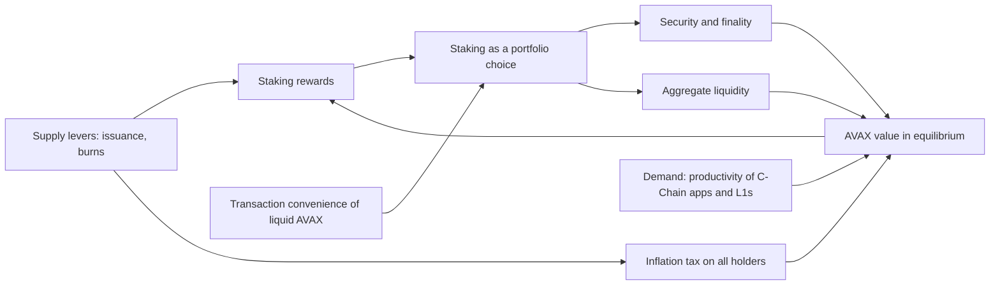

Read the [source](/Phase-II/Wiki/Collections/Essential-Readings/Value-Accrual-as-Equilibrium-How-We-Think-About-AVAX-Tokenomics/Source-Article).

*The article's argument. Supply levers and demand drivers meet in one equilibrium, and the reward rate is an outcome of it. The article has no figure, so this diagram is drawn from its text.*

## Question

Eric Lu published the article on March 19, 2026. It asks how to evaluate policy and design changes that affect AVAX value accrual when AVAX is both money-like, giving transaction convenience when liquid, and asset-like, earning staking rewards and voting rights when locked.

## Argument

The article adopts the general-equilibrium model of Cong, He, and Tang, summarized in [The Tokenomics of Staking](/Phase-II/Wiki/Collections/Supplementary-Research-Papers/2025-The-Tokenomics-of-Staking). The two roles of the token "must be evaluated in a general-equilibrium framework that ties transaction convenience, staking rewards, and platform adoption dynamics together in one system."

1. Policies move supply and demand together. Higher staking rewards improve security, which raises demand, and impose a higher inflation tax, which lowers it.
2. Staking is "a portfolio choice trading off staking rewards against a loss of transaction convenience."
3. Reward rates are "endogenous in equilibrium, not a dial you set and forget."
4. Emissions are redistribution. All holders pay the inflation tax pro rata. Because Avalanche burns all fees, all holders also receive fee revenue pro rata, "yet validators are the ones doing the work."

The section on adapting to Avalanche names two problems with the reference model. Network productivity is one reduced-form state variable, with no micro-foundation for the channels that governance can move. Fees flow to validators in the model, but Avalanche burns them. The article judges the first "the most important to overcome."

## Main results

The article is conceptual. It has no equations, data, or Avalanche estimates. Its output is a set of questions a policy must answer, in the section on endogenous reward rates: "what equilibrium aggregate staking does a policy produce? What does that do to transaction convenience and adoption? And what distributional effects does it create across users vs. stakers?"

## What it gives this research

1. A model form for deliverable [1.3](/Phase-II/Milestones/Milestone-1/1-3-Staking-Model-Spec/). A holder's split between liquid and staked AVAX, with a convenience cost of locking, is the Foundation's stated framing of the stake decision.
2. Report fields for deliverable [2.8](/Phase-II/Milestones/Milestone-2/2-8-Collaborative-Mechanism-Design/). The three questions become three outputs of every mechanism comparison: the equilibrium staking ratio, the liquid supply left for transactions, and the incidence of issuance and burn across non-stakers, delegators, and validators.
3. A KPI for deliverable [2.3](/Phase-II/Milestones/Milestone-2/2-3-KPI-Computation/). The proposal's KPIs include net inflation but not its incidence. The share of issuance received by stakers against the dilution borne by non-stakers states the redistribution the article describes.

## Limits and open questions

Reward rates on Avalanche are endogenous only in part. Each commitment's reward is fixed at its start by the formula, the stake, the duration, and the supply remaining to the cap. The rate per staked AVAX does not fall when more stake joins, except through that supply counter. The realized inflation rate does depend on how much is staked and for how long. The endogenous quantity for Avalanche is therefore issuance and its incidence, more than the reward rate.

The model has one kind of stake and no duration. Avalanche's reward rises with commitment duration, and that duration choice is where the [validator-rewards article](/Phase-II/Wiki/Collections/Essential-Readings/How-Do-Avalanche-Validators-Actually-Think-About-Staking-Rewards/Overview) finds validators respond.

The productivity problem the article ranks first is not solved here. The staking model keeps productivity and price as external inputs. An open question for the Foundation is which demand channel, C-Chain activity, L1 activity, or real-world assets, it wants modeled first.
