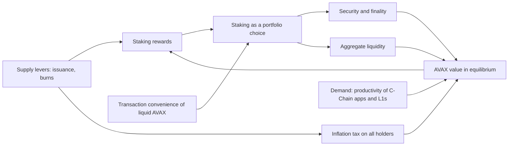

Eric Lu argues that AVAX value accrual is the equilibrium outcome of supply and demand forces acting together, in which staking is a portfolio choice between rewards and liquidity, reward rates are set by the equilibrium, and issuance works as an inflation tax on all holders.

<!-- overview-table:start -->

| | |
| --- | --- |
| **Authors** | Siyu (Eric) Lu |
| **Published** | March 19, 2026 |
| **Source** | LinkedIn, [original](https://www.linkedin.com/pulse/value-accrual-equilibrium-how-we-think-avax-siyu-eric-lu-phd-pokvc), [full text](/Phase-II/Wiki/Collections/Essential-Readings/Value-Accrual-as-Equilibrium-How-We-Think-About-AVAX-Tokenomics/Source-Article) |
| **Topics** | [token valuation](/tags/token-valuation), [distributional effects](/tags/distributional-effects), [issuance and rewards](/tags/issuance-and-rewards) |
| **Key terms** | transaction convenience, inflation tax, money-like, asset-like, supply-side levers, demand-side drivers, endogenous reward rate |
| **Serves deliverables** | [1.3](/Phase-II/Milestones/Milestone-1/1-3-Staking-Model-Spec/), [1.4](/Phase-II/Milestones/Milestone-1/1-4-Behavioral-Calibration/), [2.3](/Phase-II/Milestones/Milestone-2/2-3-KPI-Computation/), [2.8](/Phase-II/Milestones/Milestone-2/2-8-Collaborative-Mechanism-Design/) |

<!-- overview-table:end -->

Eric Lu of the Avalanche Foundation published the article on LinkedIn on March 19, 2026. It sets out the lens the Foundation uses to judge policy and design changes that affect AVAX value. Its starting point is that AVAX has two roles at once. It is **money-like**, because liquid tokens give their holders a **transaction convenience** flow. It is **asset-like**, because locked tokens earn staking rewards and voting rights. The article's claim is that the two roles cannot be valued separately.

The lens is the general-equilibrium model of [Cong, He, and Tang (2025)](/Phase-II/Wiki/Collections/Supplementary-Research-Papers/2025-The-Tokenomics-of-Staking), which ties transaction convenience, staking rewards, and platform adoption together in one system. The article uses it to move tokenomics debates past a split between "supply-side people" and "demand-side people." **Supply-side levers** are issuance policy and burn or buyback mechanics. **Demand-side drivers** are the productivity of C-Chain applications and Avalanche L1s. Policies often move both. Higher staking rewards improve security and raise demand, but they also impose a higher **inflation tax**, the dilution that issuance imposes on every holder, which lowers demand. In the article's words, "Equilibrium is where you see what you actually bought."

Four arguments follow. Staking is "a portfolio choice trading off staking rewards against a loss of transaction convenience," so more staking strengthens security but tightens liquidity. Reward rates are **endogenous**, "not a dial you set and forget." The right questions are what aggregate staking a policy produces, what that does to convenience and adoption, and how its effects fall on users and stakers. Emissions are redistribution, not free yield. All holders pay the inflation tax pro rata, and because Avalanche burns all transaction fees, all holders also receive fee revenue pro rata, "yet validators are the ones doing the work." Last, the framework forces each mechanism to name the channel it works through.

The article is conceptual. It has no equations, data, or Avalanche estimates. It names two problems to solve before the model can support policy. First, network productivity is one aggregate state variable, with no micro-foundation for the channels governance can move. Second, the model routes fees to validators, while Avalanche burns them. The article ranks the first as "the most important to overcome," because every program aimed at demand for AVAX works through that productivity process. It closes with three trade-offs a policy must state: how it changes the wedge between being liquid and being staked, how it shifts the incidence of the inflation tax or fee burn across users, holders, and validators, and whether it improves network fundamental value in a way that accrues through AVAX.

*The article's argument. Supply levers and demand drivers meet in one equilibrium, and the reward rate is an outcome of that equilibrium, not a setting. Follow the two paths from issuance: one raises rewards and security, the other taxes every holder. The article has no figure, so this diagram is drawn from its text.*

## How it relates to our research

**It is the Foundation's framing of the stake decision.** Deliverable [1.3](/Phase-II/Milestones/Milestone-1/1-3-Staking-Model-Spec/) specifies behavioral state variables for staking, unstaking, and restaking. The proposal drives the stake rate by the gap between the staking yield and external yields. The article adds a second cost, the lost convenience of liquid AVAX. The [Tokenomics of Staking](/Phase-II/Wiki/Collections/Supplementary-Research-Papers/2025-The-Tokenomics-of-Staking) page gives that cost a form, convex in the staked share, with a curvature $\beta$ and a scale $u$, and derives the staking ratio in closed form. Deliverable [1.4](/Phase-II/Milestones/Milestone-1/1-4-Behavioral-Calibration/) can calibrate those two parameters from the level of Avalanche's staking ratio and its change across upgrade periods.

**On Avalanche, reward rates are endogenous only in part.** In the reference model all stakers share one reward pool, so the rate per staked token falls as stake joins. On Avalanche each commitment's reward is fixed at its start by the reward formula, from the stake, the duration, and the supply remaining to the 720,000,000 AVAX cap. The rate per staked AVAX does not fall when more stake joins, except through the supply counter. What the equilibrium does set is realized issuance and who bears it, since issuance depends on how much is staked and for how long. The reference model also has no duration. Avalanche's reward rises with commitment length, and that length is where the [validator rewards article](/Phase-II/Wiki/Collections/Essential-Readings/How-Do-Avalanche-Validators-Actually-Think-About-Staking-Rewards/) finds validators respond.

**The protocol settles part of the fee problem.** The burn lowers the realized total supply, so it benefits every holder. The reward formula, however, reads the P-Chain supply counter, which does not subtract C-Chain burns, as the [ACP-283 page](/Phase-II/Wiki/Collections/Economic-ACPs/ACP-283-Dynamic-Minimum-Gas-Price/) records. The burn therefore leaves staking rewards unchanged. In our model fees enter through net inflation, not validator income, unless a mechanism evaluated in deliverable [2.8](/Phase-II/Milestones/Milestone-2/2-8-Collaborative-Mechanism-Design/) routes a share to validators.

**The article's questions become model outputs.** Every mechanism comparison in deliverable 2.8 can report the equilibrium staking ratio, the liquid supply left for transactions, and the incidence of issuance and burn across non-stakers, delegators, and validators. The proposal's KPIs in deliverable [2.3](/Phase-II/Milestones/Milestone-2/2-3-KPI-Computation/) include net inflation but not its incidence. Setting the share of issuance received by stakers against the dilution borne by non-stakers states the redistribution the article describes. Both sides can be computed from the realized total supply and the unstaked supply, which the [glossary](/Phase-II/Wiki/Reference/Glossary-and-Notation) defines from our daily supply replay.

**Other sources test and extend the framing.** The [January model images](/Phase-II/Wiki/Collections/Essential-Readings/January-Staking-and-Price-Model-A-Three-Image-Reconstruction/) appear to specialize the same model, a reading that needs the author's confirmation. The [Ethereum staking market framework](/Phase-II/Wiki/Collections/Supplementary-Research-Papers/2025-Ethereum-Staking-Market-Framework) shows why incidence matters: in its calibration, an issuance cut lowers total stake by 25.4% and solo stakers' profit per ETH by 75%. The trade-off between liquidity and reward is also weaker for part of the stake than the article assumes. A **liquid staking token** earns the reward while staying tradable, and BENQI told us that it holds 10% to 12% of all stake. The article's view of reward rates as policy is carried further by the [Static Constants article](/Phase-II/Wiki/Collections/Essential-Readings/From-Static-Constants-to-Dynamic-Variables-Where-Avalanches-Economics-Are-Headed/) and by [Control Theory for Monetary Policy](/Phase-II/Wiki/Collections/Supplementary-Research-Papers/2021-Control-Theory-for-Monetary-Policy/), which tunes a rate that responds to network state.

**Open questions for the Foundation.** The article ranks productivity first, and our model keeps productivity and price as external inputs. Which demand channel should be modeled first: C-Chain activity, L1 activity, or real-world assets? Should holders of liquid staking tokens count as liquid, as staked, or as both in the convenience cost?

## Source

Siyu (Eric) Lu. 2026. Value Accrual as Equilibrium: How We Think About AVAX Tokenomics. LinkedIn article, March 19, 2026. <https://www.linkedin.com/pulse/value-accrual-equilibrium-how-we-think-avax-siyu-eric-lu-phd-pokvc>. Read the [Source Article](/Phase-II/Wiki/Collections/Essential-Readings/Value-Accrual-as-Equilibrium-How-We-Think-About-AVAX-Tokenomics/Source-Article), a reading copy of the article. The reference model is Lin William Cong, Zhiheng He, and Ke Tang, The Tokenomics of Staking, NBER Working Paper 33640, 2025, <https://www.nber.org/papers/w33640>.
