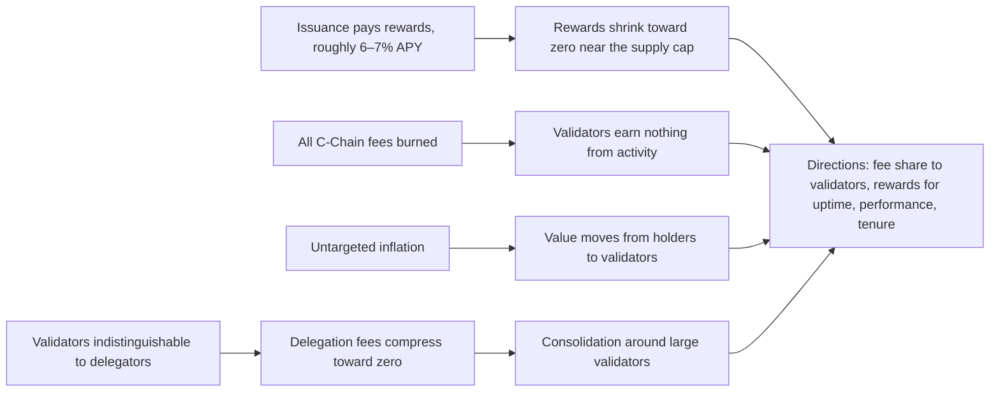

Read the [source](/Phase-II/Wiki/Collections/Essential-Readings/Why-Avalanche-Validator-Economics-Need-a-Redesign/Source-Article). The collection holds a guide to this article rather than a copy. The original X address does not reliably open, and this overview follows a dated capture of the article text.

*The article's four problems and the directions it proposes. The article has no figure, so this diagram is drawn from its text.*

## Question

Matias Antonio, Chief Investment Officer of the Avalanche Foundation, published the article on April 2, 2026. It asks whether validator economics "designed for an earlier stage" can keep Avalanche secure as the network matures, and answers that they cannot without redesign.

## Argument

The article names four problems, each in its own section.

1. Inflation as the sole revenue source has an expiration date. Validators earn "roughly 6–7% APY paid in newly minted AVAX." Issuance is finite, so rewards shrink toward zero as supply approaches the cap, and security "becomes a depreciating asset."
2. Validators have no alignment with C-Chain success. All C-Chain fees are burned, and "Validators don't see a cent of it." The article proposes researching whether some portion of fees could flow to validators.
3. Inflation is dilutive. Untargeted inflation "silently transfers value from holders to validators." Inflation should reward "uptime, performance, ecosystem contribution."
4. Validator markets are perfectly competitive. Commission is "the only real differentiator," so delegation fees fall as validators undercut each other, smaller operators become unviable, and stake consolidates. The proposed direction is fee structures that reward "longevity and proven track record," and the article cites the delegation multipliers of ACP-247.

## Main results

The article is a diagnosis and reports no data. Its one number is the 6–7% APY. It gives no measurement of fee levels, operator costs, or stake concentration. Its claim that the burn weakens as a value-accrual channel refers to an earlier thread of the author's that is not in this collection.

## What it gives this research

1. Mechanisms for deliverable [2.8](/Phase-II/Milestones/Milestone-2/2-8-Collaborative-Mechanism-Design/). The agreement's example mechanisms, node-age weighting and activity multipliers, correspond to the article's rewards for tenure and its fee revenue tied to usage. The article is the Foundation's stated reason for testing them.
2. Two claims to test in the data of deliverable [1.1](/Phase-II/Milestones/Milestone-1/1-1-Data-Ingestion/). Fee compression is visible in the P-Chain record as the distribution of delegation fees over time against the 2% protocol minimum. Consolidation is visible as the concentration of stake across validators. Both enter the KPIs of deliverable [2.3](/Phase-II/Milestones/Milestone-2/2-3-KPI-Computation/) as validator profitability and decentralization.
3. A failure condition for deliverable [2.6](/Phase-II/Milestones/Milestone-2/2-6-Risk-Surface-Map/). A region of parameters where rewards fall below the cost of running a validator is a region where incentives fail in the article's sense.

## Limits and open questions

Operator costs are not recorded on-chain. Validator profitability therefore needs a cost figure from the Foundation or from validators, and the research has none yet.

The 6–7% APY is a headline figure. The rate a validator receives depends on commitment duration and on the remaining-supply factor in the reward formula, as the [Static Constants article](/Phase-II/Wiki/Collections/Essential-Readings/From-Static-Constants-to-Dynamic-Variables-Where-Avalanches-Economics-Are-Headed/Overview) explains.

The claim that commission is the only differentiator conflicts with the Foundation's own estimate. The [validator-rewards article](/Phase-II/Wiki/Collections/Essential-Readings/How-Do-Avalanche-Validators-Actually-Think-About-Staking-Rewards/Overview) finds that delegators prefer larger validators, a coefficient of +0.29 on log stake. Size already differentiates validators, and the model should let it.

The proposed mechanisms are directions without schedules. No fee share, tenure weighting, or performance measure is specified, so each needs a concrete form agreed with the Foundation before it can be simulated.
