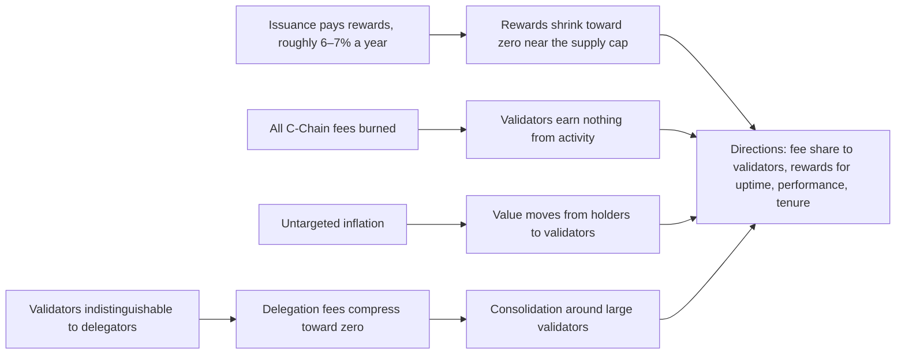

Matias Antonio argues that Avalanche validator economics, funded almost entirely by new issuance, will not keep the network secure as it matures, and names fee revenue for validators and rewards for performance and tenure as the directions the Foundation is researching.

<!-- overview-table:start -->

| | |
| --- | --- |
| **Authors** | Matias Antonio |
| **Published** | April 2, 2026 |
| **Source** | X, [original](https://x.com/i/article/2038984867807993857), [full text](/Phase-II/Wiki/Collections/Essential-Readings/Why-Avalanche-Validator-Economics-Need-a-Redesign/Source-Article) |
| **Topics** | [validator economics](/tags/validator-economics), [security budget](/tags/security-budget), [delegation market](/tags/delegation-market), [mechanism design](/tags/mechanism-design) |
| **Key terms** | [supply cap](/Phase-II/Wiki/Reference/Glossary-and-Notation), fee burn, untargeted inflation, commission, fee compression, consolidation, operator costs |
| **Serves deliverables** | [1.1](/Phase-II/Milestones/Milestone-1/1-1-Data-Ingestion/), [2.3](/Phase-II/Milestones/Milestone-2/2-3-KPI-Computation/), [2.6](/Phase-II/Milestones/Milestone-2/2-6-Risk-Surface-Map/), [2.8](/Phase-II/Milestones/Milestone-2/2-8-Collaborative-Mechanism-Design/) |

<!-- overview-table:end -->

Matias Antonio, Chief Investment Officer of the Avalanche Foundation, published the article on X on April 2, 2026, as a follow-up to an earlier thread of his on AVAX tokenomics. It is a diagnosis rather than an analysis of data. Its claim is that validator economics on most proof-of-stake chains "were designed for an earlier stage," and that the incentives which launched these networks will not sustain them. The article is short, reports no data of its own, and ends by asking the community which problem is most urgent and at what point running a node stops making sense.

Avalanche validators are paid a **staking reward** in newly minted AVAX, which the article puts at roughly 6 to 7% a year. The **supply cap** of 720 million AVAX means this issuance is finite. As supply approaches the cap, rewards shrink toward zero, and a **security budget** paid only from issuance "becomes a depreciating asset." Meanwhile all **C-Chain transaction fees are burned**, so the activity that makes the network valuable pays validators nothing. The article calls the **fee burn** a weakening channel of value accrual as well, a point it refers back to the earlier thread for.

Two further problems concern who the rewards reach. **Untargeted inflation** transfers value from holders to validators whatever the validators do, and the article would instead use inflation "surgically" to reward uptime, performance, and ecosystem contribution. The **delegation market** is close to perfectly competitive: to a delegator one validator looks much like another, so **commission** is the only lever, fees are undercut toward zero, small independent operators become unviable, and stake **consolidates** around a few large validators. The proposed answer is market design rather than code: fee structures that reward **longevity and a proven track record**. The article credits the **delegation multipliers** of ACP-247 as community work in this direction.

*The article's four problems and the directions it proposes. The article has no figure, so this diagram is drawn from its text.*

## How it relates to our research

**It states why the mechanisms are on the agenda.** Deliverable [2.8](/Phase-II/Milestones/Milestone-2/2-8-Collaborative-Mechanism-Design/) names **node-age weighting** and **activity multipliers** as example mechanisms, and these are the article's rewards for tenure and its fee revenue tied to usage. The article is the Foundation's stated reason for testing them. It gives each only as a direction, with no fee share, tenure schedule, or performance measure, so each needs a concrete form agreed with the Foundation before it can be simulated. The community proposals in the [Economic ACPs](/Phase-II/Wiki/Collections/Economic-ACPs/) collection supply some of those forms: [ACP-247](/Phase-II/Wiki/Collections/Economic-ACPs/ACP-247-Delegation-Multiplier/) specifies delegation multipliers, and [ACP-267](/Phase-II/Wiki/Collections/Economic-ACPs/ACP-267-Uptime-Requirement/) sets the uptime standard a performance reward would build on.

**Two claims we can check in the data.** The P-Chain record we ingest for deliverable [1.1](/Phase-II/Milestones/Milestone-1/1-1-Data-Ingestion/) shows both of the article's market claims. **Fee compression** appears as the distribution of delegation fees over time against the 2% protocol minimum. **Consolidation** appears as the concentration of stake across validators, measured by stake-weighted shares rather than validator count. Both become key performance indicators in deliverable [2.3](/Phase-II/Milestones/Milestone-2/2-3-KPI-Computation/), so every parameter setting in the sweeps reports what it does to fees and to concentration.

**Commission is not the only differentiator.** The article treats validators as indistinguishable apart from commission. The Foundation's [validator rewards article](/Phase-II/Wiki/Collections/Essential-Readings/How-Do-Avalanche-Validators-Actually-Think-About-Staking-Rewards/) estimates that delegators also prefer larger validators, with a coefficient of +0.29 on log stake. Size already gives large validators an advantage, which pushes toward the consolidation the article describes. Our delegator model lets both commission and size decide where stake goes, so a mechanism such as tenure weighting can be judged by whether it offsets the size advantage.

**The security budget sets a failure region.** The article's first problem defines a region for the risk map of deliverable [2.6](/Phase-II/Milestones/Milestone-2/2-6-Risk-Surface-Map/): parameter settings where a validator's rewards fall below the cost of running one. **Operator costs** are not recorded on-chain, so this boundary needs a cost figure from the Foundation or from validators. The 6 to 7% figure is also a headline rate. What a validator actually receives depends on its commitment length and on the remaining-supply factor in the reward formula, which the [Static Constants article](/Phase-II/Wiki/Collections/Essential-Readings/From-Static-Constants-to-Dynamic-Variables-Where-Avalanches-Economics-Are-Headed/) explains. [Competitive Equilibria Between Staking and On-Chain Lending](/Phase-II/Wiki/Collections/Supplementary-Research-Papers/2020-Staking-and-Lending-Equilibria/) adds the second half of the condition: rewards must also stay above what the same AVAX earns elsewhere.

**Fee revenue connects to the value-capture articles.** Paying validators from fees depends on how much value the chain captures. The [Gross Chain Income article](/Phase-II/Wiki/Collections/Essential-Readings/From-Gross-Chain-Product-to-Gross-Chain-Income-Where-the-Value-Goes/) shows that AVAX captures only the C-Chain fee burn today, a small and cyclical share of on-chain value. A fee share for validators would therefore be small and volatile at current levels, and the model has to show how much of the security budget it could replace at different levels of activity.

**Open questions for the Foundation.** What share of fees is on the table, and would it come out of the burn? How should tenure and performance be measured? Can the Foundation or its validators provide operator costs?

## Source

Matias Antonio. 2026. Why Avalanche Validator Economics Need a Redesign. X article, April 2, 2026. <https://x.com/i/article/2038984867807993857>. Read the [full article](/Phase-II/Wiki/Collections/Essential-Readings/Why-Avalanche-Validator-Economics-Need-a-Redesign/Source-Article). The Foundation blog edition has been removed and the X article does not open without signing in, so the collection's copy was taken from the X article on 2026-09-29.
