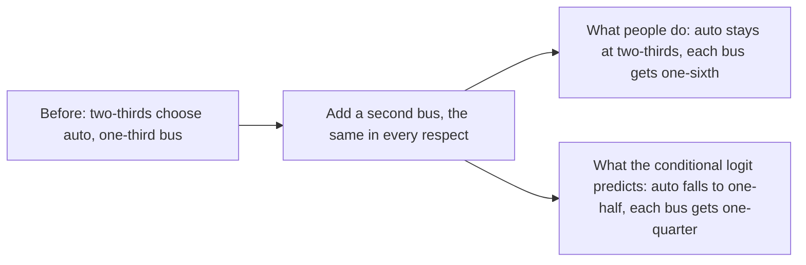

Daniel McFadden derives the conditional logit model from a population of utility maximizers whose tastes vary at random, shows how to estimate and test it, and names its main limit, and the Foundation now uses this model for a validator's choice of duration and delegation fee.

McFadden, then at the University of California, Berkeley, wrote the chapter for *Frontiers in Econometrics*, a 1973 volume edited by Paul Zarembka. His starting point is that economists observe the choices of a population, not the rule inside each person's head. When the alternatives are **qualitative**, such as a travel mode, a college, or an occupation, a small change in conditions cannot move each person a little. It moves some people from one alternative to another. Changes in aggregate choice must then come from a **distribution of decision rules** across the population. The chapter sets out how to build an econometric model of population choice from such a distribution, and works one case through in detail.

The case is **random utility**. Each person's utility from an alternative is a systematic part $v$, shared by people with the same measured traits, plus a random part $\varepsilon$ that reflects individual tastes. The chapter starts from an axiom due to Luce, **independence of irrelevant alternatives**: the odds of choosing one alternative over another do not depend on what else is on the menu. It proves that if the random parts are independent draws from the **extreme value distribution**, utility maximization gives exactly the choice probabilities the axiom implies, and that under mild conditions only that distribution does. With $v$ linear in the attributes $z$ of each alternative and taste coefficients $\theta$, the probability that person $n$ chooses alternative $i$ from menu $B_n$ is

$$P_{in} = \frac{e^{z_{in}\theta}}{\sum_{j \in B_n} e^{z_{jn}\theta}}.$$

McFadden calls this the **conditional logit model**. It extends the multinomial logit to menus that differ from one observation to the next, and he writes that its derivation from a theory of population choice "appears to be new". Estimation is by **maximum likelihood**. The log-likelihood is concave, and under a full-rank condition on the data it has a unique maximum whenever one exists. The chapter proves the estimator consistent and asymptotically normal, gives a likelihood ratio test, and defines $\rho^2$, a fit measure analogous to $R^2$ in linear regression. Its worked examples suggest the estimator behaves well at sample sizes of 50 and above.

The application reproduces work by Domencich and McFadden on a 1967 household survey in Pittsburgh. In a model of 140 shopping trips by car or transit, the coefficients imply a value of walking time of \$5.46 per hour and of in-vehicle time of \$0.95 per hour. The model gives the actual mode a probability above one half for 133 of the 140 trips, and above 0.9 for 116. In a model of 63 car trips with three to five possible destinations, it picks the actual destination in 29 cases, against 16 expected by chance. The chapter is equally direct about the axiom's cost. It calls independence of irrelevant alternatives "implausible for alternative sets containing choices that are close substitutes", and limits the model to alternatives that each decision maker weighs as distinct.

*McFadden's own example of the model's main limit, drawn from the chapter's text. People treat a near copy of an old option as the same choice, so the new bus should take riders only from the old bus. The conditional logit instead takes share from every option in proportion. Two staking durations a day apart are near copies in the same way.*

## How it relates to our research

**It is the validator model in the Foundation's article.** In [How Do Avalanche Validators Actually Think About Staking Rewards?](/Phase-II/Wiki/Collections/Essential-Readings/How-Do-Avalanche-Validators-Actually-Think-About-Staking-Rewards/), Eric Lu models each validator as picking one configuration of duration and fee from a menu, to maximize yield income plus fee income less the cost of locking capital. The article cites the chapter as McFadden 1974. It estimates the model on 278 weeks of P-Chain data with 1.5 million validator choice-set alternatives, and finds that validators need about 0.80 to 0.85 percentage points a year of extra yield to accept one more week of duration. Reproducing that **marginal rate of substitution** on the same data is the first check in deliverable [1.4](/Phase-II/Milestones/Milestone-1/1-4-Behavioral-Calibration/) that our data and our estimator match the published model.

**It prices a new menu.** Once tastes are estimated, a protocol change alters only the menu and the attributes of each option, and the same formula gives the new choice shares. The chapter makes this argument for transit fares and wait times. In the staking model of deliverable [1.3](/Phase-II/Milestones/Milestone-1/1-3-Staking-Model-Spec/), [ACP-273](/Phase-II/Wiki/Collections/Economic-ACPs/ACP-273-Minimum-Validator-Duration/) adds validator durations from 48 hours up, and [ACP-285](/Phase-II/Wiki/Collections/Economic-ACPs/ACP-285-Minimum-Consumption-Rate/) lowers the reward on short durations as the minimum consumption rate falls from 10% to 7.5%. Both enter as changes to the menu that validators face.

**What we can check in the data.** The chapter's identification rule holds for Avalanche data directly: a variable that is the same for every option on a menu, such as the AVAX price in a given week, cannot enter on its own, because it shifts every utility equally. It can enter only through an interaction with an option's attributes. The Foundation's optionality cost, duration multiplied by volatility, is such an interaction. The chapter also shows how to test a left-out variable, by regressing the model's weighted residuals on it. That gives a check on variables the article does not use, such as a validator's uptime or tenure.

**Where Avalanche differs, and how we adapt.** Independence of irrelevant alternatives matters most for the duration menu. Durations of 14 and 15 days are close substitutes, as the auto and bus example warns. The model predicts that a new 48-hour option draws from every duration in proportion, while one would expect it to draw mainly from short durations. Eric Lu's reply in the ACP-273 discussion reports that about 16% of validating nodes chose the 14-day minimum. A nested or mixed logit relaxes the axiom, and we will test whether it fits better. The model also gives every validator the same tastes unless types are added, and it treats each node as a separate chooser, while one operator can run many nodes. Finally, the first post-Helicon data are thin. The [25 September brief](/Phase-II/Wiki/Briefs/2026-09-25-sprint-8/) counted 20 validator commitments under the new rules by 24 September, two of them at 48 hours. The chapter's examples show the estimator behaving well from about 50 observations, so tastes on the new menu should wait for at least that many.

**How it connects to the other pages.** [Berry 1994](/Phase-II/Wiki/Collections/Supplementary-Research-Papers/1994-Discrete-Choice-Demand-Estimation) supplies the delegator side of the same article. [Rust 1987](/Phase-II/Wiki/Collections/Supplementary-Research-Papers/1987-Optimal-Replacement-of-Bus-Engines) extends the conditional logit to choices with future consequences, such as whether to renew a commitment, and shows that McFadden's static model is the special case in which today's choice does not change tomorrow's options. The [BENQI interview](/Phase-II/Interviews/BENQI-2026-08-31/) shows how one rule shapes the menu. BENQI leaned toward two-day commitments after Helicon, but delegations still need 14 days, so it could shorten them only through validators it runs itself.

**Open question for the Foundation.** Does the article's estimate treat each node as one chooser, or group nodes by operator?

## Source

Daniel McFadden. 1973. Conditional logit analysis of qualitative choice behavior. In Paul Zarembka, editor, *Frontiers in Econometrics*, pages 105 to 142. New York: Academic Press. The chapter has no DOI. Author's reprint: <https://eml.berkeley.edu/reprints/mcfadden/zarembka.pdf>. The Foundation's article cites it as 1974.
