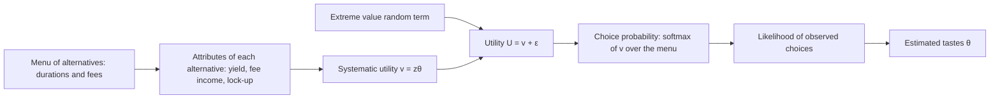

The Foundation's [validator rewards article](/Phase-II/Wiki/Collections/Essential-Readings/How-Do-Avalanche-Validators-Actually-Think-About-Staking-Rewards/) models each validator as picking one staking configuration, a duration and a delegation fee, from a menu. It estimates that choice with McFadden's conditional logit. This chapter is where the model comes from, and where its main restriction is stated.

## Citation

Daniel McFadden. 1973. Conditional logit analysis of qualitative choice behavior. In Paul Zarembka, editor, Frontiers in Econometrics, pages 105 to 142. New York: Academic Press. Author's reprint: <https://eml.berkeley.edu/reprints/mcfadden/zarembka.pdf>. The chapter has no DOI. The Foundation's article cites it as 1974.

## Question and method

The chapter asks how a population's choices among discrete alternatives follow from each person maximizing a random utility, and how the resulting model can be estimated and tested. Utility of alternative $j$ for decision maker $n$ is a systematic part plus a random term, $U_{nj} = v_{nj} + \varepsilon_{nj}$. If the random terms are independent draws from the extreme value distribution, the probability of choosing $i$ from the set $B$ is

$$P_{ni} = \frac{e^{z_{ni}\theta}}{\sum_{j \in B} e^{z_{nj}\theta}},$$

where $z_{nj}$ are the attributes of alternative $j$ as $n$ faces it and $\theta$ the taste coefficients. The model is estimated by maximum likelihood, and the chapter shows the likelihood is strictly concave, so the estimate is unique.

## Main result

The chapter's application reports results of Domencich and McFadden, 1972, on a 1967 Pittsburgh household survey. In a binary model of 140 shopping trips by car or transit, the coefficients imply a value of walking time of USD 5.46 per hour and of in-vehicle time of USD 0.95 per hour. The model gives the actual mode a probability above 0.5 for 133 of 140 trips and above 0.9 for 116. In a destination model of 63 car trips with three to five alternatives, it picks the actual destination in 29 cases, against 16 expected by chance.

The chapter also states the model's main restriction. The conditional logit implies independence of irrelevant alternatives: the ratio of two alternatives' probabilities does not depend on what else is on the menu. McFadden calls this "implausible for alternative sets containing choices that are close substitutes."

## What it gives this research

1. The estimator for validator choice in deliverable [1.4](/Phase-II/Milestones/Milestone-1/1-4-Behavioral-Calibration/). The Foundation's article estimates it on 278 weeks of P-Chain data with 1.5 million validator choice-set alternatives. It finds a marginal rate of substitution of about 0.8 percentage points of annualized yield per extra week of duration. Reproducing that figure is the first check that our data and our estimator match the published model.
2. A way to price a new menu in deliverable [1.3](/Phase-II/Milestones/Milestone-1/1-3-Staking-Model-Spec/). Once tastes are estimated, a proposed rule such as ACP-273's 48-hour minimum changes only the menu and its attributes, and the same formula gives the new choice shares.

## Limits for Avalanche

Independence of irrelevant alternatives matters here. Durations of 14 and 15 days are close substitutes, and adding a 2-day option after Helicon takes share mainly from the shortest durations, not from all durations in proportion. A nested or mixed logit relaxes the restriction. Tastes are the same for every validator unless the model adds types, while the validator set mixes single-node operators with operators that run hundreds of nodes. A variable that does not vary within a menu, such as the AVAX price in a given week, cannot enter as an attribute on its own.
