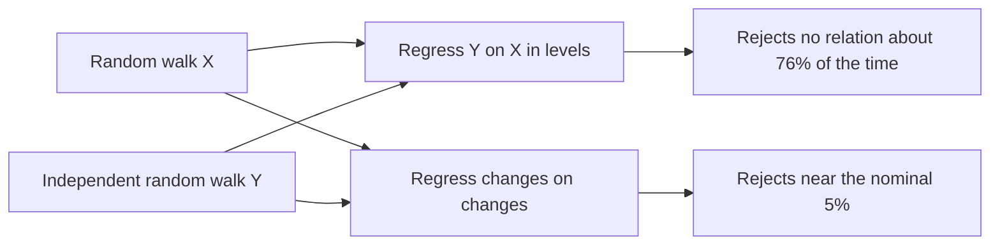

The contract's acceptance test for the staking model is a correlation above 0.90 between simulated and observed staking. Granger and Newbold show why that number alone is weak evidence. Two series that trend over time will often correlate strongly when they are unrelated. A model can pass by drifting in the right direction, and fail while matching every mechanism but one shock.

## Citation

C. W. J. Granger and P. Newbold. 1974. Spurious regressions in econometrics. Journal of Econometrics 2, no. 2: 111 to 120. DOI [10.1016/0304-4076(74)90034-7](https://doi.org/10.1016/0304-4076(74)90034-7).

## Question and method

The paper asks what can be inferred from time-series regressions with a high $R^2$ and a very low Durbin-Watson statistic. By simulation, it regresses one series on another when the two are independent random walks,

$$Y_t = \beta_0 + \beta_1 X_t + e_t, \qquad X_t - X_{t-1} = a_t, \quad Y_t - Y_{t-1} = b_t,$$

with $a_t$ and $b_t$ independent standard normal shocks, series of length 50, and 100 replications. It counts how often the usual t-test rejects $\beta_1 = 0$ at the 5% level, and repeats the exercise with more regressors, with smoother series, and on first differences.

## Main result

The null of no relation is "rejected (wrongly) on approximately three-quarters of all occasions". With one regressor the rejection rate is 76%, the average Durbin-Watson statistic 0.32, and the average adjusted $R^2$ 0.26. With five independent regressors the rejection rate rises to 96% and 37% of regressions have an adjusted $R^2$ above 0.7. On first differences the rejection rate falls to between 2% and 10%. The authors state that "a high value for $R^2$ or $\bar R^2$, combined with a low value of d, is no indication of a true relationship."

## What it gives this research

1. A reason and a remedy for deliverable [2.4](/Phase-II/Milestones/Milestone-2/2-4-Validation-Confirmation/). The correlation is reported twice, on levels as the contract asks and on weekly changes, where a trend cannot produce it. A model that correlates on levels but not on changes has matched the trend, not the dynamics.
2. A benchmark to beat. A naive forecast that holds the staking ratio at its starting value, or extends its trend, sets the correlation any model gets for free. The staking model's fit is reported against that benchmark.

## Limits for Avalanche

The simulations are small, 100 replications of 50 points, and the paper gives no asymptotic theory. The authors note that first differencing is "not ... a universal sure-fire solution" and recommend models in both levels and changes. For Avalanche, weekly changes in the staking ratio are small and noisy, so a correlation on changes will usually be lower than on levels. Its pass band has to be set with that in mind, before the fit is run.
