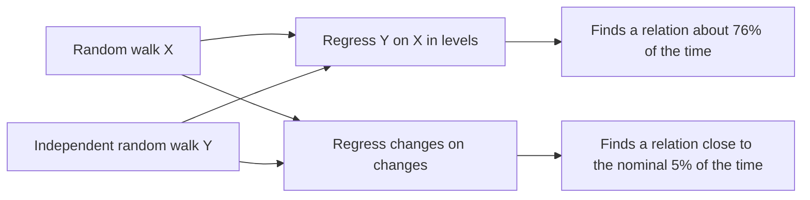

C. W. J. Granger and P. Newbold show that regressing one random walk on another, unrelated one finds a significant relation about three times in four, which is why a high correlation between two trending series is weak evidence of a good model.

<!-- overview-table:start -->

| | |
| --- | --- |
| **Authors** | C. W. J. Granger, P. Newbold |
| **Published** | July 1974 |
| **Source** | *Journal of Econometrics*, [original](https://doi.org/10.1016/0304-4076(74)90034-7) |
| **Topics** | [model validation](/tags/model-validation) |
| **Key terms** | spurious regression, random walk, Durbin-Watson statistic, first differences, R-squared |
| **Serves deliverables** | [2.4](/Phase-II/Milestones/Milestone-2/2-4-Validation-Confirmation/) |

<!-- overview-table:end -->

The paper appeared in the *Journal of Econometrics* in July 1974. No free full text is available and the publisher's record carries no abstract, so this summary rests on the published record of the paper's method and results. It asks what can be inferred from a time-series regression with a high $R^2$, the share of variation a regression explains, and a very low **Durbin-Watson statistic**. The Durbin-Watson statistic tests whether a regression's errors are correlated from one period to the next. It is near 2 when they are not and near 0 when each error closely follows the last.

The background is the **random walk**, a series in which each value is the last value plus a new random shock. A random walk has no fixed level to return to, so it drifts, and over a short stretch it often appears to trend. Two independent random walks will often drift in the same direction for a while. A regression of one on the other then finds a relation that exists only in the sample. This is what the title calls a **spurious regression**.

The method is simulation. The authors generate two independent random walks and regress one on the other,

$$Y_t = \beta_0 + \beta_1 X_t + e_t, \qquad X_t - X_{t-1} = a_t, \quad Y_t - Y_{t-1} = b_t,$$

with $a_t$ and $b_t$ independent standard normal shocks and series of length 50. Over 100 replications they count how often the usual t-test rejects $\beta_1 = 0$ at the 5% level, when the true answer is that no relation exists. They repeat the exercise with more regressors, with smoother series, and with the regression run on **first differences**, the change in each series from one period to the next, instead of on levels.

The null of no relation is "rejected (wrongly) on approximately three-quarters of all occasions". With one regressor the rejection rate is 76%, the average Durbin-Watson statistic 0.32, and the average adjusted $R^2$ 0.26. With five independent regressors the rejection rate rises to 96%, and 37% of the regressions have an adjusted $R^2$ above 0.7. On first differences the rejection rate falls to between 2% and 10%, close to the 5% the test is meant to have. The authors conclude that "a high value for $R^2$ or $\bar R^2$, combined with a low value of d, is no indication of a true relationship." They also warn that differencing is "not ... a universal sure-fire solution", and recommend models built in both levels and changes.

*The paper's central experiment, drawn from the published record. Two series built to be unrelated appear related most of the time when compared in levels, because both drift. Compared as period-to-period changes, they appear related about as often as chance allows.*

## How it relates to our research

**It qualifies the contract's acceptance test.** Deliverable [2.4](/Phase-II/Milestones/Milestone-2/2-4-Validation-Confirmation/) requires a final goodness-of-fit with correlation above 90%. The [proposal](/Phase-II/Milestones/Milestone-0/Proposal/) defines it as the Pearson correlation between simulated and actual series, and the [Preliminary Validation Report](/Phase-II/Milestones/Milestone-1/Preliminary-Validation-Report/) describes the test: start the model from the observed state in January 2025, simulate through December 2025, and compare. If the staking ratio trended over 2025, any simulation that drifts the same way will correlate with it, whether or not the model's mechanisms are right. A model can also fail the test while matching every mechanism but one shock. The paper does not make the correlation useless. It shows that the correlation alone cannot separate these cases.

**Report the correlation twice.** We will report it on levels, as the contract asks, and on weekly changes, where a shared trend cannot produce it. A model that correlates on levels but not on changes has matched the trend, not the dynamics. This follows the authors' own advice to work in both levels and changes.

**Measure what a model gets for free.** A naive forecast that holds the staking ratio at its January 2025 value, or extends its trend, sets the correlation any model achieves without behavioral content. We will report the staking model's fit beside that benchmark, so the Foundation can see how much the model adds.

**The other targets help.** The proposal's remaining targets are a staking ratio error under 2 percentage points, trend direction matched more than 85% of the time, and changes timed within 7 days. Direction and timing are judged on changes, so they are less exposed to the problem this paper describes. [Sterman 1984](/Phase-II/Wiki/Collections/Supplementary-Research-Papers/1984-Summary-Statistics-for-Historical-Fit) splits the error into bias, amplitude, and point-by-point parts, and [Barlas 1996](/Phase-II/Wiki/Collections/Supplementary-Research-Papers/1996-Model-Validity-in-System-Dynamics) argues that any fit to history is weaker evidence than tests of the model's structure. [Keane and Wolpin 2007](/Phase-II/Wiki/Collections/Supplementary-Research-Papers/2007-Nonrandom-Holdout-Validation) add a stronger test, a forecast across a protocol upgrade that the model was not fitted to.

**Where Avalanche differs, and how we adapt.** The paper's simulations are small, 100 replications of 50 points, and it gives no asymptotic theory. The size is close to ours: at weekly grain a one-year backtest has 52 points. Weekly changes in the staking ratio are small and noisy, so a correlation on changes will usually be lower than one on levels. Its pass band therefore has to be agreed before the fit is run, not after.

**Open question for the Foundation.** Will the Foundation accept a target on weekly changes, reported beside the contract's target on levels?

## Source

C. W. J. Granger and P. Newbold. 1974. Spurious regressions in econometrics. *Journal of Econometrics* 2, no. 2: 111 to 120. DOI [10.1016/0304-4076(74)90034-7](https://doi.org/10.1016/0304-4076(74)90034-7).
