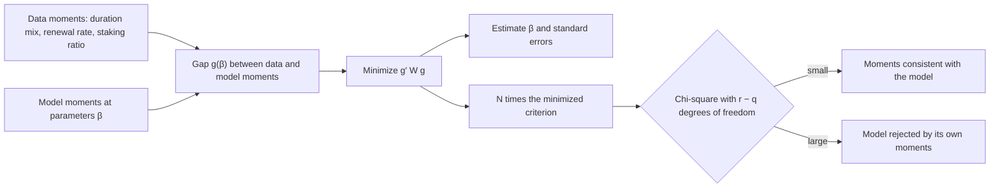

At the Milestone 1 review the Foundation asked that the model lay out which parameters it has and which moments it matches. A **moment** is a summary number of the data, such as the median validator duration or the share of commitments renewed within 7 days. Hansen's generalized method of moments is the framework in which that request becomes an estimator with standard errors and a test of fit.

## Citation

Lars Peter Hansen. 1982. Large Sample Properties of Generalized Method of Moments Estimators. Econometrica 50, no. 4: 1029 to 1054. DOI [10.2307/1912775](https://doi.org/10.2307/1912775).

## Question and method

The paper asks what large-sample properties an estimator has when it sets sample moment conditions as close to zero as possible. It covers data that are stationary and ergodic, with errors that may be serially correlated and heteroskedastic. With $r$ moment conditions $g_N(\beta) = \frac{1}{N}\sum_{n=1}^{N} f(x_n, \beta)$ and $q$ parameters, the estimator minimizes

$$g_N(\beta)^\top\, W_N\, g_N(\beta).$$

Theorem 3.1 gives the estimator's asymptotic normal distribution. Theorem 3.2 shows that the weighting $W = S_w^{-1}$, the inverse of the long-run covariance of the moments, gives the smallest variance, $(d_0^\top S_w^{-1} d_0)^{-1}$, where $d_0$ is the expected derivative of the moments with respect to the parameters. A first-stage estimate is needed to form $S_w$.

## Main result

The paper is theory and has no empirical application. Its test is the result used most. When there are more moment conditions than parameters, $r > q$, the minimized criterion under optimal weighting, multiplied by the sample size, converges to a chi-square distribution with $r - q$ degrees of freedom. The paper does not name it, and later work calls it the J statistic. A model fitted to exactly as many moments as it has parameters always fits those moments perfectly, so it cannot be tested this way.

## What it gives this research

1. A calibration standard for deliverable [1.4](/Phase-II/Milestones/Milestone-1/1-4-Behavioral-Calibration/). Declare the moments before fitting, use more moments than free parameters, report standard errors from the optimal weighting, and report the overidentification test. When the model is simulated to get its moments, the simulated method of moments applies the same logic.
2. A fit report for deliverable [2.4](/Phase-II/Milestones/Milestone-2/2-4-Validation-Confirmation/). The test statistic, with each targeted moment's miss in standard errors, is a statement of fit that a single correlation of two time series cannot give.

## Limits for Avalanche

The theory assumes stationary, ergodic data. Avalanche's staking history is split by protocol upgrades that change the reward rules, so moments have to be defined within upgrade periods, or the model must carry the rules that changed. The optimality result takes the choice of moments as given. It does not say which moments to use, and the paper states it allows only a finite number of them. Weekly and per-commitment moments are serially correlated, so $S_w$ must be a long-run covariance, not a simple sample variance.
