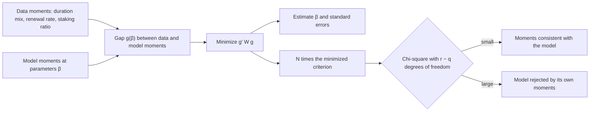

Lars Peter Hansen defines the generalized method of moments, shows which weighting of the moments gives the most precise estimates, and gives the chi-square test that tells whether a model fitted to more moments than it has parameters is consistent with all of them.

Hansen wrote the paper at Carnegie-Mellon University, and *Econometrica* published it in July 1982. Many estimators in econometrics work the same way underneath. An economic model implies **orthogonality conditions**: the expected product of the model's unobserved errors and some observed variables is zero. Replacing each expectation with a sample average gives **moment conditions**, and an estimator picks the parameters that set those averages as close to zero as possible. Instrumental variables, two- and three-stage least squares, and some least squares and quasi-maximum likelihood estimators all fit this pattern. The problem Hansen addresses is that the applications he names, rational expectations models, tests of forecast efficiency, and multiperiod probit models, produce errors that are **serially correlated**, related from one period to the next, and **conditionally heteroskedastic**, with a spread that changes with conditions. Existing theory did not cover those cases. The paper gives one large-sample theory for the whole class that does.

The paper assumes the observed data are **stationary and ergodic**: their statistical behavior does not change over time, and averages over a long sample converge to the population averages. With $r$ moment conditions $g_N(\beta) = \frac{1}{N}\sum_{n=1}^{N} f(x_n, \beta)$ and $q$ parameters, where $r \ge q$, the estimator minimizes

$$g_N(\beta)^\top\, W_N\, g_N(\beta)$$

for a chosen **weighting matrix** $W_N$. Section 2 proves the estimator consistent. Theorem 3.1 gives its asymptotic normal distribution. The covariance depends on $S_w$, the **long-run covariance** of the moments, which adds up their covariances at every lag and so absorbs the serial correlation. Theorem 3.2 shows that the weighting $W = S_w^{-1}$ gives the smallest variance, $(d_0^\top S_w^{-1} d_0)^{-1}$, where $d_0$ is the expected derivative of the moments with respect to the parameters. In practice a first-stage estimate with any valid weighting supplies the estimate of $S_w$ that the optimal second stage needs.

The paper is theory and has no empirical application. The result used most is in Section 4. When there are more moment conditions than parameters, estimation sets only $q$ combinations of the moments to zero, and the remaining $r - q$ should also be close to zero if the model is right. Lemma 4.2 shows that the minimized criterion under optimal weighting, multiplied by the sample size, converges to a **chi-square distribution** with $r - q$ degrees of freedom. The paper presents it as an extension of a test by Sargan. It does not name the statistic, and later work calls it the **J statistic**. A model fitted to exactly as many moments as it has parameters matches them all by construction, so it cannot be tested this way. Hansen also states the limits of his optimality result: it takes the moment conditions as given, says nothing about how to choose them, and allows only a finite number of them.

*How a moment-based calibration of the staking model would run, drawn from the paper's text. The model's parameters are chosen to close the gap between the moments it produces and the moments in the data. The remaining gap, scaled by the sample size, is the test: a large value means the model cannot match all its targets at once.*

## How it relates to our research

**It turns the calibration deliverable into an estimator with confidence intervals.** Deliverable [1.4](/Phase-II/Milestones/Milestone-1/1-4-Behavioral-Calibration/) asks for fitted response functions for stake, unstake, and restake, with confidence intervals. The paper supplies both halves. The fit is the minimizer of the weighted gap, and the intervals come from Theorem 3.1's covariance. The standard we will follow is to declare the moments before fitting, use more moments than free parameters, estimate with the optimal weighting, and report the overidentification test with the estimates. A **moment** here is a summary number of the data, such as the median validator duration, the share of commitments renewed within 7 days, or the staking ratio. The staking model is simulated, so its moments come from simulation, and the simulated method of moments applies the same logic.

**It answers the Foundation's request for parameters against moments.** The Foundation has asked that the model lay out which parameters it has and which moments it matches. The paper gives the form of that table, and [Andrews, Gentzkow, and Shapiro 2017](/Phase-II/Wiki/Collections/Supplementary-Research-Papers/2017-Sensitivity-of-Estimates-to-Moments) fills it with numbers. Their sensitivity matrix uses the same derivative and weighting matrices that the estimation already computes.

**It gives a fit report that a correlation cannot.** Deliverable [2.4](/Phase-II/Milestones/Milestone-2/2-4-Validation-Confirmation/) judges fit by a correlation above 90%. The overidentification test, with each targeted moment's miss stated in standard errors, says whether the model matches the specific features of the data it was built to match. [Granger and Newbold 1974](/Phase-II/Wiki/Collections/Supplementary-Research-Papers/1974-Spurious-Regressions) show why a correlation between trending series alone is weak evidence.

**It fills a gap in the Foundation's model.** The Foundation's [validator rewards article](/Phase-II/Wiki/Collections/Essential-Readings/How-Do-Avalanche-Validators-Actually-Think-About-Staking-Rewards/) fixes each validator's stake size, so it estimates no response of stake amount to reward. The contract's stake and unstake functions need that response. Moments of aggregate stake, such as how the staking ratio moves after a change in the reward rate, are where the staking model can identify it.

**Where Avalanche differs, and how we adapt.** The theory assumes stationary data. Avalanche's staking history is split by five upgrades that changed staking rules: Banff, Cortina, Durango, Etna, and Helicon. Moments therefore have to be defined within periods between upgrades, or the model must carry each rule that changed. Weekly and per-commitment moments are likely to be serially correlated, which is the case the paper was written for, so $S_w$ must be a long-run covariance, not a simple sample variance. Hansen notes one advantage of spectral estimates of $S_w$ over truncated sums of covariances: they cannot produce a negative variance. The optimality result also does not say which moments to use, so that choice has to be argued from the model's purpose. [Keane and Wolpin 2007](/Phase-II/Wiki/Collections/Supplementary-Research-Papers/2007-Nonrandom-Holdout-Validation) then give the stronger test: fit on moments from before an upgrade and predict the period after it.

**Open question for the Foundation.** Which features of staking behavior does the Foundation regard as ones the model must match, and so as candidate moments?

## Source

Lars Peter Hansen. 1982. Large Sample Properties of Generalized Method of Moments Estimators. *Econometrica* 50, no. 4: 1029 to 1054. DOI [10.2307/1912775](https://doi.org/10.2307/1912775).
