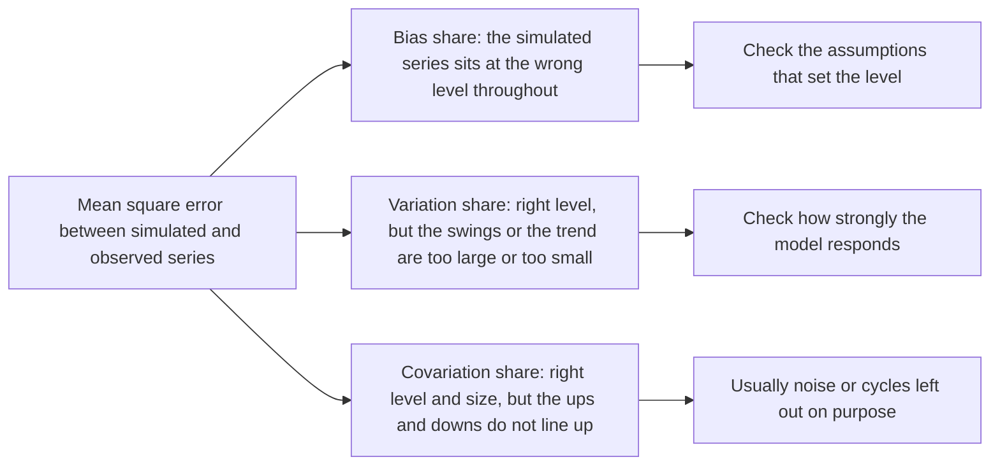

John Sterman splits the mean square error between a simulated and an observed series into three parts, bias, unequal variation, and unequal covariation, so that a fit report shows whether a model's error is systematic or noise.

<!-- overview-table:start -->

| | |
| --- | --- |
| **Authors** | John D. Sterman |
| **Published** | 1984 |
| **Source** | *Dynamica*, [original](https://systemdynamics.org/wp-content/uploads/assets/dynamica/volume-10/10-2/4.pdf) |
| **Topics** | [model validation](/tags/model-validation) |
| **Key terms** | historical fit, Theil's inequality statistics, root mean square percent error, unequal covariation, ex post forecast, system dynamics |
| **Serves deliverables** | [1.4](/Phase-II/Milestones/Milestone-1/1-4-Behavioral-Calibration/), [2.4](/Phase-II/Milestones/Milestone-2/2-4-Validation-Confirmation/) |

<!-- overview-table:end -->

Sterman, then an assistant professor at the MIT Sloan School of Management, published the paper in *Dynamica* in the winter of 1984. It answers a complaint against his field. **System dynamics** models, simulations built from feedback loops, were often shown against history only as a graph beside the data, with the reader left to judge whether the fit was "close enough". Economists and other quantitative social scientists saw this as sloppy. Sterman accepts the complaint and proposes statistics that suit such models.

His background is the field's view of validity. There is no absolute, objective, or single test of a model. **Historical fit** is a weak test that contributes little to confidence on its own, but a necessary one, because a model that fails it is often dismissed. A system dynamics model should generate history from its own structure. Its parameters are set from data below the level of the aggregate series, such as interviews, engineering data, and surveys, not fitted to the history it is compared with. For that reason Sterman rejects $R^2$ for this use. Its whole simulated history can instead be read as an **ex post forecast**, a forecast of a period whose outcome is known, and forecast error statistics are the right measures.

He recommends the **root mean square percent error** for the size of the error, and **Theil's inequality statistics** for its source. The mean square error between simulated values $S_t$ and actual values $A_t$ splits exactly into three terms,

$$\frac{1}{n}\sum_t (S_t - A_t)^2 = (\bar S - \bar A)^2 + (s_S - s_A)^2 + 2(1 - r)\,s_S\,s_A,$$

where $s$ is a standard deviation and $r$ the correlation of the two series. Dividing each term by the total gives three shares that sum to one: $U^M$ for **bias**, a constant gap between the series, $U^S$ for **unequal variation**, a wrong amplitude or trend size, and $U^C$ for **unequal covariation**, a failure to follow the data point by point. A large bias or variation share points to a systematic error in the model's assumptions. When most of the error sits in the covariation share, the model captures the average and the trend, and the rest is noise or cycles the model leaves out on purpose. Sterman's rule is that the error should be small and unsystematic.

The application is a model of the U.S. economy and energy sector, including OPEC, run from 1950 to 2050 to examine how resource depletion and rising energy prices affect long-run growth. It deliberately leaves out the business cycle and has only three outside inputs. Starting in 1950 gives about 30 years to compare with the data. Selected rows of the paper's Table 3:

| Variable | RMSPE, % | $U^M$ | $U^S$ | $U^C$ |
| --- | --- | --- | --- | --- |
| Real private investment | 11.7 | 0.02 | 0.10 | 0.88 |
| Real energy price | 14.0 | 0.58 | 0.00 | 0.42 |
| Net energy consumption | 9.7 | 0.16 | 0.62 | 0.22 |
| Real consumption | 4.7 | 0.54 | 0.29 | 0.17 |
| Primary energy consumption | 4.0 | 0.04 | 0.05 | 0.91 |

Investment has a large error, but "only 2% of the mean-square-error is due to bias". Actual investment swings with the business cycle around a simulated path that tracks its trend, so the error is outside the model's purpose. The energy price error is mostly bias, because the actual price fell more than 30% from 1950 to 1970 and the model captures only part of that decline. Nearly two-thirds of the error in net energy consumption is unequal variation. Sterman traces it to one simplifying assumption, a constant 80% conversion efficiency, when actual efficiency fell from 88% in 1950 to 70% in 1977. The paper closes by stating that these "are not tests of validity, but are summary statistics".

*How the paper reads a fit error, drawn from its text. The total error is split into three shares that add to one. The first two point to a fault in the model. The third, when it holds most of a small total error, is the acceptable case.*

## How it relates to our research

**Where it enters the validation report.** The [proposal](/Phase-II/Milestones/Milestone-0/Proposal/) sets four targets for the fit of the staking model over 2025, which the [Preliminary Validation Report](/Phase-II/Milestones/Milestone-1/Preliminary-Validation-Report/) and deliverable [2.4](/Phase-II/Milestones/Milestone-2/2-4-Validation-Confirmation/) repeat. They are correlation above 0.90, a **[staking ratio](/Phase-II/Wiki/Reference/Glossary-and-Notation)** error under 2 percentage points, trend direction matched more than 85% of the time, and changes timed within 7 days. None of them says where the error comes from. The 2-point target is a root mean square error, the square root of the quantity Sterman decomposes, so the three Theil shares can be reported beside it at no extra cost.

**What the shares tell us about the model.** A high bias share in the simulated staking ratio points to a level error, such as a wrong outside yield in the holder's choice between staking and other uses of AVAX. A high variation share points to a response that is too strong or too weak, for example to a change in the reward rate. A high covariation share with a small total error is the acceptable case.

**A correlation hides bias and scale.** The formula shows why the contract's correlation target is not enough on its own. The correlation $r$ enters only the covariation term. A simulation can sit at the wrong level throughout, or swing twice as far as the data, and still correlate above 0.90. [Granger and Newbold 1974](/Phase-II/Wiki/Collections/Supplementary-Research-Papers/1974-Spurious-Regressions) add that trending series correlate even when unrelated.

**Where Avalanche differs, and how we adapt.** Sterman's case against $R^2$ rests on parameters that are not fitted to the aggregate history. Our behavioral parameters in deliverable [1.4](/Phase-II/Milestones/Milestone-1/1-4-Behavioral-Calibration/) are estimated from individual commitments, which is below the level of the staking ratio. If the calibration also targets the 2025 staking ratio, the backtest is no longer an ex post forecast. Sterman notes in that case that the statistics still apply but that passing is weaker evidence. The validation report will therefore state which series were used in calibration. Sterman also decides which behavior lies outside the model's purpose, such as the business cycle, before he judges the errors. For the staking model, any short-term swing we choose not to model has to be named before the fit is run.

**How it connects to the other pages.** Sterman's table of confidence-building tests covers structure, behavior, and policy, and historical fit is one entry. [Barlas 1996](/Phase-II/Wiki/Collections/Supplementary-Research-Papers/1996-Model-Validity-in-System-Dynamics) orders those tests and puts fit last. [Keane and Wolpin 2007](/Phase-II/Wiki/Collections/Supplementary-Research-Papers/2007-Nonrandom-Holdout-Validation) give the stronger test of predicting across a protocol upgrade. [Hansen 1982](/Phase-II/Wiki/Collections/Supplementary-Research-Papers/1982-Generalized-Method-of-Moments) supplies a formal test for the moments the model was calibrated to, which the Theil statistics do not provide.

## Source

John D. Sterman. 1984. Appropriate Summary Statistics for Evaluating the Historical Fit of System Dynamics Models. *Dynamica* 10, part II, Winter 1984: 51 to 66. The article has no DOI. Copy in the System Dynamics Society's archive of *Dynamica*: <https://systemdynamics.org/wp-content/uploads/assets/dynamica/volume-10/10-2/4.pdf>.
