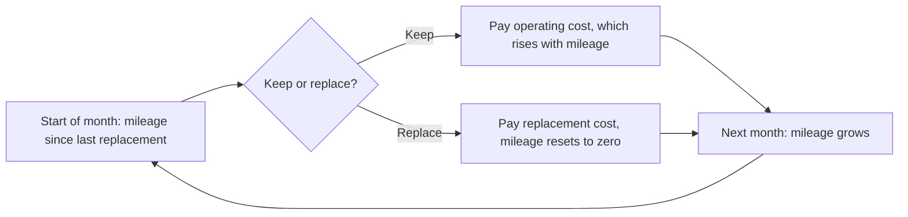

John Rust estimates a forward-looking keep-or-replace decision from one maintenance manager's records, using a nested fixed point algorithm of his own, and the same model form fits a validator deciding at the end of each commitment whether to renew or exit.

Rust, at the University of Wisconsin-Madison, published the paper in *Econometrica* in September 1987. Its subject is Harold Zurcher, superintendent of maintenance at the Madison Metropolitan Bus Company in Wisconsin, who gave Rust the maintenance records of 162 buses from December 1974 to May 1985. Rust admits that few readers care about bus engines as such. He uses them to show two ideas: a **bottom-up** model of replacement investment built from individual decisions, and a way to estimate a **dynamic discrete choice** model, one in which today's choice changes the options and costs of later periods.

Each month Zurcher either keeps an engine, paying operating costs that rise with its mileage since the last replacement, or replaces it at a fixed cost, which resets the mileage to zero. This is an **optimal stopping** problem. Replacing costs more now but lowers costs in every later month. On average engines were replaced after 5 years and more than 200,000 miles, but the mileage at replacement ranged from 82,400 to 387,300. A single mileage threshold cannot explain that spread. Rust therefore adds **unobserved state variables**, costs that Zurcher sees and the econometrician does not, such as a full repair shop. The value of each state then solves a **Bellman equation**, which sets today's value equal to the best of this month's payoff plus the discounted expected value of next month:

$$V_\theta(x_t, \varepsilon_t) = \max_{i \in \{0,1\}} \left[u(x_t, i, \theta) + \varepsilon_t(i) + \beta\, EV_\theta(x_t, i)\right].$$

With extreme value shocks, the probability of each choice is a logit in $u + \beta EV$. Rust notes that McFadden's static logit is the special case in which a choice has no future consequences. The **nested fixed point** algorithm solves the Bellman equation for each trial value of the parameters, the inner loop, and searches over parameters to maximize the likelihood of the observed choices, the outer loop. Mileage is split into 90 bands of 5,000 miles.

The estimates use 8,156 bus-months from the 104 buses in the four newest groups. With the discount factor $\beta$ fixed at 0.9999, which Rust equates to an annual real interest rate of about 0.1%, the pooled replacement cost estimate is 9.76, standard error 1.23, and the mileage cost coefficient is 2.63, standard error 0.62. A likelihood ratio test rejects the **myopic** model, which sets $\beta$ to zero and looks only at this month, with a statistic of 12.78 on one degree of freedom. In dollars, Zurcher's costs for the newer buses rise by about \$3.75 a month for every 5,000 miles, against \$1.70 for the older group. That explains why the newer buses had engines replaced sooner despite a replacement cost about 25% higher. The estimated replacement hazard levels off at about 7% near 450,000 miles, while the myopic model's exceeds 20%. Asked to choose, Zurcher picked the hazards from the linear and square root cost models. Rust is direct about two weak points. He "was not able to precisely estimate the discount factor", because it moves replacement timing much as the replacement cost does. A test of his key independence assumption rejects it for the three newest groups combined and for all four, though not for the 1975 buses on their own.

*Zurcher's monthly decision as Rust models it, drawn from the paper's text. Replacing costs more today but lowers operating costs in every later month, so a manager who looks ahead replaces earlier than one who looks only at this month. A validator at the end of a commitment faces the same kind of loop: renew, change terms, or exit.*

## How it relates to our research

**Where it enters the staking model.** The restake rate is one of the three behavioral variables the staking model in deliverable [1.3](/Phase-II/Milestones/Milestone-1/1-3-Staking-Model-Spec/) must carry, beside stake and unstake. Rust gives its form. At the end of a commitment a validator's state includes its time staked, its current yield, and its delegated stake. Its choices are to renew on the same terms, renew on new terms, or exit. Deliverable [1.4](/Phase-II/Milestones/Milestone-1/1-4-Behavioral-Calibration/) then estimates the decision by nested fixed point or a faster variant, and the likelihood ratio test against a myopic model asks whether validators look ahead at all.

**How it extends the Foundation's validator model.** The Foundation's [validator rewards article](/Phase-II/Wiki/Collections/Essential-Readings/How-Do-Avalanche-Validators-Actually-Think-About-Staking-Rewards/) estimates a static conditional logit in which a renewal cost term, falling as duration rises, carries a coefficient of 5.4. That term prices the effort of renewing as part of today's choice. Rust's model makes the next decision explicit through $\beta EV$. The article states that its model captures a static equilibrium, not dynamic adjustment. The dynamic model is how the staking model can show adjustment over time.

**Why a structural model is needed for policy.** Rust ends by tracing a demand curve for engines as the replacement cost varies. He argues that a regression of replacements on cost could not recover it, because replacement costs had varied little and the data sit in a small cluster. The staking parameters are in the same position. The Foundation's article notes that short minimum durations and lower minimum consumption rates both lie outside the historical data. Only a model built on estimated preferences can predict behavior under [ACP-285](/Phase-II/Wiki/Collections/Economic-ACPs/ACP-285-Minimum-Consumption-Rate/) and the other Helicon changes.

**Where Avalanche differs, and how we adapt.** The discount factor is not identified from choices alone, as Rust states, so we will fix it from outside information or sweep it as an uncertain input. A dynamic model also needs variation in the future terms validators face. Helicon, active since 22 September 2026, supplies the first large variation: a 48-hour minimum, [auto-renewed staking](/Phase-II/Wiki/Collections/Economic-ACPs/ACP-236-Auto-Renewed-Staking/), and a reward curve that ramps down to 21 December. Auto-renewal changes the decision itself. A validator no longer decides at every period end. It keeps renewing until it chooses to stop, which is closer to Rust's stopping problem. The [25 September brief](/Phase-II/Wiki/Briefs/2026-09-25-sprint-8/) counted 20 commitments under the new rules by 24 September, two of them 48-hour auto-renewals. Until such data accumulate, a static duration logit with a lock-up cost remains the simpler choice.

**Who makes the decision.** Rust assumes decisions are independent across buses, and a referee noted that scheduling of shop bays could link them. Validators have a stronger version of this problem. One operator can run many nodes, and the site uses a shared reward address only as a proxy for an operator. The unit of choice may be the operator, not the node. Delegations follow their own rules: the [BENQI interview](/Phase-II/Interviews/BENQI-2026-08-31/) describes placements made by bots that weigh capacity, uptime, duration, and stake. The static choice models of [McFadden 1973](/Phase-II/Wiki/Collections/Supplementary-Research-Papers/1973-Conditional-Logit-Analysis) and [Berry 1994](/Phase-II/Wiki/Collections/Supplementary-Research-Papers/1994-Discrete-Choice-Demand-Estimation) remain the starting point, and this paper shows how to add the future to them.

**Open question for the Foundation.** What rate of return should the model assume validators use to value future rewards, and could operators tell us?

## Source

John Rust. 1987. Optimal Replacement of GMC Bus Engines: An Empirical Model of Harold Zurcher. *Econometrica* 55, no. 5: 999 to 1033. DOI [10.2307/1911259](https://doi.org/10.2307/1911259).
