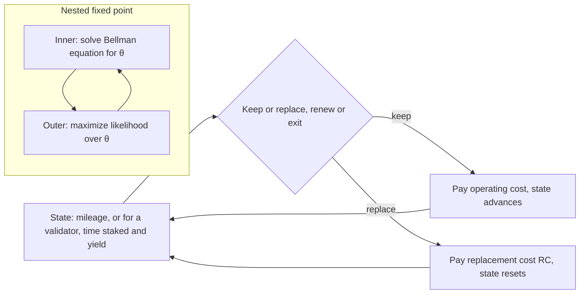

At the end of every commitment a validator decides whether to renew, change its terms, or leave. That choice looks ahead: renewing now changes what the validator can do next time. Rust gives the standard method for estimating such a decision from observed choices, using a maintenance manager's engine replacements.

## Citation

John Rust. 1987. Optimal Replacement of GMC Bus Engines: An Empirical Model of Harold Zurcher. Econometrica 55, no. 5: 999 to 1033. DOI [10.2307/1911259](https://doi.org/10.2307/1911259).

## Question and method

The paper asks whether one manager's engine-replacement decisions follow an optimal stopping rule, and shows how to estimate such a rule by maximum likelihood. Each month the manager keeps an engine, paying an operating cost that rises with mileage $x_t$, or replaces it at cost $RC$. The value of each state solves a Bellman equation:

$$V_\theta(x_t, \varepsilon_t) = \max_{i \in \{0,1\}} \left[u(x_t, i, \theta) + \varepsilon_t(i) + \beta\, EV_\theta(x_t, i)\right].$$

With extreme value shocks, the choice probability is a logit in $u + \beta EV$. The nested fixed point algorithm solves the Bellman equation by contraction for each trial parameter value, the inner loop. It then searches over parameters to maximize the likelihood of the observed choices, the outer loop.

## Main result

The data are 8,156 bus-months from 104 buses between December 1974 and May 1985. With the discount factor fixed at 0.9999, the pooled replacement cost estimate is 9.76, standard error 1.23, and the mileage cost coefficient is 2.63, standard error 0.62. In dollars, operating costs for the first bus groups rise by about USD 3.75 per 5,000 miles. A likelihood ratio test rejects the myopic model with a discount factor of zero, statistic 12.78 on one degree of freedom for the pooled sample.

The paper is direct about its weak point. Rust "was not able to precisely estimate the discount factor", because it is collinear with the replacement cost, and he reports that the discount factor is not identified without restrictions on the utility function.

## What it gives this research

1. A model form for the renew-or-exit decision in deliverable [1.3](/Phase-II/Milestones/Milestone-1/1-3-Staking-Model-Spec/). The validator's state at the end of a commitment includes its time staked, its current yield, and its delegated stake. Its choices are to renew on the same terms, renew on new terms, or exit.
2. An estimator and a test for deliverable [1.4](/Phase-II/Milestones/Milestone-1/1-4-Behavioral-Calibration/). The nested fixed point, or its faster conditional choice probability variants, estimates the decision. The likelihood ratio test against a myopic model asks whether validators look ahead at all.

## Limits for Avalanche

The discount factor is not identified from choices alone, as Rust states, so it must be fixed from outside information or swept as an uncertain input. A dynamic model also needs variation in the future terms a validator faces. The ACP-285 ramp and Helicon's 48-hour and auto-renewed options, all from 22 September 2026, supply the first large variation of that kind. Until those data accumulate, a static duration logit with a lock-up cost is the simpler choice. Rust assumes shocks are independent across buses. Validators run by one operator share decisions, so the unit of choice may be the operator, not the node.
