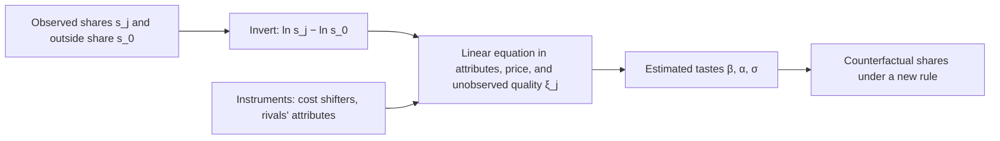

Steven Berry shows how to turn observed market shares into the mean utility of each product, so that logit and nested logit demand can be estimated by instrumental variables when prices are correlated with qualities the analyst cannot see, and this inversion is the method behind the Foundation's delegator model.

<!-- overview-table:start -->

| | |
| --- | --- |
| **Authors** | Steven T. Berry |
| **Published** | 1994 |
| **Source** | *The RAND Journal of Economics*, [original](https://doi.org/10.2307/2555829) |
| **Topics** | [structural estimation](/tags/structural-estimation), [delegation market](/tags/delegation-market) |
| **Key terms** | inversion, mean utility, nested logit, instrumental variables, outside option, unobserved demand factors |
| **Serves deliverables** | [1.3](/Phase-II/Milestones/Milestone-1/1-3-Staking-Model-Spec/), [1.4](/Phase-II/Milestones/Milestone-1/1-4-Behavioral-Calibration/) |

<!-- overview-table:end -->

Berry published the paper in *The RAND Journal of Economics* in the summer of 1994. No free full text is available, so this summary rests on the publisher's abstract and the published record of the paper. The abstract states the problem as supply-and-demand analysis across many **oligopoly** markets, markets with a few sellers, in which products differ. Demand is described by a discrete-choice model, and prices are set by the firms. In contrast to some earlier empirical work, the method allows prices to be correlated with **unobserved demand factors**, qualities of a product that buyers see and the analyst does not.

That correlation is the core problem. A firm with a well-regarded product can charge more for it, so in the data higher prices go with qualities the analyst has no measure of. A regression of demand on price then mixes the effect of price with the effect of the unseen quality. The standard remedy is **instrumental variables**: variables that move price but are unrelated to the unseen quality, used to isolate the effect of price alone. The difficulty is that in a discrete-choice model the unseen quality sits inside a nonlinear formula for market shares, where instruments cannot be applied directly.

Berry's answer, in the abstract's words, is to "invert" the market-share equation to find the implied **mean utility** of each good, the utility the average buyer gets from it. Each product $j$ has mean utility $\delta_j = x_j\beta - \alpha p_j + \xi_j$, where $x_j$ are its characteristics, $p_j$ its price, and $\xi_j$ the unobserved quality. The **outside option**, buying none of the products, has its utility set to zero. In the logit case the inversion is a linear equation in the market shares $s_j$ and the outside share $s_0$:

$$\ln s_j - \ln s_0 = x_j\beta - \alpha p_j + \xi_j.$$

In the **nested logit**, products are grouped, and a product's share within its group $g$ enters as well:

$$\ln s_j - \ln s_0 = x_j\beta - \alpha p_j + \sigma \ln \bar s_{j/g} + \xi_j.$$

Price and the within-group share both correlate with $\xi_j$, so the equation is estimated by instrumental variables. Valid instruments include cost shifters that do not affect utility and the characteristics of rival products. The paper's Monte Carlo experiment shows what is at stake. With a true price coefficient of 1 across 100 samples of 500 two-firm markets, ordinary least squares estimates 0.726 when the unobserved quality has variance 1, and 0.181 when it has variance 3. Instrumental variables estimates 0.995 and 0.979. The paper states that "the coefficient on price is systematically underestimated by OLS", and that OLS can even suggest buyers prefer higher prices.

*Berry's method in five steps, drawn from the published record. Shares become a linear equation, instruments separate the effect of price from unseen quality, and the estimated tastes then predict shares under new prices or rules.*

## How it relates to our research

**It is the delegator model in the Foundation's article.** The chain records each delegation, but not the menu of validators each delegator compared. The Foundation's [validator rewards article](/Phase-II/Wiki/Collections/Essential-Readings/How-Do-Avalanche-Validators-Actually-Think-About-Staking-Rewards/) treats each validator and duration as a product, computes weekly market shares from delegation volumes, and regresses the log-odds against the outside option of not delegating on product characteristics. On roughly 375,000 delegator observations it finds +0.44 on log net APY, −0.64 on log weeks, and +0.29 on log validator stake, with an R-squared of 0.202. Reproducing those estimates is a task in deliverable [1.4](/Phase-II/Milestones/Milestone-1/1-4-Behavioral-Calibration/).

**The article's estimate uses ordinary least squares, and Berry's result is a reason to add instruments.** Appendix A of the article states that the log-odds were regressed "using OLS". The delegation fee is the price in this market, and a validator sets it knowing its own reputation, which delegators see and the data do not. That is the correlation Berry warns about, and his Monte Carlo shows the price effect biased toward zero under it. If the same holds here, delegators respond more strongly to net APY than +0.44 suggests, and the article's trade-off of a 1.5% higher APY per 1% longer duration would shift with it. Candidate instruments are rival validators' attributes and protocol changes that move APY for reasons unrelated to reputation, such as the [ACP-285](/Phase-II/Wiki/Collections/Economic-ACPs/ACP-285-Minimum-Consumption-Rate/) ramp, which changes rewards by start date.

**It links the delegator model to the staking ratio.** If the outside share $s_0$ is defined as AVAX that is not staked, one minus the **[staking ratio](/Phase-II/Wiki/Reference/Glossary-and-Notation)**, the nested logit ties the choice among validators to the choice whether to stake at all. "Stake" and "stay unstaked" become separate nests. This gives the staking model in deliverable [1.3](/Phase-II/Milestones/Milestone-1/1-3-Staking-Model-Spec/) one consistent account of both decisions, and connects it to the outside yields in [Chitra 2020](/Phase-II/Wiki/Collections/Supplementary-Research-Papers/2020-Staking-and-Lending-Equilibria/).

**Where Avalanche differs, and how we adapt.** The inversion treats each observed share as demand. On Avalanche some validators cannot take more delegation. The [ACP-247 page](/Phase-II/Wiki/Collections/Economic-ACPs/ACP-247-Delegation-Multiplier/) finds, in a snapshot of 601 validators, that 113 were at 90% or more of their delegation capacity and held 54% of all delegation. Their shares reflect a limit, not only delegators' preferences, and the estimate has to treat them as capped. The menu also changes by week: a validator is **on offer** only while it has at least 14 days left and room for at least 25 AVAX more, since delegations need 14 days. The model is static, while each delegation is locked for its full term. A validator's stake and track record build up from past delegation, so they are not fixed characteristics as the paper assumes. And the paper warns that the inversion "may be quite sensitive to measurement error in observed market shares", which matters for small validators with few delegations in a week.

**Intermediated stake needs its own model.** The [BENQI interview](/Phase-II/Interviews/BENQI-2026-08-31/) reports that BENQI holds 10% to 12% of all stake and places its delegations with bots that weigh each validator's capacity, uptime, duration, and stake. Those placements follow a rule, not the tastes of many small delegators, so they should be modeled as a separate route. [McFadden 1973](/Phase-II/Wiki/Collections/Supplementary-Research-Papers/1973-Conditional-Logit-Analysis) supplies the validator side of the same market.

**Open question for the Foundation.** Did the article's estimate count liquid staking providers' delegations as delegator choices, and would the Foundation support separating them?

## Source

Steven T. Berry. 1994. Estimating Discrete-Choice Models of Product Differentiation. *The RAND Journal of Economics* 25, no. 2: 242 to 262. DOI [10.2307/2555829](https://doi.org/10.2307/2555829).
