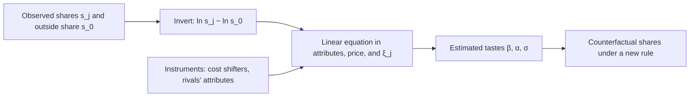

Delegators are not observed one at a time. What the chain records is how much delegated stake each validator attracts each week. Berry shows how to recover delegator preferences from those shares, and why the fee a validator sets cannot be treated as given. The Foundation's [validator rewards article](/Phase-II/Wiki/Collections/Essential-Readings/How-Do-Avalanche-Validators-Actually-Think-About-Staking-Rewards/) uses this method for its delegator model.

## Citation

Steven T. Berry. 1994. Estimating Discrete-Choice Models of Product Differentiation. The RAND Journal of Economics 25, no. 2: 242 to 262. DOI [10.2307/2555829](https://doi.org/10.2307/2555829).

## Question and method

The paper asks how to estimate discrete-choice demand from market shares when price is correlated with product qualities the econometrician cannot see. Each product $j$ has mean utility $\delta_j = x_j\beta - \alpha p_j + \xi_j$, where $\xi_j$ is an unobserved quality. The paper proves that observed shares can be inverted to a unique vector of mean utilities, with the outside option normalized to zero. In the logit case the inversion is a linear equation:

$$\ln s_j - \ln s_0 = x_j\beta - \alpha p_j + \xi_j,$$

where $s_0$ is the share of the outside option. In the nested logit, products are grouped and a within-group share enters:

$$\ln s_j - \ln s_0 = x_j\beta - \alpha p_j + \sigma \ln \bar s_{j/g} + \xi_j.$$

Price and the within-group share both correlate with $\xi_j$, so the equation is estimated by instrumental variables. Valid instruments are cost shifters excluded from utility and the characteristics of rival products.

## Main result

In the paper's Monte Carlo, 100 samples of 500 duopoly markets with a true price coefficient of 1, ordinary least squares estimates 0.726 when the unobserved quality has variance 1 and 0.181 when it has variance 3. Instrumental variables estimates 0.995 and 0.979. The paper's statement is that "the coefficient on price is systematically underestimated by OLS", and that OLS can even suggest consumers prefer higher prices.

## What it gives this research

1. The delegator estimator for deliverable [1.4](/Phase-II/Milestones/Milestone-1/1-4-Behavioral-Calibration/). A validator's weekly share of delegated stake, its net reward rate, its duration, and its size give the logit equation directly. The Foundation's estimates on roughly 375,000 delegator observations are +0.44 on log net APY, −0.64 on log weeks, and +0.29 on log validator stake, with an R-squared of 0.202.
2. An outside option for the staking model in deliverable [1.3](/Phase-II/Milestones/Milestone-1/1-3-Staking-Model-Spec/). With $s_0$ defined as AVAX that is not staked, one minus the **[staking ratio](/Phase-II/Wiki/Reference/Glossary-and-Notation)**, the nested logit ties the choice among validators to the choice whether to stake at all. It places "stake" and "stay unstaked" in separate nests.
3. A reason to instrument the fee. A validator sets its delegation fee knowing its own reputation, which delegators see and the data do not. Rival validators' attributes and protocol changes are candidate instruments.

## Limits for Avalanche

The inversion assumes observed shares are measured without error, and the paper warns it "may be quite sensitive to measurement error in observed market shares." Weekly shares of small validators are noisy. The model is static, while a delegation is locked for its full duration. Product characteristics other than price are assumed exogenous, but a validator's stake and track record build up from past delegation. Intermediated stake such as BENQI's selects validators by rule, not by utility, and needs its own model.
