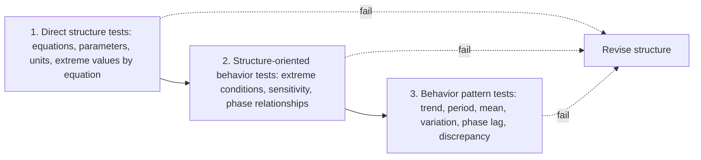

Deliverable 2.4 judges the staking model by its fit to history. Barlas explains why fit to history should be the last test, not the first. A model can match a time series for the wrong reasons, and only tests of its structure show whether it matches for the right ones. The paper gives the tests, the order in which to run them, and the statistics for comparing simulated and observed series.

## Citation

Yaman Barlas. 1996. Formal aspects of model validity and validation in system dynamics. System Dynamics Review 12, no. 3: 183 to 210. DOI [10.1002/(SICI)1099-1727(199623)12:3%3C183::AID-SDR103%3E3.0.CO;2-4](https://doi.org/10.1002/(SICI)1099-1727(199623)12:3%3C183::AID-SDR103%3E3.0.CO;2-4).

## Question and method

The paper asks what validity means for a model meant to explain how a system works, and which formal tests establish it, in what order. It sorts tests into three groups and says "direct structure tests must be carried out first, then structure-oriented behavior tests and then finally behavior pattern tests."

For the behavior pattern tests the paper gives a six-step procedure for a simulated series $S$ against an observed series $A$: compare and remove trends, compare periods by autocorrelation, compare means, compare variations, estimate phase lag by cross-correlation, and compute a discrepancy coefficient

$$U = \frac{\sqrt{\sum_i \left(S_i - \bar S - A_i + \bar A\right)^2}}{\sqrt{\sum_i (A_i - \bar A)^2} + \sqrt{\sum_i (S_i - \bar S)^2}}.$$

The error in means is $E_1 = |\bar S - \bar A|/\bar A$ and the error in variation is $E_2 = |s_S - s_A|/s_A$.

## Main result

The paper is conceptual and has no application. Its central claim is that behavior pattern tests "are 'weak' tests that provide no information on the validity of the structure". A model that passes them without passing the structure tests has not been shown valid. It proposes a minimum set: parameter confirmation, direct extreme-condition, and dimensional consistency tests of structure, then extreme-condition, sensitivity, and phase-relationship tests of behavior, then the full pattern procedure. It gives no numeric pass thresholds for $E_1$, $E_2$, or $U$.

## What it gives this research

1. An order of tests for deliverable [2.4](/Phase-II/Milestones/Milestone-2/2-4-Validation-Confirmation/). The reward kernel is checked against the protocol code, units are checked, and extreme conditions are run before any historical fit is reported. Extreme conditions include zero reward, supply at the cap, and all stake exiting.
2. Pattern statistics to report beside the contract's measures. The proposal already names trend direction and phase alignment. Barlas adds the comparison of means and variations and the discrepancy coefficient, each of which tests a different aspect of fit.
3. A structure checklist for deliverable [1.3](/Phase-II/Milestones/Milestone-1/1-3-Staking-Model-Spec/). Each equation of the staking model should have a documented parameter source and pass a dimensional check.

## Limits for Avalanche

Barlas writes for continuous feedback models of management systems. The Avalanche model is partly event-driven, with commitments that start and end on exact timestamps, so the autocorrelation and period tests apply to aggregated series such as the weekly staking ratio, not to the events. The paper gives no thresholds, so pass bands for each statistic have to be set before the fit is run. The author notes that the structure-oriented behavior tests are still "quite informal".
