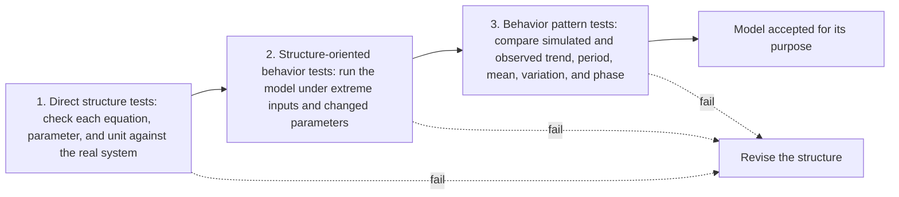

Yaman Barlas sets out the order in which a system dynamics model should be tested, structure first, then behavior tests designed to expose structural flaws, and only then the match to historical patterns, and he argues that the middle stage deserves the most attention.

<!-- overview-table:start -->

| | |
| --- | --- |
| **Authors** | Yaman Barlas |
| **Published** | 1996 |
| **Source** | *System Dynamics Review*, [original](https://doi.org/10.1002/(SICI)1099-1727(199623)12:3%3C183::AID-SDR103%3E3.0.CO;2-4) |
| **Topics** | [model validation](/tags/model-validation) |
| **Key terms** | causal-descriptive model, direct structure tests, structure-oriented behavior tests, behavior pattern tests, discrepancy coefficient, system dynamics |
| **Serves deliverables** | [1.3](/Phase-II/Milestones/Milestone-1/1-3-Staking-Model-Spec/), [2.4](/Phase-II/Milestones/Milestone-2/2-4-Validation-Confirmation/), [2.5](/Phase-II/Milestones/Milestone-2/2-5-Sensitivity-Analysis/) |

<!-- overview-table:end -->

Barlas, of Boğaziçi University, published the paper in *System Dynamics Review* in 1996. His starting point, in the abstract, is that published and informal evidence shows little effort in the system dynamics community devoted explicitly to model validity. The paper has no free full text. This overview rests on the publisher's abstract and the published record of the paper's tests, and it reports no result that those sources do not state.

A **system dynamics** model represents a system as stocks, flows, and feedback loops, and is meant to explain how the system produces its behavior. Barlas calls such models **causal-descriptive**. For them, **validity** means that the model's structure matches the real system, not only that its output matches the data. A model can reproduce a historical series for the wrong reasons, for example because a fitted parameter absorbs an error in an equation. **Validation** is therefore a long process with both formal, quantitative tools and informal, qualitative ones. This paper treats the formal side.

The paper begins with a short discussion of the philosophy of validation, then gives a flowchart of the order in which validation activities must be carried out, then gives example tests for each of three stages. **Direct structure tests** compare each equation and parameter with what is known about the real system, without running the model. They include parameter confirmation, dimensional consistency, and extreme-condition checks of single equations. **Structure-oriented behavior tests** run the whole model under designed conditions, such as extreme inputs or changed parameters, and ask whether its behavior reveals a flaw in structure. **Behavior pattern tests** come last and compare simulated and observed series. The paper also discusses whether, and how far, statistical significance tests can be used in validation.

The paper is conceptual and has no application to a single model. Its main claim concerns the middle stage. Structure-oriented behavior tests are "strong behavior tests that can provide information on potential structure flaws," and because they combine a structural focus with measurable results, Barlas calls them "the most promising direction for research on model validation." For the final stage, the published record gives a procedure for comparing a simulated series $S$ with an observed series $A$: compare and remove trends, compare periods by autocorrelation, compare means with $E_1 = |\bar S - \bar A| / \bar A$, compare variations with $E_2 = |s_S - s_A| / s_A$, estimate the phase lag by cross-correlation, and compute a **discrepancy coefficient** that summarizes the remaining point-by-point gap. The paper sets no numeric pass thresholds for these statistics.

*The three stages of formal validation in the order Barlas prescribes. Each stage runs only after the one before it passes, and a failure at any stage sends the modeler back to the structure. Fit to history is the last test, not the first. The paper's figures are not reproduced here, so this diagram is drawn from the abstract and the published record.*

## How it relates to our research

**It puts the contract's fit targets in the last stage.** The [Preliminary Validation Report](/Phase-II/Milestones/Milestone-1/Preliminary-Validation-Report/) and deliverable [2.4](/Phase-II/Milestones/Milestone-2/2-4-Validation-Confirmation/) judge the model by a backtest. It starts the model from the observed state in January 2025, simulates through December 2025, and asks for correlation above 0.90, a staking ratio error under 2 percentage points, trend direction matched more than 85% of the time, and changes timed within 7 days. All four are behavior pattern tests. Barlas's order means those numbers are reported only after the structure tests and the structure-oriented behavior tests have passed. It also means that when a pattern test fails, the structure is reviewed before the behavioral parameters are refit, so that a good fit cannot hide a wrong equation.

**Direct structure tests already exist for the reward block.** The [protocol kernel](/Phase-II/Wiki/Reference/Glossary-and-Notation) is our reimplementation of the AvalancheGo reward and staking rules in integer arithmetic. The staking periods notebook, described on the [Notebooks](/Phase-II/Wiki/Reference/Notebooks) page, compares the kernel's reward with the recorded potential reward for every commitment and counts the commitments it reproduces. That is a direct structure test of one equation against the real system. Deliverable [1.3](/Phase-II/Milestones/Milestone-1/1-3-Staking-Model-Spec/) extends the same discipline to every equation of the staking model: each gets a documented parameter source and a unit check across AVAX, nAVAX, and AVAX-weeks.

**Extreme conditions give the model its strong tests.** Structure-oriented behavior tests for Avalanche follow from the protocol's own limits. With supply at the 720,000,000 AVAX cap, the reward formula pays nothing, and the model must show no new rewards. With the staking reward at zero, or with outside yields at the top of the proposal's 3% to 10% range, stake should leave and not grow. With every commitment ending at once, the staking ratio must fall to zero without a negative stock. Each test is run before the historical fit. The sensitivity runs of deliverable [2.5](/Phase-II/Milestones/Milestone-2/2-5-Sensitivity-Analysis/) supply the changed-parameter tests of the same stage.

**Pattern statistics that add to the contract's measures.** The comparison of means and of variations, and the discrepancy coefficient, each measure a different part of fit than correlation does. [Sterman](/Phase-II/Wiki/Collections/Supplementary-Research-Papers/1984-Summary-Statistics-for-Historical-Fit) splits the same error into bias, unequal variation, and unequal covariation. [Granger and Newbold](/Phase-II/Wiki/Collections/Supplementary-Research-Papers/1974-Spurious-Regressions) show that correlation between two trending series is weak evidence, which is why Barlas's procedure removes trends before comparing anything else. [Keane and Wolpin](/Phase-II/Wiki/Collections/Supplementary-Research-Papers/2007-Nonrandom-Holdout-Validation) add a test Barlas does not have: prediction of a period with different rules, without refitting.

**Where Avalanche differs from Barlas's setting.** Barlas writes for continuous feedback models of management systems. The Avalanche model is partly event-driven, because commitments start and end at exact timestamps. Autocorrelation and period tests therefore apply to aggregated series, such as the weekly staking ratio, not to single events. The historical record is also split by [network upgrades](/Phase-II/Wiki/Reference/Glossary-and-Notation) that changed staking rules, so a pattern test is run within one set of rules. The 2025 backtest meets this condition, because Fortuna and Granite changed no staking rule. The paper gives no thresholds, so pass bands for $E_1$, $E_2$, and the discrepancy coefficient have to be set before the fit is run.

**Open question for the Foundation.** The contract sets targets for correlation, error, direction, and timing only. What pass bands would the Foundation accept for the error in means, the error in variation, and the discrepancy coefficient?

## Source

Yaman Barlas. 1996. Formal aspects of model validity and validation in system dynamics. *System Dynamics Review* 12, no. 3: 183 to 210. DOI [10.1002/(SICI)1099-1727(199623)12:3%3C183::AID-SDR103%3E3.0.CO;2-4](https://doi.org/10.1002/(SICI)1099-1727(199623)12:3%3C183::AID-SDR103%3E3.0.CO;2-4). The paper has no free full text. This overview follows the publisher's abstract and the published record.
