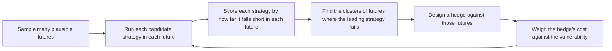

Lempert, Groves, Popper, and Bankes set out robust decision making, a method that proposes a strategy, finds the futures in which it fails, and weighs the cost of hedging against them, so that scenarios come out of the analysis instead of being written in advance.

Robert Lempert, David Groves, Steven Popper, and Steven Bankes, all of the RAND Corporation, published the paper in *Management Science* in April 2006. Their starting point is that "robustness is a key criterion for evaluating alternative decisions under conditions of deep uncertainty," yet no systematic, general approach existed for finding robust strategies with the range of models and data that decision makers often have. The full text is behind the publisher's paywall. This overview rests on the publisher's abstract and the published record, and it gives none of the paper's numbers.

**Deep uncertainty** describes decisions where the parties cannot agree on, or reliably assign, probabilities to the conditions that will decide the outcome. The usual approach under uncertainty picks the strategy with the best expected result across an assumed distribution of futures. That choice can hide the futures in which the strategy does badly. A **robust strategy** is one that performs acceptably across a wide range of plausible futures, even if it is not the best in any single one. The paper's contribution is a method for finding such strategies with a computer model rather than by expert judgment alone.

The method, called **robust decision making**, is iterative. It "first suggests candidate robust strategies, identifies clusters of future states of the world to which they are vulnerable, and then evaluates the trade-offs in hedging against these vulnerabilities." A **future state of the world** is one combination of values for the uncertain inputs of the model. A **vulnerability** is a cluster of such futures in which a candidate strategy fails. A **hedge** is a change to the strategy that protects it in those futures, at some cost in the others. Because each vulnerable cluster is a small set of input conditions, it can be read as a story about the future. The clusters are therefore interpretable as **narrative scenarios**, and they are produced by the analysis instead of being chosen before it.

The paper demonstrates the method by "identifying robust, adaptive, near-term pollution-control strategies to help ensure economic growth and environmental quality throughout the 21st century." An **adaptive** strategy is one that changes course when the conditions it was hedged against start to appear. The companion page on [scenario discovery](/Phase-II/Wiki/Collections/Supplementary-Research-Papers/2010-Scenario-Discovery) covers the later paper by Bryant and Lempert that turns the step of finding vulnerable clusters into an algorithm with measured accuracy.

*The robust decision making loop as the abstract describes it. Each pass proposes a strategy, finds the futures that break it, and tests a hedge, and the hedged strategy becomes the next candidate. The futures that break a strategy are the output that matters, not only the average score. The paper's figures are not reproduced here, so this diagram is drawn from the abstract.*

## How it relates to our research

**It supplies the selection rule for the sweeps.** The [proposal](/Phase-II/Milestones/Milestone-0/Proposal/) commits to parameter selection under uncertainty: run the model across many futures and find the parameter settings that meet the Foundation's goals in most of them. Deliverable [2.2](/Phase-II/Milestones/Milestone-2/2-2-Simulation-Execution/) sizes that sweep at 500 governance configurations, 20 scenarios, and 5 runs each, 50,000 trajectories in all, with external yields from 3% to 10%, bull, neutral, and bear markets, and low, medium, and high network growth. Robust decision making says how to choose among the 500. Each candidate is scored in every future. We measure a candidate's **regret** in a future as the gap between its outcome and the best outcome any candidate reaches in that future. We report the maximum regret and a high percentile of regret, not only the mean, in deliverables [2.1](/Phase-II/Milestones/Milestone-2/2-1-PSUU-Infrastructure/) to [2.3](/Phase-II/Milestones/Milestone-2/2-3-KPI-Computation/).

**Vulnerabilities become the risk map and the playbook.** The futures in which the leading configuration fails are the content of deliverable [2.6](/Phase-II/Milestones/Milestone-2/2-6-Risk-Surface-Map/), whose contract requirement is the parameter regions where staking incentives fail. The proposal already names the conditions to test: high volatility, sudden shocks, and sustained stress such as a bear market with high external yields. The hedge step maps onto the [Scenario Playbook](/Phase-II/Milestones/Milestone-3/3-2-Scenario-Playbook/), which the contract defines as "If X market condition, then Y parameter adjustment." A vulnerable cluster names the market condition, and the hedge names the adjustment. This is an adaptive strategy in the paper's sense.

**Mechanisms are compared by where they fail.** Deliverable [2.8](/Phase-II/Milestones/Milestone-2/2-8-Collaborative-Mechanism-Design/) evaluates reward mechanisms proposed by the Foundation or outside teams, such as node-age weighting, activity multipliers, and alternative duration curves. Following this paper, each mechanism is presented with the futures in which it underperforms the current reward function and with the cost of the hedge that would cover them. The [Parameter Recommendation Report](/Phase-II/Milestones/Milestone-3/3-1-Parameter-Recommendation-Report/) gives a range that meets all goals together, which is the robust answer this method looks for.

**Where Avalanche differs from the paper's setting.** The method needs a model trusted enough to run across thousands of futures, so it comes after the behavioral calibration of deliverable [1.4](/Phase-II/Milestones/Milestone-1/1-4-Behavioral-Calibration/) and the tests of [Barlas](/Phase-II/Wiki/Collections/Supplementary-Research-Papers/1996-Model-Validity-in-System-Dynamics) and [Keane and Wolpin](/Phase-II/Wiki/Collections/Supplementary-Research-Papers/2007-Nonrandom-Holdout-Validation). It needs a range for each uncertain input. For Avalanche those ranges come from data where possible, such as the AVAX price history and the Treasury yield curve listed on the [Data](/Phase-II/Wiki/Reference/Data) page, and from stated assumptions where not. The paper's horizon is a century of environmental policy. The Avalanche horizon is months to a few years, and a later proposal can change the protocol again, as Helicon changed four staking rules at once. That makes rules which name the conditions for the next change more useful than a single fixed choice.

**It connects to the other methods pages.** [Paruch and Shorish](/Phase-II/Wiki/Collections/Supplementary-Research-Papers/2021-Parameter-Selection-Under-Uncertainty) give the six-step workflow the sweeps follow. [Summoning the Money God](/Phase-II/Wiki/Collections/Supplementary-Research-Papers/2021-Control-Theory-for-Monetary-Policy/) tests a controller against attacks and shocks before launch in the same spirit. [Competitive Equilibria Between Staking and On-Chain Lending](/Phase-II/Wiki/Collections/Supplementary-Research-Papers/2020-Staking-and-Lending-Equilibria/) identifies the best outside yield as the uncertain input most likely to define a vulnerable cluster.

**Open question for the Foundation.** A robust choice gives up some performance in the expected future to avoid failure in others. How much worse than the best available outcome in a given future is the Foundation willing to accept in exchange?

## Source

Robert J. Lempert, David G. Groves, Steven W. Popper, and Steven C. Bankes. 2006. A General, Analytic Method for Generating Robust Strategies and Narrative Scenarios. *Management Science* 52, no. 4: 514 to 528. DOI [10.1287/mnsc.1050.0472](https://doi.org/10.1287/mnsc.1050.0472). The paper has no free full text. This overview follows the publisher's abstract and the published record.
