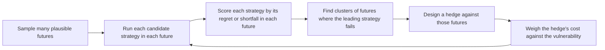

A parameter recommendation for Avalanche has to hold up across AVAX prices, outside yields, and validator responses that no one can assign reliable probabilities to. Choosing the parameter set with the best average outcome hides the futures in which it fails. This paper sets out robust decision making, a method that searches for a strategy that performs acceptably across many futures and names the ones where it does not.

## Citation

Robert J. Lempert, David G. Groves, Steven W. Popper, and Steve C. Bankes. 2006. A General, Analytic Method for Generating Robust Strategies and Narrative Scenarios. Management Science 52, no. 4: 514 to 528. DOI [10.1287/mnsc.1050.0472](https://doi.org/10.1287/mnsc.1050.0472).

## Question and method

The paper starts from the statement that "robustness is a key criterion for evaluating alternative decisions under conditions of deep uncertainty", and that no systematic, general approach existed for finding robust strategies. Its method is iterative. It "first suggests candidate robust strategies, identifies clusters of future states of the world to which they are vulnerable, and then evaluates the trade-offs in hedging against these vulnerabilities." The clusters of futures are interpretable as narrative scenarios, so the scenarios come out of the analysis rather than being written in advance.

## Main result

The application is to "robust, adaptive, near-term pollution-control strategies to help ensure economic growth and environmental quality throughout the 21st century." The full text is behind the publisher's paywall and we did not have access to it. This page therefore reports the method as the abstract states it and gives none of the paper's numbers.

## What it gives this research

1. A selection criterion for deliverables [2.1](/Phase-II/Milestones/Milestone-2/2-1-PSUU-Infrastructure/) to [2.3](/Phase-II/Milestones/Milestone-2/2-3-KPI-Computation/). Each candidate parameter set is scored in every sampled future. We measure a parameter set's regret in a future as the gap between its outcome and the best outcome any candidate achieves in that future. We report the maximum regret and a high percentile of regret, not only the mean.
2. A structure for mechanism comparisons in deliverable [2.8](/Phase-II/Milestones/Milestone-2/2-8-Collaborative-Mechanism-Design/). A proposed reward mechanism is presented with the futures in which it fails and with the cost of the hedge that would cover them.

## Limits for Avalanche

The method needs a simulation model trusted enough to run across thousands of futures, so it comes after the behavioral calibration, not before. It needs ranges for each uncertain input. For Avalanche those ranges have to come from data where possible, such as the observed range of AVAX volatility and outside yields, and from stated assumptions where not. The paper's own application is environmental policy over a century. The Avalanche horizon is months to a few years, and the protocol can be changed again by a later proposal, which makes adaptive rules and signposts more useful than a single fixed choice.
