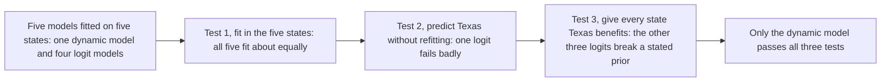

Keane and Wolpin fit models of young women's welfare, work, and family choices on five U.S. states, predict behavior in Texas, whose welfare benefits are far lower, and show that models which fit equally well in sample differ sharply once they must predict a different policy regime.

<!-- overview-table:start -->

| | |
| --- | --- |
| **Authors** | Michael P. Keane, Kenneth I. Wolpin |
| **Published** | 2007 |
| **Source** | *International Economic Review*, [original](https://doi.org/10.1111/j.1468-2354.2007.00465.x) |
| **Topics** | [model validation](/tags/model-validation), [structural estimation](/tags/structural-estimation) |
| **Key terms** | nonrandom holdout sample, dynamic programming model, multinomial logit, counterfactual, overfitting |
| **Serves deliverables** | [1.4](/Phase-II/Milestones/Milestone-1/1-4-Behavioral-Calibration/), [2.4](/Phase-II/Milestones/Milestone-2/2-4-Validation-Confirmation/) |

<!-- overview-table:end -->

Michael Keane, then at Yale, and Kenneth Wolpin, at the University of Pennsylvania, circulated the paper in May 2005 as PIER Working Paper 06-006 and published it in the *International Economic Review* in 2007. Their problem is that chances to validate a behavioral model against a real change in policy are "extremely rare." The classic case is McFadden's forecast of ridership on San Francisco's BART rail system, made before the system opened and then compared with actual use. Waiting for such events is not a workable research strategy, so the authors create the test from existing data.

The proposal is a **nonrandom holdout sample**. An ordinary holdout sample is a random part of the data kept out of estimation to check for overfitting. A nonrandom holdout is chosen because it faces a very different policy regime, so predicting it resembles predicting the effect of a policy change. The model is a **dynamic programming model**, one in which each woman looks ahead and chooses, every six months from age 14, among up to 36 combinations of school, part-time or full-time work, marriage, pregnancy, and welfare. The data are the 1979 youth cohort of the National Longitudinal Survey, over 6,000 women aged 14 to 21 in January 1979, together with state welfare rules collected for 1967 to 1990. The model is estimated on California, Michigan, New York, North Carolina, and Ohio. Texas is held out because it "is by far the least generous state." Average benefits for a woman with one child were 654 dollars a month in Michigan and 377 in Texas, in 1987 New York dollars.

The benchmarks are four **multinomial logit** models, static and flexible models that relate four of the choices directly to the woman's circumstances. The base logit has 13 choices and 240 parameters, about as many as the dynamic model. All models face three tests. The first is fit to the five estimation states. The second is prediction of Texas without refitting. The third is a **counterfactual**: give all five states Texas's benefits and check the predictions against three strong priors. Welfare use should fall, work should rise by no more than welfare falls, and schooling should not fall.

In sample, every model fits well and "it is difficult to choose among them." In Texas, the logit with state fixed effects fits "a bit better than the DP model." One logit, which replaces state effects with five benefit parameters, fails badly. Its error for white women's welfare use rises from 0.010 to 0.815, because it predicts very high welfare use in Texas. Those five parameters had passed a within-sample test with a p-value of 0.000. The authors conclude that "the validation sample is capable of identifying over-fitting in a way that the within-sample significance test was not." The counterfactual then breaks the three remaining logits. The best-fitting one predicts that welfare use and fertility rise and work falls, which the authors call "seemingly perverse." Another predicts that, at ages 26 to 29.5, white women's work rises 12.2 percentage points while their welfare use falls only 3.8 points, and that schooling falls. The dynamic model predicts a fall in welfare use larger than the rise in work, which stays under 5 points, and a slight rise in schooling. The largest effect is for Hispanic women, whose welfare use falls from 15.3% to 10.2%. The authors credit the model's economic structure for keeping its predictions sensible. These figures are from the working paper and have not been checked against the published tables.

*How the three tests separated five models that looked equally good in sample. The holdout state removed one model, and the counterfactual checked against strong priors removed three more. The paper's figures are not reproduced here, so this diagram is drawn from its text.*

## How it relates to our research

**Network upgrades are Avalanche's holdout states.** Of the upgrades the [Glossary](/Phase-II/Wiki/Reference/Glossary-and-Notation) lists, Banff, Cortina, Durango, and Helicon changed Primary Network staking rules. Etna separated L1 validators from Primary Network staking but left the reward rules unchanged. The holdout design for deliverable [2.4](/Phase-II/Milestones/Milestone-2/2-4-Validation-Confirmation/) fits the behavioral blocks on earlier upgrade periods and predicts the next one without refitting. The proposal's backtest, from January to December 2025, is a time holdout within one set of staking rules, because Fortuna and Granite changed none. Keane and Wolpin argue that the further apart the regimes, the less likely a good prediction is by chance, which makes Helicon the stronger test.

**Helicon is a live holdout for the Foundation's own model.** The Foundation's [validator rewards article](/Phase-II/Wiki/Collections/Essential-Readings/How-Do-Avalanche-Validators-Actually-Think-About-Staking-Rewards/) predicts average commitment durations of 16.7 weeks at a minimum consumption rate of 0.08 and 20.9 weeks at 0.07, with a short minimum duration. Helicon, active since 2026-09-22 15:00 UTC, lowers the rate from 0.10 to 0.075 over 90 days under [ACP-285](/Phase-II/Wiki/Collections/Economic-ACPs/ACP-285-Minimum-Consumption-Rate/). Commitments started after the ramp will confirm or reject that range. The same applies to our model: a forecast frozen now is scored against data that do not yet exist, a stricter test than the authors could run with data already in hand.

**Every structural result gets a simpler rival and stated priors.** Deliverable [1.4](/Phase-II/Milestones/Milestone-1/1-4-Behavioral-Calibration/) fits response functions for staking, unstaking, and restaking. Each is compared with a reduced-form model fitted to the same data, as the logits were here. The structural model earns its place where it predicts a new regime better, or where the rival's counterfactuals break a prior. The priors are written down before any run. One example is that cutting rewards for short commitments should not move stake toward shorter commitments.

**Where Avalanche differs from the paper's setting.** Texas differs from the other states mainly in benefit level. Helicon changed four rules at once: the consumption rate ramp, a 48-hour minimum validator duration under [ACP-273](/Phase-II/Wiki/Collections/Economic-ACPs/ACP-273-Minimum-Validator-Duration/), a 90% uptime requirement, and auto-renewed staking. A holdout across it tests the model's response to the package, not to one parameter. The authors note that a regime shift separated in time lets other conditions change, so AVAX price and outside yields enter the model as inputs. [BENQI told us](/Phase-II/Interviews/BENQI-2026-08-31/) that the minimum delegation commitment is still 14 days, so it could shorten its commitments only through validators it runs itself. The holdout therefore scores validators and delegators separately. Finally, the paper judges acceptability "based on our own subjective standards," so our pass bands are set before the forecast is scored.

**It completes the validation pages.** [Barlas](/Phase-II/Wiki/Collections/Supplementary-Research-Papers/1996-Model-Validity-in-System-Dynamics) tests structure through extreme conditions, which play the role of the authors' priors. [Hansen](/Phase-II/Wiki/Collections/Supplementary-Research-Papers/1982-Generalized-Method-of-Moments) gives a within-sample test of fit, and this paper shows why within-sample tests are not enough alone. [Andrews, Gentzkow, and Shapiro](/Phase-II/Wiki/Collections/Supplementary-Research-Papers/2017-Sensitivity-of-Estimates-to-Moments) measure how estimates respond to small violations of assumptions, and a holdout across an upgrade tests the large ones.

**Open question for the Foundation.** Which Helicon outcomes should we forecast and freeze now, before the post-ramp data arrive?

## Source

Michael P. Keane and Kenneth I. Wolpin. 2007. Exploring the usefulness of a nonrandom holdout sample for model validation: Welfare effects on female behavior. *International Economic Review* 48, no. 4: 1351 to 1378. DOI [10.1111/j.1468-2354.2007.00465.x](https://doi.org/10.1111/j.1468-2354.2007.00465.x). The figures on this page are from the public working paper version, PIER Working Paper 06-006, University of Pennsylvania, <https://economics.sas.upenn.edu/sites/default/files/filevault/working-papers/06-006.pdf>.
