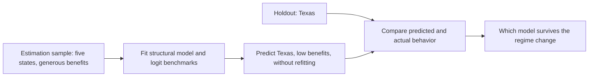

A staking model is worth building if it can predict what happens after the protocol changes. The fair test is to fit it before an upgrade and predict after, without refitting. Keane and Wolpin give the design and show what it reveals. In their case a simple model that fits well in sample makes counterfactual predictions with the wrong sign.

## Citation

Michael P. Keane and Kenneth I. Wolpin. 2007. Exploring the usefulness of a nonrandom holdout sample for model validation: Welfare effects on female behavior. International Economic Review 48, no. 4: 1351 to 1378. DOI [10.1111/j.1468-2354.2007.00465.x](https://doi.org/10.1111/j.1468-2354.2007.00465.x). Open working paper version: PIER Working Paper 06-006, University of Pennsylvania, <https://economics.sas.upenn.edu/sites/default/files/filevault/working-papers/06-006.pdf>.

## Question and method

The paper asks how to gain confidence in a model's forecasts of a large policy change when no experiment exists. Its answer is to hold out a sample that faced a very different policy. The model is a dynamic programming model of women's joint choices on schooling, work, marriage, pregnancy, and welfare, with decisions every six months from age 14. The data are the 1979 youth cohort of the National Longitudinal Survey, with state welfare rules. The authors estimate the model on five states and hold out Texas, which "is by far the least generous state". Average benefits for one child were 377 dollars in Texas against 654 in Michigan, in 1987 New York dollars. They compare it with four multinomial logit models with 240 parameters each.

## Main result

The figures below are from the open working paper. We have not checked them against the published tables. In the holdout, a logit with state fixed effects fits Texas well, and the authors write that it "fits the data from Texas a bit better than the DP model". The same logit then gives a counterfactual the authors call "seemingly perverse". Given Texas benefits in all five states, it predicts that welfare take-up and fertility rise and work falls. A within-sample test strongly favors extra benefit parameters, with p = 0.000, yet adding them does not improve the holdout fit. The authors read this as "evidence that the validation sample is capable of identifying over-fitting in a way that the within-sample significance test was not".

## What it gives this research

1. A holdout design for deliverable [2.4](/Phase-II/Milestones/Milestone-2/2-4-Validation-Confirmation/). Fit the behavioral blocks on commitments before an upgrade, such as Durango or Etna, and predict the upgrade period that follows without refitting. Helicon, active since 22 September 2026, allows a forecast written now to be scored against data that do not yet exist.
2. A benchmark rule for the same deliverable. Every structural result is compared with a reduced-form model fitted to the same data. The structural model earns its place only where it predicts the new regime better, or where the reduced-form model's counterfactuals have the wrong sign.

## Limits for Avalanche

Texas differs from the other states by benefit level, while an Avalanche upgrade changes several rules at once. Helicon changed the minimum duration, the consumption rate path, the uptime requirement, and the renewal options together. A holdout across it tests the model's response to the whole package, not to one parameter. The paper has one holdout state and judges acceptability by the authors' own standards, which it says openly. Since 2022, five Avalanche upgrades have changed staking rules: Banff, Cortina, Durango, Etna, and Helicon. That gives more holdouts than the paper had, each with fewer observations.
