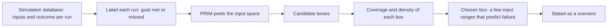

After a parameter sweep, the question is not only which parameter set did best, but under what conditions each one fails. Bryant and Lempert turn that question into a procedure. A scenario is a region of the uncertain inputs, a box, in which a policy misses its goals, and an algorithm searches the simulation results for boxes that are both accurate and easy to state.

## Citation

Benjamin P. Bryant and Robert J. Lempert. 2010. Thinking inside the box: A participatory, computer-assisted approach to scenario discovery. Technological Forecasting and Social Change 77, no. 1: 34 to 49. DOI [10.1016/j.techfore.2009.08.002](https://doi.org/10.1016/j.techfore.2009.08.002).

## Question and method

The paper defines scenarios as "a set of plausible future states of the world that represent vulnerabilities of proposed policies, that is, cases where a policy fails to meet its performance goals." It applies "statistical or data-mining algorithms to databases of simulation-model-generated results in order to identify easy-to-interpret combinations of uncertain model input parameters that are highly predictive of these policy-relevant cases", and presents statistical tests to evaluate the resulting scenarios. The main algorithm is the Patient Rule Induction Method, PRIM, which peels away thin slices of the input space to leave a box rich in failures.

A candidate box is judged on two measures, as the scenario discovery literature defines them. **Coverage** is the share of all failure cases that fall inside the box. **Density** is the share of cases inside the box that are failures. A useful box has high values of both and restricts few inputs.

## Main result

The application tests "the efficacy of a proposed U.S. renewable energy standard." The full text is behind the publisher's paywall, so this page gives no numbers from the paper itself. A public reproduction in the documentation of the Exploratory Modeling Workbench uses the paper's data, which Bryant made available: 882 runs over 9 uncertain inputs, 89 of them cases of interest where the policy misses its goal. It selects a box that restricts 4 inputs, with coverage 0.75 and density 0.77. Those figures are the reproduction's, <https://emaworkbench.readthedocs.io/en/latest/examples/scenario_discovery.html>.

## What it gives this research

1. The analysis step after deliverables [2.1](/Phase-II/Milestones/Milestone-2/2-1-PSUU-Infrastructure/) to [2.3](/Phase-II/Milestones/Milestone-2/2-3-KPI-Computation/). Each trajectory is labelled by whether it meets each KPI threshold, and PRIM finds the input ranges that predict failure.
2. The method for the [risk surface map](/Phase-II/Milestones/Milestone-2/2-6-Risk-Surface-Map/), whose contract requirement is the parameter regions where staking incentives fail. A box with its coverage and density is that region stated in a form the Foundation can check.

## Limits for Avalanche

Boxes are aligned with the input axes. A failure region that depends on a ratio of two inputs, such as the staking reward rate against the outside yield, is found only if that ratio is supplied as an input. The results depend on the sampled ranges, so a box is only as credible as the ranges behind it. Density and coverage trade against each other, and the choice between boxes is a judgment the paper frames as participatory, made with the decision makers rather than by the algorithm alone.
