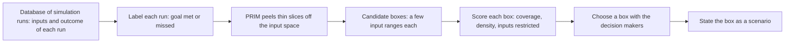

Bryant and Lempert define a scenario as a region of uncertain inputs in which a policy fails to meet its goals, and find such regions by running a box-finding algorithm over a database of simulation runs, so that the scenarios are both accurate and easy to state.

Benjamin Bryant and Robert Lempert, both of the RAND Corporation, published the paper in *Technological Forecasting and Social Change* in January 2010. It builds on [robust decision making](/Phase-II/Wiki/Collections/Supplementary-Research-Papers/2006-Robust-Strategies-and-Narrative-Scenarios), Lempert's earlier method, which asks in which futures a proposed strategy fails. This paper turns that question into a procedure with statistical tests. The full text is behind the publisher's paywall. This overview rests on the publisher's abstract, the published record, and a public reproduction of the paper's example, and it reports no number from the paper itself.

Scenario planning has traditionally meant writing a few stories about the future before any analysis. Bryant and Lempert reverse the order. They define scenarios as "a set of plausible future states of the world that represent vulnerabilities of proposed policies, that is, cases where a policy fails to meet its performance goals." The raw material is a large database of simulation runs, each with its uncertain inputs and its outcome. The method applies "statistical or data-mining algorithms" to that database to find "easy-to-interpret combinations of uncertain model input parameters that are highly predictive of these policy-relevant cases." The approach is **participatory** because the decision makers help choose among the candidate scenarios that the computer proposes.

The main algorithm is the **Patient Rule Induction Method**, or **PRIM**. Each run is first labeled by whether the policy met its goal. PRIM then peels thin slices off the edges of the input space, one at a time, and leaves a **box**: a range for each of a few inputs, inside which failures are concentrated. **Coverage** is the share of all failure cases that fall inside the box. **Density** is the share of cases inside the box that are failures. A useful box scores high on both and restricts few inputs, which keeps it easy to interpret. Coverage and density trade against each other, and the paper presents statistical tests to evaluate the resulting scenarios.

The paper's example tests "the efficacy of a proposed U.S. renewable energy standard." The documentation of the Exploratory Modeling Workbench, an open-source toolkit, reproduces the example with data that Bryant made available. The data hold 882 runs over 9 uncertain inputs, such as total biomass, demand elasticity, and cellulosic cost, with 89 cases of interest in which the policy misses its goal. The reproduction selects a box that restricts 4 inputs, with coverage of 0.75 and density of 0.77. The restriction on cellulosic cost is not statistically significant, and dropping it gives coverage of about 0.76 and density of about 0.72. These figures are the reproduction's, not the paper's.

*The scenario discovery procedure. The computer proposes boxes of input ranges in which failures cluster, and people choose among them by weighing coverage against density. The chosen box is then read as a plain statement, such as "the policy fails when total biomass, demand elasticity, and the biomass backstop price all lie in these ranges." The paper's figures are not reproduced here, so this diagram is drawn from the abstract and the public reproduction.*

## How it relates to our research

**It is the analysis step after the sweep.** Deliverable [2.3](/Phase-II/Milestones/Milestone-2/2-3-KPI-Computation/) scores every trajectory as pass or fail on each KPI, and the [proposal](/Phase-II/Milestones/Milestone-0/Proposal/) converts each KPI to met or not met before analysis. That table of inputs and pass or fail labels is exactly PRIM's input. The proposal names decision trees for deliverable [2.5](/Phase-II/Milestones/Milestone-2/2-5-Sensitivity-Analysis/). A leaf of a decision tree is also a set of input ranges, so both methods describe failure in the same form. PRIM adds a single box that is easy to state, with its coverage and density, and we report both.

**It gives the risk map a form the Foundation can check.** The contract requirement of deliverable [2.6](/Phase-II/Milestones/Milestone-2/2-6-Risk-Surface-Map/) is the parameter regions where staking incentives fail. The proposal counts a configuration as failing when any KPI crosses its threshold, and it tests failure under high volatility, sudden shocks, and sustained stress. A box with its coverage and density is such a region, stated as a few ranges that anyone can test against new runs. A box can restrict governance parameters, such as the minimum consumption rate, and environmental inputs, such as external yields, at the same time.

**Boxes become rows of the playbook.** The [Scenario Playbook](/Phase-II/Milestones/Milestone-3/3-2-Scenario-Playbook/) is defined as "If X market condition, then Y parameter adjustment." A box over environmental inputs names the market condition. The parameter setting that no longer fails inside that box names the adjustment. The 2006 paper supplies the hedge, and this paper supplies a tested way to find what the hedge must cover.

**Ratios must be supplied as inputs.** PRIM's boxes are aligned with the input axes. A failure region that depends on a ratio or a difference of two inputs is found only if that quantity is supplied as an input of its own. The security condition in [Competitive Equilibria Between Staking and On-Chain Lending](/Phase-II/Wiki/Collections/Supplementary-Research-Papers/2020-Staking-and-Lending-Equilibria/) is such a quantity: staking is secure only while the staking reward clears the best outside yield. The spread between the two therefore enters the database beside the reward rate and the outside yield.

**Where Avalanche differs, and what stays open.** A box is only as credible as the sampled ranges behind it. The proposal marks its ranges and scenarios as illustrative, and deliverable [2.2](/Phase-II/Milestones/Milestone-2/2-2-Simulation-Execution/) asks the Foundation which ones the sweep should cover. The paper treats the choice between boxes as a judgment made with the decision makers. The natural place for that judgment is [Workshop 1](/Phase-II/Milestones/Milestone-2/2-7-Workshop-1/), the review of preliminary findings. [Paruch and Shorish](/Phase-II/Wiki/Collections/Supplementary-Research-Papers/2021-Parameter-Selection-Under-Uncertainty) describe the sweep that produces the database this method reads.

**Open question for the Foundation.** A box with high coverage catches most failures but includes some safe cases, and a box with high density is precise but misses some failures. For the risk map, which error matters more to the Foundation?

## Source

Benjamin P. Bryant and Robert J. Lempert. 2010. Thinking inside the box: A participatory, computer-assisted approach to scenario discovery. *Technological Forecasting and Social Change* 77, no. 1: 34 to 49. DOI [10.1016/j.techfore.2009.08.002](https://doi.org/10.1016/j.techfore.2009.08.002). The paper has no free full text. This overview follows the publisher's abstract and the published record. The reproduction figures are from the Exploratory Modeling Workbench documentation, <https://emaworkbench.readthedocs.io/en/latest/examples/scenario_discovery.html>.
