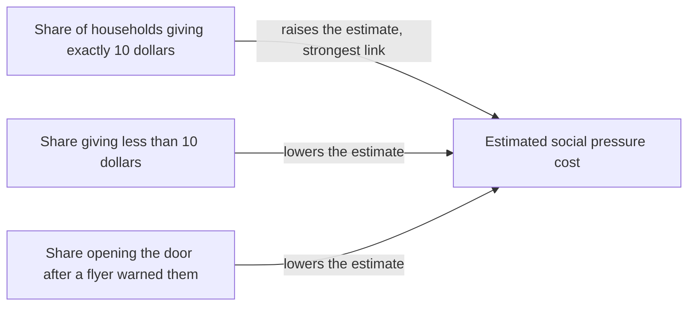

Andrews, Gentzkow, and Shapiro give a matrix that shows how much each estimated parameter moves when each summary of the data moves, so that a reader can see which features of the data drive a structural estimate and predict the bias that a named violation of the model's assumptions would cause.

<!-- overview-table:start -->

| | |
| --- | --- |
| **Authors** | Isaiah Andrews, Matthew Gentzkow, Jesse M. Shapiro |
| **Published** | 2017 |
| **Source** | *The Quarterly Journal of Economics*, [original](https://doi.org/10.1093/qje/qjx023) |
| **Topics** | [structural estimation](/tags/structural-estimation), [sensitivity analysis](/tags/sensitivity-analysis) |
| **Key terms** | sensitivity matrix, transparency, minimum distance estimator, moment, omitted variables bias formula |
| **Serves deliverables** | [1.4](/Phase-II/Milestones/Milestone-1/1-4-Behavioral-Calibration/), [2.4](/Phase-II/Milestones/Milestone-2/2-4-Validation-Confirmation/) |

<!-- overview-table:end -->

Isaiah Andrews of MIT, Matthew Gentzkow of Stanford, and Jesse Shapiro of Brown circulated the paper as NBER Working Paper 20673 in November 2014, revised it in May 2017, and published it in *The Quarterly Journal of Economics* in 2017. Their starting point is a common complaint about **structural estimation**, which fits an economic model of behavior to data. Critics say it lacks transparency, and the authors quote Angrist and Pischke that it is often "hard to see precisely which features of the data drive the ultimate results." The authors call research **transparent** when it lets a reader work out how the estimates would change under assumptions the reader finds more plausible.

Linear regression is transparent in this sense because of the **omitted variables bias formula**. A reader who suspects a missing variable can guess the direction and size of the bias without the data. The paper extends that property to a broad class of nonlinear estimators. A **moment** is a summary number of the data, such as a share, a mean, or a covariance. A **minimum distance estimator** chooses the parameters that bring the model's moments as close as possible to the data's moments, by minimizing $\hat g(\theta)^\top W \hat g(\theta)$, where $\hat g$ is the gap between them and $W$ is a weight matrix. The class includes the [generalized method of moments](/Phase-II/Wiki/Collections/Supplementary-Research-Papers/1982-Generalized-Method-of-Moments), classical minimum distance, maximum likelihood, and their simulated versions.

The paper's measure is the **sensitivity** matrix

$$\Lambda = -\left(G^\top W G\right)^{-1} G^\top W,$$

where $G$ is the derivative of the moments with respect to the parameters. Row $k$ of $\Lambda$ says how much parameter $k$ moves per unit change in each moment. If an alternative assumption would shift the moments by $\Delta g$, the first-order bias in the estimates is approximately $\Lambda\,\Delta g$. For ordinary least squares, $\Lambda$ reduces to the omitted variables bias formula. $G$ and $W$ are already computed to get standard errors, so $\Lambda$ costs "essentially zero" extra computation. The authors also suggest that informal claims that a parameter is "identified by" certain moments be restated as claims about sensitivity, which can be measured.

The authors apply $\Lambda$ to three published models, and the results below are from the May 2017 working paper. In DellaVigna, List, and Malmendier's 2012 model of door-to-door charity, estimated social pressure is \$0.14 per dollar not given, with a standard error of \$0.08. The estimate is most sensitive to the share of households giving exactly \$10. If 1% of households gave \$10 for another reason, such as convenience, the estimate would be overstated by roughly 5%, and at 10% of households by more than 50%. In Gourinchas and Parker's 2002 model of lifecycle consumption, if shopping effort varies with age, the discount factor is overstated by 0.4 percentage points and risk aversion is understated by roughly a third. In Berry, Levinsohn, and Pakes's 1995 model of automobile demand, one plausible violation of a supply-side assumption biases the estimated markup of 0.33 down by 17 percentage points, to a corrected 0.50. The paper names two limits. $\Lambda$ is a local approximation, so large departures need a full sensitivity analysis, and its units depend on the units of the moments.

*What one column of the sensitivity matrix says about the charity model. Three moments move the social pressure estimate, and giving exactly 10 dollars moves it most. A reader who doubts that giving at 10 dollars reflects social pressure alone now knows which estimate to distrust, and by how much. The paper's figures are not reproduced here, so this diagram is drawn from its text.*

## How it relates to our research

**It answers the Foundation's parameter and moment request.** The Foundation has asked that the model lay out which parameters it has and which moments it matches, as the [Hansen page](/Phase-II/Wiki/Collections/Supplementary-Research-Papers/1982-Generalized-Method-of-Moments) records. Hansen gives the estimator and its test of fit. $\Lambda$ gives the table that shows which moments set each parameter. For deliverable [1.4](/Phase-II/Milestones/Milestone-1/1-4-Behavioral-Calibration/), which fits the staking, unstaking, and restaking response functions with confidence intervals, we publish $\Lambda$ beside the estimates. A reader can then see, for example, whether a renewal parameter rests on the share of commitments renewed within 7 days or on the median validator duration.

**It turns doubts about our data into numbers.** BENQI told us that its liquid staking delegations run 14 to 18 days, a length set for its users' liquidity, and that it holds 10% to 12% of all stake. Those durations are chosen for reasons outside a reward-driven choice of duration, which is the same problem as households giving \$10 because it is a convenient amount. The [Glossary](/Phase-II/Wiki/Reference/Glossary-and-Notation) records a second case: a single delegator address made 93% of delegation events. For each doubt, $\Lambda\,\Delta g$ says how far each parameter would move if the model misreads that behavior. These checks belong in deliverable [2.4](/Phase-II/Milestones/Milestone-2/2-4-Validation-Confirmation/).

**It helps reconcile our estimates with the Foundation's.** The Foundation's [validator rewards article](/Phase-II/Wiki/Collections/Essential-Readings/How-Do-Avalanche-Validators-Actually-Think-About-Staking-Rewards/) estimates delegator coefficients of +0.44 on log APY and −0.64 on log weeks, and deliverable 1.4 must match or explain them. Where an independent estimate differs, $\Lambda$ shows which moments each coefficient rests on, so the gap can be traced to a specific feature of the data rather than argued in general.

**Where Avalanche differs from the paper's setting.** $\Lambda$ is accurate only near the baseline assumptions. A new upgrade period is a large change, and it is tested by prediction across the upgrade, as [Keane and Wolpin](/Phase-II/Wiki/Collections/Supplementary-Research-Papers/2007-Nonrandom-Holdout-Validation) do, not by $\Lambda$. The Avalanche moments sit on different scales, such as a share, a count of weeks, and a ratio. Because the units of $\Lambda$ follow the units of the moments, ranking which moment matters most needs the moments on a common scale. The authors do this for the automobile model by expressing each violation per standard deviation of the instrument. Our model is simulated, and the paper's online appendix extends the results to simulated moments that are not smooth in the parameters.

**It connects to the other calibration pages.** [Hansen](/Phase-II/Wiki/Collections/Supplementary-Research-Papers/1982-Generalized-Method-of-Moments) sets the estimator that $\Lambda$ describes. [Berry](/Phase-II/Wiki/Collections/Supplementary-Research-Papers/1994-Discrete-Choice-Demand-Estimation) and [Rust](/Phase-II/Wiki/Collections/Supplementary-Research-Papers/1987-Optimal-Replacement-of-Bus-Engines) supply behavioral models whose parameters it can be computed for. [Sterman](/Phase-II/Wiki/Collections/Supplementary-Research-Papers/1984-Summary-Statistics-for-Historical-Fit) reports how well the fitted model tracks history, and $\Lambda$ reports which data the fit depends on.

## Source

Isaiah Andrews, Matthew Gentzkow, and Jesse M. Shapiro. 2017. Measuring the Sensitivity of Parameter Estimates to Estimation Moments. *The Quarterly Journal of Economics* 132, no. 4: 1553 to 1592. DOI [10.1093/qje/qjx023](https://doi.org/10.1093/qje/qjx023). The figures on this page are from the public working paper version, NBER Working Paper 20673, revised May 2017, <https://www.nber.org/papers/w20673>.
