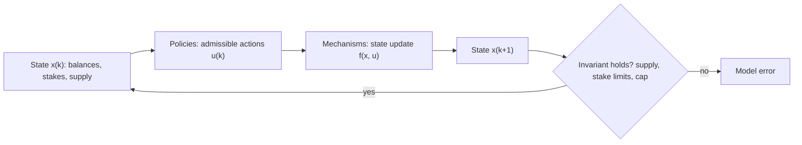

The staking model is built in cadCAD, and cadCAD's structure of state, policies, and state updates comes from this paper. It shows that a ledger is a dynamical system and that the protocol's own rules, not agents' good behavior, fix properties such as total supply. That gives the model a test it must pass before any behavior is added. Replaying the chain's actions must reproduce the chain's state exactly.

## Citation

Michael Zargham, Zixuan Zhang, and Victor Preciado. 2018. A State-Space Modeling Framework for Engineering Blockchain-Enabled Economic Systems. arXiv:1807.00955, 3 July 2018. Oral presentation at the Ninth International Conference on Complex Systems. <https://arxiv.org/abs/1807.00955>.

## Question and method

The paper asks whether a blockchain ledger can be written as a dynamical system so that control theory applies, and whether local restrictions on what each account may do can guarantee global properties. The state is the vector of account balances $x(k)$ after block $k$. It changes only through admissible actions:

$$x(k) = x(k-1) + \Delta x(k), \qquad x(K) = x(0) + \sum_{k=1}^{K} \Delta x(k).$$

For Bitcoin the paper writes this as a linear system whose number of accounts can only grow:

$$x(k+1) = A_k\,x(k) + B_k\,u(k) + \mu_k\,v(k),$$

where $u(k)$ are transfers, $B_k$ is an incidence matrix whose columns sum to zero, and $\mu_k$ is the block reward distributed by $v(k)$. A no-overspend rule, $\sum_j u_{(i,j)} \le x_i(k)$, limits each account's actions. The paper also defines invariant and Lyapunov-type value functions, which state what a mechanism conserves or drives toward a target.

## Main result

Because transfers conserve value, total supply depends only on the reward schedule: $y(K) = \sum_k \mu_k$. With Bitcoin's halving schedule this gives $y_\infty = 20{,}999{,}999.9769$ BTC, "generally quoted as 21 million BTC". The paper's point is that the system "tracks a desired property ... for the entire trajectory ... with no assumptions about the actions of the individual agents."

## What it gives this research

1. The model structure for deliverable [1.3](/Phase-II/Milestones/Milestone-1/1-3-Staking-Model-Spec/). State variables are stakes, commitments, and supply. Policies are the actions the P-Chain allows: add a validator, add a delegator, and after Helicon renew automatically. Mechanisms apply the reward formula and the protocol's limits.
2. A structure test for deliverable [2.4](/Phase-II/Milestones/Milestone-2/2-4-Validation-Confirmation/). Replaying observed staking transactions through the model's mechanisms must reproduce the ledger's stake and rewards exactly. The invariants to check at every step are the 720,000,000 AVAX supply cap, the minimum and maximum stake, and the 3,000,000 AVAX weight cap.

## Limits for Avalanche

The paper models supply that only grows. Avalanche mints rewards at the end of each commitment and burns transaction fees, so supply has an inflow and an outflow, and the invariant is the ledger identity, not a fixed schedule. The framework describes what actions are allowed, not which ones agents take. The authors state that it pays "no direct attention ... to the actions of individuals". The behavior blocks on the other pages of this collection fill that gap. The convergence results assume a convex, compact state space.
