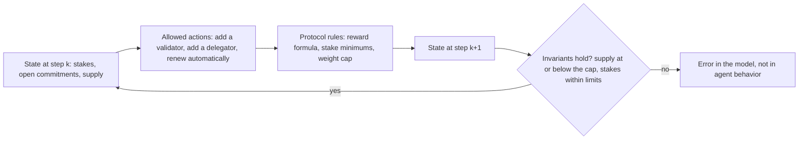

Zargham, Zhang, and Preciado write a blockchain ledger as a discrete-time state-space system and show that local rules on what each account may do can guarantee a global property, such as total supply, whatever the individual agents choose.

Michael Zargham, founder and chief executive of BlockScience, wrote the paper with Zixuan Zhang and Victor Preciado of the University of Pennsylvania's Department of Electrical and Systems Engineering. It was posted to arXiv on 3 July 2018 and given as an oral presentation at the Ninth International Conference on Complex Systems. The authors argue that blockchain networks are economies of agents "driven by incentives under a set of rules," whatever their consensus mechanism, and that engineering them needs a proper mathematical framework. The paper supplies one from control theory.

A **state-space representation** describes a system by a set of **state** variables that change over discrete time steps. The state at the next step depends only on the current state and the inputs applied now. In the paper, the state $x(k)$ is the vector of account balances after block $k$, and it changes only through valid transactions: $x(k) = x(k-1) + \Delta x(k)$, so $x(K) = x(0) + \sum_{k=1}^{K} \Delta x(k)$. The ledger's history is therefore the trajectory of a dynamical system from its genesis block. The paper also treats consensus as a rule for choosing between two valid chains, and notes that proof of work lacks **finality**, the guarantee that an agreed block will never be reversed.

For Bitcoin the paper builds a **linear time-expanding** model, a linear system whose number of accounts can only grow:

$$x(k+1) = A_k\,x(k) + B_k\,u(k) + \mu_k\,v(k).$$

Here $u(k)$ are the transfers, $B_k$ is an incidence matrix whose columns sum to zero because every transfer leaves one account and enters another, $\mu_k$ is the block reward, and $v(k)$ splits it among accounts. A **no-overspend rule**, $\sum_j u_{(i,j)} \le x_i(k)$, limits each account's actions, and each account can enforce it using only its own balance. Because transfers conserve value, total supply depends only on the reward schedule: $y(K) = \sum_k \mu_k$. With Bitcoin's 32 halving intervals of 210,000 blocks, the sum is 20,999,999.9769 BTC, "generally quoted as 21 million BTC."

The paper then generalizes. A **value function** is a nonnegative number computed from the state that encodes a property the designer wants. A property is an **invariant** when every allowed action leaves its value function unchanged. It then holds along every valid trajectory. The paper also defines rules under which a value can only rise, and rules under which it shrinks toward a target at a fixed rate, in the manner of a Lyapunov function in control theory. The convergence results assume a convex, compact state space. The main claim is that such a system "tracks a desired property ... for the entire trajectory ... with no assumptions about the actions of the individual agents." The authors also note the limit of that claim: "no direct attention is paid to the actions of individuals," and some goals cannot be secured by restricting actions alone.

*The paper's framework written with Avalanche's staking rules. Agents choose among the allowed actions, the protocol rules update the state, and the invariants are checked after every step. A broken invariant points to an error in the model's rules, because no allowed action should be able to break one. The paper's own figures illustrate an incidence matrix and an invariant, and are not reproduced here.*

## How it relates to our research

**It gives the model its mechanical layer.** Deliverable [1.3](/Phase-II/Milestones/Milestone-1/1-3-Staking-Model-Spec/) will show the model's state variables, governance parameters, and update rules. This paper sets that form. The state is the stakes, the open commitments, and the supply. The actions are what the P-Chain allows: add a validator, add a delegator, and since Helicon, stake with [auto-renewal](/Phase-II/Wiki/Collections/Economic-ACPs/ACP-236-Auto-Renewed-Staking/). The rules are the reward formula and the protocol's limits. The [proposal](/Phase-II/Milestones/Milestone-0/Proposal/) names cadCAD, BlockScience's simulation framework, as the simulation executor, and cadCAD uses the same split of state, actions, and updates. The [ACP-285 community call](/Phase-II/Wiki/Collections/Essential-Readings/ACP-285-Avalanche-Community-Call-Staking-Reward-Curve-Adjustment/) page describes a mechanical layer that reproduces rewards and issuance with choices held fixed. This paper describes that layer.

**Replay is the first structure test.** Before any behavior is added, replaying the observed staking transactions through the model's rules must reproduce the ledger. The staking periods notebook on the [Notebooks](/Phase-II/Wiki/Reference/Notebooks) page already compares the protocol kernel's reward with the recorded potential reward for every commitment and counts the ones it reproduces. For deliverable [2.4](/Phase-II/Milestones/Milestone-2/2-4-Validation-Confirmation/) the invariants are checked at every step: supply never exceeds the 720,000,000 AVAX cap, validators hold at least 2,000 AVAX of self-stake, delegations are at least 25 AVAX, and no validator's weight exceeds five times its self-stake or 3,000,000 AVAX. This is the direct structure test that [Barlas](/Phase-II/Wiki/Collections/Supplementary-Research-Papers/1996-Model-Validity-in-System-Dynamics) puts first.

**Avalanche's supply has two ledgers.** The paper's supply only grows, by the block reward. Avalanche has two supply measures, which the [Glossary](/Phase-II/Wiki/Reference/Glossary-and-Notation) defines. The P-Chain **supply counter** adds a commitment's potential reward when the reward is fixed at its start and removes rewards that are forfeited. The **realized total supply** starts from the 360,000,000 AVAX genesis supply, adds rewards paid, and subtracts AVAX burned on the P-, X-, and C-Chains. The invariant is therefore a ledger identity with an inflow and an outflow, not a fixed schedule. The [Data](/Phase-II/Wiki/Reference/Data) page notes that the current monetary ledger checks realized supply only through 2023-10-05, because its C-Chain fee data are incomplete after that date. The identity can be enforced over the full history only once that gap is closed.

**Rules bound behavior but do not predict it.** The framework says which actions are allowed, not which ones agents take. The behavioral pages of this collection fill that gap: [McFadden](/Phase-II/Wiki/Collections/Supplementary-Research-Papers/1973-Conditional-Logit-Analysis) and [Rust](/Phase-II/Wiki/Collections/Supplementary-Research-Papers/1987-Optimal-Replacement-of-Bus-Engines) for validator choices, [Berry](/Phase-II/Wiki/Collections/Supplementary-Research-Papers/1994-Discrete-Choice-Demand-Estimation) for delegators, and [Chitra](/Phase-II/Wiki/Collections/Supplementary-Research-Papers/2020-Staking-and-Lending-Equilibria/) for the outside option. The authors suggest comparing the direction of individual incentives with the direction of a global value function. Deliverable [2.8](/Phase-II/Milestones/Milestone-2/2-8-Collaborative-Mechanism-Design/) asks the same of each proposed reward mechanism: does it move each validator's incentive toward network goals such as lower stake concentration?

**What the Avalanche state must hold.** The paper's time step is a block. Our model steps through time, and many commitments are open at once. Under [ACP-285](/Phase-II/Wiki/Collections/Economic-ACPs/ACP-285-Minimum-Consumption-Rate/), each commitment's minimum consumption rate is fixed at its start, so the state must carry every open commitment's start time, stake, and duration, not only totals. Commitments are discrete objects, so the state space is not convex, and the paper's convergence results do not apply directly. Its invariant results, which need no such assumption, are the part we use.

## Source

Michael Zargham, Zixuan Zhang, and Victor Preciado. 2018. A State-Space Modeling Framework for Engineering Blockchain-Enabled Economic Systems. arXiv:1807.00955, posted 3 July 2018. Oral presentation at the Ninth International Conference on Complex Systems. DOI [10.48550/arXiv.1807.00955](https://doi.org/10.48550/arXiv.1807.00955), <https://arxiv.org/abs/1807.00955>.
