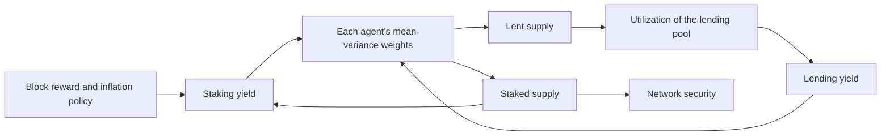

Read the [full paper](/Phase-II/Wiki/Collections/Supplementary-Research-Papers/2020-Staking-and-Lending-Equilibria/Source-Paper).

A validator's outside option is what the same AVAX would earn elsewhere. The Foundation has asked that the model treat that option as a portfolio of alternative uses of capital, not lending alone. This paper is the first formal treatment of staking as one asset in such a portfolio. It shows how a lending market can draw stake away from validation.

## Citation

Tarun Chitra. 2020. Competitive equilibria between staking and on-chain lending. Cryptoeconomic Systems, published 30 November 2020. DOI [10.21428/58320208.9ce1cd26](https://doi.org/10.21428/58320208.9ce1cd26). Preprint arXiv:2001.00919, <https://arxiv.org/abs/2001.00919>.

## Question and method

The paper asks whether on-chain lending yields can pull tokens out of proof-of-stake validation and weaken security, and how the answer depends on monetary policy. Each agent is a myopic mean-variance investor. It splits its tokens between staking and lending with portfolio weights

$$w = \lambda\,\Sigma^{-1}\mu, \qquad \mu = \left(\frac{\pi_{\text{stake}}}{\zeta_t},\ \gamma_t\right),$$

where $\zeta_t$ is total staked supply, $\pi_{\text{stake}}$ the block reward, $\gamma_t$ the lending rate, $\Sigma$ an agent-specific covariance, and $\lambda$ the agent's risk tolerance. The lending rate follows a Compound-style utilization curve, so it rises as more tokens are borrowed. Rewards come only from block rewards. There are no fees and no unbonding period.

## Main result

The paper's conclusion is that rational actors "can dramatically reduce PoS network security if block rewards are not calibrated appropriately above the expected yields of on-chain lending." Under deflationary policy, large moves of tokens from staking to lending occur unless the reward rate clears a bound set by the lending rate and the spread of agents' risk preferences. The paper derives similar conditions for polynomial and exponential inflation. Simulations with 512 agents over 250,000 blocks, 100 seeds per setting, and Compound's rate parameters of 5% and 45% show more lending than staking under deflationary policy and staking dominance under linear inflation. The formal proofs cover only a two-state version of the model.

## What it gives this research

1. An outside-option block for deliverable [1.3](/Phase-II/Milestones/Milestone-1/1-3-Staking-Model-Spec/). The mean-variance weights extend to more than two assets, so one block can hold staking, lending, treasury bills, and liquid staking yields, which is the portfolio of alternatives the Foundation asked for.
2. An environment variable and a failure condition for deliverables [2.1](/Phase-II/Milestones/Milestone-2/2-1-PSUU-Infrastructure/) to [2.3](/Phase-II/Milestones/Milestone-2/2-3-KPI-Computation/). The outside yield enters the sweep as an uncontrolled input, and the spread between the staking reward rate and the best outside yield is the quantity at which stake starts to leave.

## Limits for Avalanche

The model has no lock-up. Avalanche stake is locked for the full commitment, from 48 hours to one year, so the cost of giving up liquidity rises with duration. The Foundation's [validator rewards article](/Phase-II/Wiki/Collections/Essential-Readings/How-Do-Avalanche-Validators-Actually-Think-About-Staking-Rewards/) measures that cost at about 0.8 percentage points of annualized yield per extra week. A mean-variance block without a duration term would miss it. Agents are myopic and rebalance every block, while an Avalanche staker can only move stake at the end of a commitment. The model has no fees, a fixed number of agents, and no external markets.
