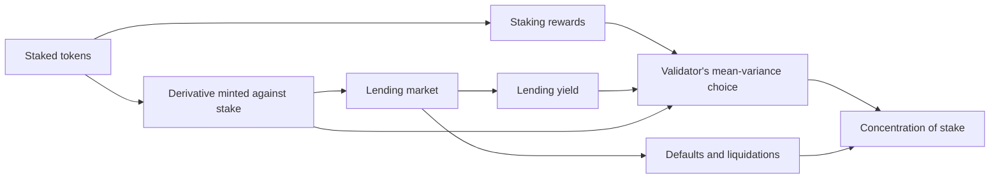

Liquid staking lets a holder stake and still use the value of the stake. On Avalanche this is BENQI's sAVAX. A model that treats staked AVAX as fully illiquid will overstate the cost of staking for anyone who can hold a liquid claim instead. Chitra and Evans give the first model of these claims as a third asset beside staking and lending, and trace their effect on how evenly stake is spread.

## Citation

Tarun Chitra and Alex Evans. 2020. Why Stake When You Can Borrow? arXiv:2006.11156, 16 June 2020. <https://arxiv.org/abs/2006.11156>. Also SSRN 3629988, DOI [10.2139/ssrn.3629988](https://doi.org/10.2139/ssrn.3629988).

## Question and method

The paper asks what staking derivatives, fungible claims minted against staked assets, do to security, to the concentration of stake, and to returns. Each validator's derivative is priced by a decreasing curve in the share of its stake that has been borrowed against, $\varphi_i(s) = \phi(a_i s + b_i)$, for example $\phi(s) = s^{-k} \wedge 1$. The loan is liquidated below a collateral factor. Stake evolves as a Pólya urn in which validators gain stake in proportion to what they hold, and can be slashed or default. Validators choose mean-variance portfolios across staking, the derivative, and lending:

$$\max_w\ w^\top \mu - \tfrac{1}{2}\,\lambda\, w^\top \Sigma\, w.$$

## Main result

The probability that a validator is eventually wiped out by slashing is $\gamma = p_i/(1-p_i)$, where $p_i$ is its per-period slashing probability. The paper conjectures that validators use the derivative if and only if the curvature of its pricing curve satisfies $k \le 1$. In simulations, the boundary between concentrated and spread-out stake lies near $\lambda_{\text{slash}} = \tfrac{4}{5}\lambda_{\text{borrow}} - 1$ in the rates of slashing and borrowing. Derivatives can reduce inequality in stake, but a large fraction of the money supply is then burned to cover defaults. The unsafe regime is not studied, and the concentration result is a simulation finding, not a proof.

## What it gives this research

1. A third asset for the outside-option block of deliverable [1.3](/Phase-II/Milestones/Milestone-1/1-3-Staking-Model-Spec/). A liquid staking token earns the staking yield less a fee and keeps most of the holder's liquidity, so it enters the holder's portfolio as its own asset rather than as staking.
2. A concentration measure for deliverable [2.3](/Phase-II/Milestones/Milestone-2/2-3-KPI-Computation/). The paper reports a Gini-type measure of stake across validators. Stake concentration is one of the quantities a parameter sweep over [2.1](/Phase-II/Milestones/Milestone-2/2-1-PSUU-Infrastructure/) to 2.3 should compute per trajectory.

## Limits for Avalanche

The paper's risk runs through slashing and loan default. Avalanche does not slash stake, so the default channel that drives much of the concentration result is absent. BENQI's liquid staking delegates to validators rather than letting each validator borrow against its own stake, so on Avalanche the derivative changes delegator behavior first. The formal results rest on stricter assumptions than the simulations, and credit risk is approximated rather than priced.
