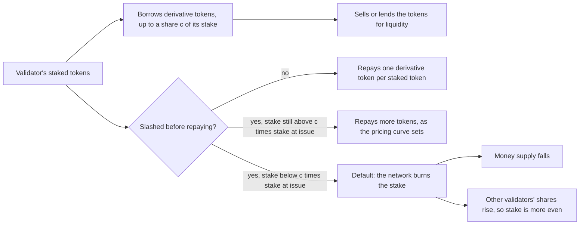

Tarun Chitra and Alex Evans model staking derivatives, tokens a validator mints against its staked assets, and find that they can spread stake more evenly across validators, but only by burning a large share of the money supply through defaults.

Chitra, of Gauntlet, and Evans, of Placeholder, posted the paper on 16 June 2020. It follows Chitra's earlier paper on [staking and on-chain lending](/Phase-II/Wiki/Collections/Supplementary-Research-Papers/2020-Staking-and-Lending-Equilibria/), which showed that holders leave staking when lending pays more. Designs for Cosmos and Polkadot had proposed **staking derivatives** as a remedy. A staking derivative is a fungible token that lets a validator borrow against its locked stake and regain some liquidity. The paper asks what such derivatives do to network security, to the **concentration of stake** across validators, and to validators' returns.

The paper's example is a Tezos validator with 10,000 XTZ staked and a **collateral factor** of 75%, so it can borrow up to 7,500 XTZ worth of a synthetic token, sXTZ. If the validator is **slashed**, meaning the protocol burns part of its stake as a penalty, it must repay more. If slashing takes its stake below 75% of the stake it had when it borrowed, the loan defaults and the network takes the stake. A **derivative pricing function** φ sets how many derivative tokens redeem one staked token. It equals 1 while the validator still holds at least its stake at issuance, rises as the validator is slashed, and becomes infinite at default. The paper works with the family $\phi(s) = \max(s^{-k}, 1)$, where the exponent $k$ sets how steeply the repayment rises.

The model has two parts. The first follows the distribution of stake as a **Pólya urn**. At each block one validator, drawn in proportion to its stake, wins the block reward, so stake compounds for those who already hold it. Validators can also be slashed by a fixed fraction or default. Concentration is measured by the **Gini coefficient** and by the ratio of the L2 to the L1 norm of the stake vector. The second part treats each validator as a **mean-variance investor** that weighs expected return against variance and chooses weights on staking, the derivative, and on-chain lending at Compound's rates.

A validator with slashing probability $p_i$ below one half eventually loses all its stake with probability $p_i/(1-p_i)$. The simulations run 200,000 blocks, start from an exponential stake distribution with a Gini coefficient of 0.5, and average 100 runs per parameter setting. The expected Gini coefficient shows a sharp transition roughly along $\lambda_{\text{slash}} = \tfrac{5}{4}\lambda_{\text{borrow}} - 1$, where the two λ terms set how often validators are slashed and how often they borrow. With high borrowing and non-trivial slashing, stake becomes more even, because large holders also borrow, and when they are slashed their defaults pass share to smaller validators. The paper conjectures that validators use the derivative only when $k \le 1$, and simulation supports it. With lending added, a flatter pricing curve brings heavy borrowing and many defaults. Under a deflationary monetary policy there is an unsafe region in which the whole money supply is burned. A larger slashing fraction, 0.35 against 0.05, pushes validators toward lending and shrinks that region, and an inflationary policy keeps more of the supply. The authors conclude that a small region near the boundary lets the derivative become the main borrowing market, which blunts the lending attack of the earlier paper. The concentration boundary is a simulation finding, not a proof, and credit risk is approximated rather than priced.

*How a staking derivative works in the paper's model, drawn from the paper's text. A validator borrows against its stake and must buy the derivative back to recover it. Slashing raises the repayment, and slashing below the collateral share c means default. Notice that each default does two things at once: it spreads stake more evenly and it burns supply. That pair is the trade-off the paper reports.*

## How it relates to our research

**Where it enters the model.** The staking model in deliverable [1.3](/Phase-II/Milestones/Milestone-1/1-3-Staking-Model-Spec/) sets a holder's **outside option**, what the same AVAX would earn elsewhere, as a portfolio of alternative uses. A **liquid staking token** belongs in that portfolio as its own route, not as plain staking or plain lending, because it earns the staking reward while keeping most of the holder's liquidity. This paper puts such a claim in a portfolio beside staking and lending, and it shows why the route cannot be treated as an independent asset. The derivative's return moves with the staking return, and the paper models that covariance directly, where [the earlier paper](/Phase-II/Wiki/Collections/Supplementary-Research-Papers/2020-Staking-and-Lending-Equilibria/) assumed the two returns independent.

**What changes for Avalanche.** Avalanche does not slash stake. A validator below the [uptime requirement](/Phase-II/Wiki/Collections/Economic-ACPs/ACP-267-Uptime-Requirement/) loses its reward but keeps its stake. The default channel that drives much of the paper's concentration result is therefore absent, and so is the equalizing effect it produces. The derivative is also issued by a third party, not by the protocol. BENQI takes AVAX from users and delegates it to validators, where it appears on the P-Chain as delegations. The paper notes that this case is simpler, because default risk stays with the provider's customers. Avalanche also fixes each commitment's reward at its start rather than paying one block producer per block, so the urn dynamics do not carry over directly.

**What we can measure.** Deliverable [2.3](/Phase-II/Milestones/Milestone-2/2-3-KPI-Computation/) computes a decentralization KPI, which the proposal defines as one minus the Herfindahl-Hirschman index (HHI), the sum of squared stake shares. The paper's norm ratio is the square root of the HHI, so both it and the Gini coefficient can be reported for every trajectory. [BENQI told us](/Phase-II/Interviews/BENQI-2026-08-31/) that it holds 10% to 12% of all stake and allocates delegations with bots that weigh each validator's capacity, uptime, duration, and stake. Comparing concentration with and without BENQI's delegations shows whether that routing spreads stake or adds to large validators. The answer matters because delegators already prefer larger validators, as the [validator rewards article](/Phase-II/Wiki/Collections/Essential-Readings/How-Do-Avalanche-Validators-Actually-Think-About-Staking-Rewards/) finds, and the [validator economics article](/Phase-II/Wiki/Collections/Essential-Readings/Why-Avalanche-Validator-Economics-Need-a-Redesign/) names consolidation as a problem.

**Duration takes the place of the loan term.** The paper's loans last one epoch and are repaid at its end. On Avalanche the matching unit is the delegation commitment. BENQI runs its delegations for 14 to 18 days, a length set for its users' liquidity. After Helicon it was leaning toward two-day commitments, but the delegator minimum under [ACP-273](/Phase-II/Wiki/Collections/Economic-ACPs/ACP-273-Minimum-Validator-Duration/) is still 14 days. The model therefore gives liquid staking its own duration choice, bounded by the delegator minimum.

**How it shapes the risk map.** The paper sweeps two behavioral parameters, maps concentration and remaining supply across them, and finds sharp boundaries. Deliverable [2.6](/Phase-II/Milestones/Milestone-2/2-6-Risk-Surface-Map/) maps where staking incentives fail in the same way, so its sweep grid needs enough resolution near a boundary to locate it. [Restaking Security Pricing](/Phase-II/Wiki/Collections/Supplementary-Research-Papers/2024-Restaking-Security-Pricing/), also by Chitra, prices stake reused across services. [The Ethereum staking market framework](/Phase-II/Wiki/Collections/Supplementary-Research-Papers/2025-Ethereum-Staking-Market-Framework) models liquid staking users as a separate type of staker.

**Open questions for the Foundation.** Can BENQI's delegations be identified in the P-Chain record, so that its effect on concentration can be measured? Should the decentralization KPI use the HHI alone, as the proposal states, or report the Gini coefficient beside it?

## Source

Tarun Chitra and Alex Evans. 2020. Why Stake When You Can Borrow? arXiv:2006.11156, 16 June 2020. <https://arxiv.org/abs/2006.11156>. Also SSRN 3629988, DOI [10.2139/ssrn.3629988](https://doi.org/10.2139/ssrn.3629988).
