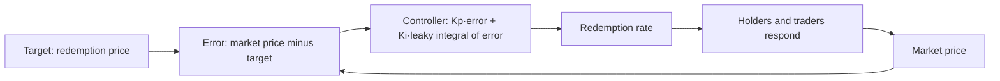

The Foundation's article [From Static Constants to Dynamic Variables](/Phase-II/Wiki/Collections/Essential-Readings/From-Static-Constants-to-Dynamic-Variables-Where-Avalanches-Economics-Are-Headed/) points toward protocol parameters that respond to the state of the network. A reward rate that moves with the staking ratio is a feedback controller. This paper is a worked case of choosing such a controller's form and gains by simulation before launch, for the RAI stablecoin.

## Citation

Michael Zargham, Danilo Lessa Bernardineli, Andrew Clark, Jamsheed Shorish, and Jeff Emmett. 2021. Summoning the Money God: Applying Control Theory to Cryptocurrency Monetary Policy. BlockScience technical article, 9 April 2021. Zenodo, DOI [10.5281/zenodo.10474385](https://doi.org/10.5281/zenodo.10474385).

## Question and method

The paper asks how the parameters of RAI's stability controller were chosen before its mainnet launch on 17 February 2021, and which controller form survives attack and shock tests. The controller sets RAI's redemption rate from the gap between its market price and its redemption price. The authors set the derivative term to zero, because "in an economic setting, the D term could become an attack vector." The candidates are a proportional controller, and proportional-integral controllers with positive, negative, or zero integral gain, each with or without a leak on the integral term. A cadCAD model with collateralized debt positions and the ETH-RAI Uniswap pool runs each candidate through three tests.

## Main result

| Test | Finding |
| --- | --- |
| Whale holds the market price | Redemption price converged to zero within two weeks in every scenario "except for the one with negative Ki AND no leak term" |
| Steady-state error | The hourly redemption rate varies by less than 5e-9 but can accumulate large errors. "The complexity added by the inclusion of the I term is not warranted" |
| 30% ETH price drop after two weeks | The paper reports that "Kp=2e-07 and 5e-09 has a runaway effect" |

The integral term is stable only with a leak, and only if $K_p > -K_i/(1-\alpha)$, where $\alpha$ is the leak parameter. The authors recommend the proportional controller as "the simplest and safest configuration", and RAI launched with the proportional term only. They state that further tuning would be needed to separate the leaky proportional-integral controller from the proportional one.

## What it gives this research

1. A candidate form for a state-dependent reward rule in deliverable [2.8](/Phase-II/Milestones/Milestone-2/2-8-Collaborative-Mechanism-Design/). The consumption rate could respond to the gap between the observed staking ratio and a target, through a proportional gain and possibly a leaky integral.
2. A test battery for deliverables [2.1](/Phase-II/Milestones/Milestone-2/2-1-PSUU-Infrastructure/) to [2.3](/Phase-II/Milestones/Milestone-2/2-3-KPI-Computation/). Each proposed rule is run against a large holder pinning the state, against a slow drift, and against a sudden price shock, and it is kept only if it stays stable in all three.

## Limits for Avalanche

RAI's controller acts on a price every hour. An Avalanche reward rule would act on stake, and each commitment's reward is fixed at its start. A change in the consumption rate reaches only new commitments, so the feedback delay is as long as the commitments that are running, from 48 hours to one year. A long delay can destabilize a feedback loop, so gains tuned for RAI do not transfer. Validators also anticipate a rule they can read, which a controller tuned against passive traders does not model. The paper's tests are, in its own words, non-exhaustive.
