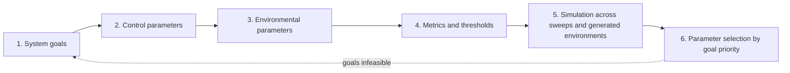

The proposal commits to parameter selection under uncertainty, PSUU, as the method for recommending staking parameters. PSUU sweeps the parameters the protocol controls across many simulated futures and recommends the settings that meet the Foundation's goals in most of them. This article is the workflow's source. It is a methods article, not a peer-reviewed paper, and it has no equations or worked example.

## Citation

Krzysztof Paruch and Jamsheed Shorish. 2021. How to Perform Parameter Selection Under Uncertainty. BlockScience, 8 April 2021, with edits by Michael Zargham, Danilo Lessa Bernardineli, Jeff Emmett, and Jessica Zartler. <https://blog.block.science/how-to-perform-parameter-selection-under-uncertainty/>.

## Question and method

The article asks how to choose parameters for a complex system when information is imperfect. It assumes three things are done first: the system's requirements are specified, the mathematical specification is written, and the computational model is programmed. It then lists six steps.

| Step | What the article asks for | Avalanche instance |
| --- | --- | --- |
| 1 | Turn qualitative targets into precise goals | Goals the Foundation sets, such as security and participation |
| 2 | Parameters the system controls, with a parameter-to-goal impact assessment | Minimum and maximum consumption rate, minimum duration, delegation fee floor, delegation multiplier, uptime requirement |
| 3 | Parameters the system cannot control, represented by generated processes | AVAX price and volatility, outside yields |
| 4 | One or more metrics per goal, and thresholds where the system becomes unresponsive or unstable | Staking ratio, validator count, stake concentration, issuance |
| 5 | Sweep control parameters, generate environments, and test robustness by sensitivity analysis | Deliverables 2.1 and 2.2 |
| 6 | Recommend from basins of attraction and confidence intervals, ranked by goal priority | Parameter recommendations in Milestone 3 |

## Main result

The article's result is the workflow itself. Its aim is "an area near the optimal parameter values", not a single optimum. It allows that goals may conflict so that full achievement is infeasible, and then calls for graduated goals.

## What it gives this research

1. The pipeline for deliverables [2.1](/Phase-II/Milestones/Milestone-2/2-1-PSUU-Infrastructure/), [2.2](/Phase-II/Milestones/Milestone-2/2-2-Simulation-Execution/), and [2.3](/Phase-II/Milestones/Milestone-2/2-3-KPI-Computation/). The split between control and environmental parameters sets the design of the sweep. Step 4 is deliverable 2.3's computation of KPIs per trajectory.
2. A rule that a metric must be able to fail. Each KPI needs a threshold stated before the sweep runs, not a value read off the results.

## Limits for Avalanche

The article gives no statistical standard for how many runs are enough, and no criterion for choosing among parameter sets when the future is uncertain beyond the environments sampled. The robust decision methods of [Lempert and others, 2006](/Phase-II/Wiki/Collections/Supplementary-Research-Papers/2006-Robust-Strategies-and-Narrative-Scenarios) and the scenario discovery of [Bryant and Lempert, 2010](/Phase-II/Wiki/Collections/Supplementary-Research-Papers/2010-Scenario-Discovery) supply both. The workflow assumes the behavior of participants is fixed inside the model. On Avalanche, validators' responses to a new parameter are themselves uncertain, so behavioral parameters have to be swept as uncertain inputs alongside the environment.
