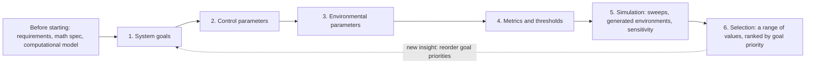

Krzysztof Paruch and Jamsheed Shorish set out parameter selection under uncertainty as six steps, from stating a system's goals to recommending a range of parameter values, and this is the workflow our parameter sweeps follow.

<!-- overview-table:start -->

| | |
| --- | --- |
| **Authors** | Krzysztof Paruch, Jamsheed Shorish |
| **Published** | April 8, 2021 |
| **Source** | BlockScience blog, [original](https://blog.block.science/how-to-perform-parameter-selection-under-uncertainty/) |
| **Topics** | [parameter selection under uncertainty](/tags/parameter-selection-under-uncertainty), [KPIs and goals](/tags/kpis-and-goals) |
| **Key terms** | [PSUU](/Phase-II/Wiki/Reference/Glossary-and-Notation), system goals, control parameters, environmental parameters, thresholds, basins of attraction, graduated goals |
| **Serves deliverables** | [1.4](/Phase-II/Milestones/Milestone-1/1-4-Behavioral-Calibration/), [2.1](/Phase-II/Milestones/Milestone-2/2-1-PSUU-Infrastructure/), [2.2](/Phase-II/Milestones/Milestone-2/2-2-Simulation-Execution/), [2.3](/Phase-II/Milestones/Milestone-2/2-3-KPI-Computation/), [2.5](/Phase-II/Milestones/Milestone-2/2-5-Sensitivity-Analysis/), [2.6](/Phase-II/Milestones/Milestone-2/2-6-Risk-Surface-Map/), [3.1](/Phase-II/Milestones/Milestone-3/3-1-Parameter-Recommendation-Report/) |

<!-- overview-table:end -->

BlockScience published the article on its blog on April 8, 2021, with edits and suggestions by Michael Zargham, Danilo Lessa Bernardineli, Jeff Emmett, and Jessica Zartler. Its stated aim is to teach the process and show where it sits in the wider engineering of a system. It is a methods article, not a peer-reviewed paper. It has no equations, no data, and no worked example, and it is short. The article abbreviates the method as PSuU. This site writes **PSUU**.

The problem is how to configure a complex system when information is imperfect. In a **cryptoeconomy** such as a token network, the values of a few **system parameters**, a fee rate or a minting rate for example, shape how users act and how the system evolves. Choosing those values at launch and maintaining them afterward are governance decisions. The article argues that such choices have wide and unintuitive effects when many agents interact, so they should come from simulation and data rather than from judgment alone. It names three things that must exist before the process starts: full system requirements, a mathematical specification, and a programmed computational model.

The method is six steps. First, turn the team's qualitative targets into precise **system goals**. Second, list the **control parameters**, those the system sets and that affect the goals, and assess which parameter moves which goal so stakeholders can rank the goals. Third, list the **environmental parameters**, processes the system cannot control that still affect the goals, such as the price of ETH. Fourth, define **metrics** for each goal. One goal can have several metrics, and several goals can share one. Metrics also mark **thresholds** beyond which the system becomes unresponsive or unstable, and they are the criteria by which control parameters are chosen. Fifth, simulate. Environmental parameters are represented by generated processes, control parameters are swept over ranges across many runs, and a **sensitivity analysis** tests how robust the results are. Sixth, select parameters using **basins of attraction**, the sets of starting conditions that end in the desired state, together with confidence intervals, and rank the choices by the priority of the goals.

The article's result is the workflow itself, and it reports no numbers. Its target is "an area near the optimal parameter values", not a single optimum. It expects goals to conflict. When meeting every goal in full is infeasible, it calls for **graduated goals** and a balance of trade-offs. It also presents the process as iterative, so goal priorities can be reordered when a later step shows they should be.

*The six steps of parameter selection under uncertainty and the work that must come before them. The dashed line shows that the process repeats: what the simulations reveal can change which goals come first. The diagram is drawn from the article's text.*

## How it relates to our research

**It is the method the contract is named for.** The accepted [proposal](/Phase-II/Milestones/Milestone-0/Proposal/) is titled Parameter Selection Under Uncertainty for Avalanche Staking and cites this article as the source of the method. The proposal groups the six steps into four: define the design space, simulate, analyze, and recommend. Each of the article's steps has an Avalanche counterpart. The goals are the proposal's three: incentive alignment, participation distribution, and network security. The control parameters are the minimum and maximum commitment length, the reward rate at each end of that range, and the validator's share of rewards. The environmental parameters are external yields from 3% to 10%, market condition, and network growth. The metrics are the seven KPIs of deliverable [2.3](/Phase-II/Milestones/Milestone-2/2-3-KPI-Computation/), and the simulation is the sweep of deliverables [2.1](/Phase-II/Milestones/Milestone-2/2-1-PSUU-Infrastructure/) and [2.2](/Phase-II/Milestones/Milestone-2/2-2-Simulation-Execution/), which the proposal sizes at 500 governance configurations, 20 scenarios, and 5 runs each, or 50,000 trajectories.

**The control parameters are already moving.** Helicon changed two of them on Mainnet. [ACP-273](/Phase-II/Wiki/Collections/Economic-ACPs/ACP-273-Minimum-Validator-Duration/) lowered the minimum validator duration from 14 days to 48 hours, and [ACP-285](/Phase-II/Wiki/Collections/Economic-ACPs/ACP-285-Minimum-Consumption-Rate/) is lowering the minimum consumption rate from 10% to 7.5%. The sweep ranges have to include these new values, and the observed response to them is data the model can be checked against. Other proposals in the [Economic ACPs](/Phase-II/Wiki/Collections/Economic-ACPs/) collection, such as the delegation multiplier of [ACP-247](/Phase-II/Wiki/Collections/Economic-ACPs/ACP-247-Delegation-Multiplier/) and the uptime requirement of [ACP-267](/Phase-II/Wiki/Collections/Economic-ACPs/ACP-267-Uptime-Requirement/), are candidates to add as control parameters.

**A metric must be able to fail.** Step 4 asks each metric to carry a threshold, and the proposal turns every KPI into a pass or a fail by that threshold. A configuration fails if any KPI crosses its threshold, and the regions where configurations fail make up the risk map of deliverable [2.6](/Phase-II/Milestones/Milestone-2/2-6-Risk-Surface-Map/). The proposal's targets, such as a staking ratio of 50% to 60% and more than 1,000 validators, are marked as illustrative. Each threshold therefore has to be agreed with the Foundation and fixed before the sweep runs, not read off the results.

**We add the selection rules the article leaves open.** Step 6 names basins of attraction and confidence intervals but gives no procedure and no standard for how many runs are enough. The proposal selects with decision trees and correlation matrices in deliverable [2.5](/Phase-II/Milestones/Milestone-2/2-5-Sensitivity-Analysis/), and the [Parameter Recommendation Report](/Phase-II/Milestones/Milestone-3/3-1-Parameter-Recommendation-Report/) gives the article's "area near the optimal" three concrete forms: a best value for each parameter, a range for each goal, and a range that meets all goals together. For choosing among settings when the future is uncertain beyond the sampled scenarios, we draw on the robust decision making of [Lempert and others, 2006](/Phase-II/Wiki/Collections/Supplementary-Research-Papers/2006-Robust-Strategies-and-Narrative-Scenarios) and the scenario discovery of [Bryant and Lempert, 2010](/Phase-II/Wiki/Collections/Supplementary-Research-Papers/2010-Scenario-Discovery).

**Behavior is a third kind of parameter.** The article sorts parameters into those the system controls and those the environment sets. It does not say where the parameters of participants' behavior belong. In the Avalanche model, how validators and delegators respond to a change in rewards is estimated from 2024 and 2025 staking history in deliverable [1.4](/Phase-II/Milestones/Milestone-1/1-4-Behavioral-Calibration/), with confidence intervals. The proposal sweeps those behavioral parameters within their uncertainty bounds, so the sweep covers governance, environment, and behavior together. The model itself is written in the state-space form of [Zargham, Zhang, and Preciado](/Phase-II/Wiki/Collections/Supplementary-Research-Papers/2018-State-Space-Modeling-of-Blockchain-Economies), which the cadCAD simulator implements. [Summoning the Money God](/Phase-II/Wiki/Collections/Supplementary-Research-Papers/2021-Control-Theory-for-Monetary-Policy/), published by BlockScience the next day, shows the same approach applied to a live system: candidate controllers for the RAI stablecoin are tuned by simulation and tested against attacks and shocks before launch.

**Open questions for the Foundation.** Step 6 ranks recommendations by the priority of the goals, and the proposal's three goals have no order yet. Which goal comes first when they conflict? Which KPI thresholds count as failure?

## Source

Krzysztof Paruch and Jamsheed Shorish. 2021. How to Perform Parameter Selection Under Uncertainty. BlockScience blog, April 8, 2021, with edits and suggestions by Michael Zargham, Danilo Lessa Bernardineli, Jeff Emmett, and Jessica Zartler. <https://blog.block.science/how-to-perform-parameter-selection-under-uncertainty/>.
