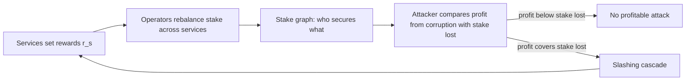

A reward mechanism buys security. Deliverable 2.8 compares reward mechanisms, and each one should say how much it pays and what that payment protects against. Chitra and Pai give one way to price it. A service pays operators enough that attacking it costs more stake than the attack would earn.

## Citation

Tarun Chitra and Mallesh Pai. 2024. How much should you pay for restaking security? arXiv:2408.00928, 1 August 2024. <https://arxiv.org/abs/2408.00928>.

## Question and method

The paper asks how much services that share restaked operators must pay those operators so the network resists cascading attacks. It also asks whether a richer model of the attacker avoids the whole-network cascades found in earlier work by Durvasula and Roughgarden. The model is a bipartite graph of services and operators. Each operator $v$ has stake $\sigma_v$. Each service $s$ offers a profit from corruption $\pi_s$ and falls when attackers control a share $\alpha_s$ of the stake securing it.

An attack on a set of services $A$ by a set of operators $B$ succeeds when the attackers' profit covers the stake they lose and they hold enough stake in each target:

$$f(\pi, A) \ge \sigma_B, \qquad \sigma_{B \cap \partial s} \ge \alpha_s\,\sigma_{\partial s}\ \ \text{for every } s \in A.$$

The attacker gets diminishing returns from attacking several services at once, $f_p(\pi, A) = \left(\sum_{s \in A} \pi_s^p\right)^{1/p}$ with $p > 1$. Services pay rewards pro rata to stake. An operator with cost $c_s$ stays with a service while its stake is large enough to cover that cost:

$$\sigma_v \ge \frac{c_s\,\sigma_{\partial s}}{r_s - c_s}.$$

Each round, services set rewards, the attacker attacks, and operators rebalance their stake. The paper frames this as an online Stackelberg security game.

## Main result

Theorem 1 shows that rewards exist that bound the share of stake lost after an initial shock of size $\psi$ by $\psi + C/S^{1-1/p}$, where $S$ is the number of services. Earlier bounds needed every service to be overcollateralized. The conditions are that each service's reward-to-cost ratio satisfies $r_s/c_s \ge K S^{1/p} + 1$, with $K$ the ratio of the largest profit from corruption to the smallest operator stake, and that stake overlap between services grows on the order of $S^{1/p}$. Rewards that fall when an operator adds overlap keep overlap in that range. An algorithm approximates the optimal rewards. The paper gives no numerical or empirical evaluation, so its results are bounds, not measured magnitudes.

## What it gives this research

1. A participation constraint for deliverable [2.8](/Phase-II/Milestones/Milestone-2/2-8-Collaborative-Mechanism-Design/). An operator stays while its share of rewards exceeds its cost, $\sigma_v \ge c_s\sigma_{\partial s}/(r_s - c_s)$. A proposed reward mechanism can be checked against it for operators at the 2,000 AVAX minimum and at the 3,000,000 AVAX weight cap.
2. A security measure for the same deliverable. The cost of an attack, measured as the stake an attacker must hold and lose against what it gains, is a quantity to report for each mechanism rather than total stake alone.

## Limits for Avalanche

The Primary Network is one service secured by one validator set, and Avalanche does not slash stake. The paper's cascades run through slashing across services that share operators, so they do not occur on the Primary Network as it stands. The participation constraint and the attack-cost comparison transfer. The graph results matter only if Avalanche validators come to secure several services with the same stake. The authors leave numerical tests on live networks, and the price risk of rewards paid in a service's own token, to future work.
