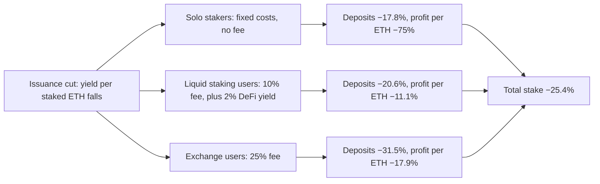

Beccuti, Chantramonklasri, Hafner, and Oderbolz model three types of Ethereum staker and find that a cut in issuance lowers total stake by about a quarter, changes who stakes, and falls hardest on the profits of solo stakers.

The authors work at the Center for Cryptoeconomics, and a CyberFund grant funded the paper. They posted it in March 2025 and revised it in July 2025. About 30% of circulating ETH is staked, and several proposals would lower **issuance**, the new ETH the protocol pays to stakers. Supporters say lower issuance would limit dilution and slow the spread of **liquid staking tokens**, tradable claims on staked ETH. Opponents say it would push out **solo stakers**, who run their own validators and add most to decentralization, and leave more stake with centralized exchanges. The paper asks how each kind of staker sets its stake, and how a new schedule changes the mix.

The model is a game between three types of ETH holder. **Experts** stake solo. **Techies** stake through a decentralized provider such as Lido and hold a liquid staking token that earns extra DeFi yield. **Retailers** stake through a centralized provider such as an exchange. The market is **segmented**: each type uses only its own route and never switches. Each holder chooses only how much to deposit and pays a cost $C + c\,d^{\alpha}$, a fixed part plus a part that rises faster than the deposit $d$. Income comes from issuance, from expected **MEV**, the extra income a block proposer earns by ordering transactions, and for Techies from DeFi yield. The outcome is a **Nash equilibrium**, in which no holder gains by changing its deposit given everyone else's. The paper compares Ethereum's schedule, $y_i(D) = 2.6 \cdot 64/\sqrt{D}$, with an alternative from Elowsson, $y_i'(D) = 2.6 \cdot 64 / \left(\sqrt{D}\,(1 + kD)\right)$ with $k = 2^{-25}$, where $D$ is total ETH staked. Because yield falls as $D$ rises, each type's deposit lowers every other type's yield.

The authors report that fitting costs to observed market shares by simulated moments "does not provide a stable best fit", because many settings match. They set the parameters instead from prior work and a survey of solo stakers on the ethstaker forum. The calibration has 25,000 Experts, 200,000 Techies, and 925,000 Retailers, a 10% fee for the decentralized provider, a 25% fee for the centralized one, a 2% DeFi yield, and a solo fixed cost of about \$1,000 a year, or 0.4 ETH at \$2,400. The authors say the results are not point forecasts. They show direction and relative size.

In the baseline, the alternative schedule lowers total stake by 25.4%. Deposits fall 31.5% for Retailers, 20.6% for Techies, and 17.8% for Experts, so the solo share rises slightly, from 2.7% to 2.97%. Profit per staked ETH falls 75% for Experts, against 11.1% for Techies and 17.9% for Retailers. Two extensions remove that gain in share. When solo stakers dislike the variance of proposal income, their deposits fall 24.6% and their profit per ETH falls to zero. When, in addition, 20% of stake belongs to **inattentive** holders who do not respond, the other types adjust more and solo deposits fall 26.9%. A last extension lets the liquid staking provider reset its fee to keep its own profit about unchanged. The fee rises from 10% to 13%, and total stake falls 22.7%.

The empirical section estimates the **elasticity** of stake to yield, the percent change in ETH staked for a 1% change in dollar staking rewards. Stake and yield are set together, so the authors use **instrumental variables**, which move yield without moving stakers' costs. With network upgrades as instruments, two-stage least squares gives 0.464 for all stake, against 0.209 by ordinary least squares, with a first-stage F of 428.2 on 423 observations. For solo stakers the same method gives −0.031, which is not significant. With gas fees as the instrument, on 622 daily observations, the elasticity is 1.184 for solo stakers and 1.078 for all stakers. The authors caution that these estimates rest on short-term movements in fees.

*How one issuance cut reaches the three types of staker in the paper's baseline calibration. Deposits fall least for solo stakers, but their profit per ETH falls most, because fixed costs must be covered from a smaller reward. The diagram is drawn from the paper's text and its baseline results.*

## How it relates to our research

**It gives the staking model more than one kind of staker.** Deliverable [1.3](/Phase-II/Milestones/Milestone-1/1-3-Staking-Model-Spec/) needs stakers who differ in cost, route, and outside income. On Avalanche the types come from the P-Chain: validators with at least 2,000 AVAX of self-stake, delegators from 25 AVAX, who pay a delegation fee of at least 2%, and stake routed through BENQI's liquid staking, which appears as delegations. [BENQI told us](/Phase-II/Interviews/BENQI-2026-08-31/) that it holds 10% to 12% of all stake.

**It supplies a number our calibration lacks.** The Foundation's [validator rewards article](/Phase-II/Wiki/Collections/Essential-Readings/How-Do-Avalanche-Validators-Actually-Think-About-Staking-Rewards/) holds stake size fixed, and the [Static Constants article](/Phase-II/Wiki/Collections/Essential-Readings/From-Static-Constants-to-Dynamic-Variables-Where-Avalanches-Economics-Are-Headed/) calls the elasticity of stake to reward low without an estimate. Deliverable [1.4](/Phase-II/Milestones/Milestone-1/1-4-Behavioral-Calibration/) needs stake response functions with confidence intervals. The significant Ethereum estimates, 0.46 to 1.18, are a prior to test, and the method transfers. Avalanche's upgrade periods, and the [ACP-285](/Phase-II/Wiki/Collections/Economic-ACPs/ACP-285-Minimum-Consumption-Rate/) ramp from 10% to 7.5%, shift the reward for reasons unrelated to stakers' costs. The gas-fee instrument does not transfer, because C-Chain fees are burned and never reach stakers. Stake and reward both trend, so the estimates also need the checks in [Spurious Regressions](/Phase-II/Wiki/Collections/Supplementary-Research-Papers/1974-Spurious-Regressions).

**The paper's competition channel is weaker on Avalanche.** Avalanche fixes each commitment's reward at its start from stake, duration, consumption rate, and remaining supply, so a new staker lowers others' rates only through the supply counter. Validators also earn no proposal income. The crowding-out result therefore does not carry over, but the cost result does: a type with fixed costs and no outside income loses the most profit per unit when rewards fall. Avalanche adds a choice the paper lacks, commitment duration, and ACP-285 lowers only the reward for short commitments.

**It gives a form to a question already on the table.** The ACP-285 page asks which cohorts bear the lower short-duration reward, and the [ACP-285 community call](/Phase-II/Wiki/Collections/Essential-Readings/ACP-285-Avalanche-Community-Call-Staking-Reward-Curve-Adjustment/) left the effect on concentration of delegated stake as a hypothesis to test. The paper shows that total stake can move modestly while the mix moves more. Deliverable [2.3](/Phase-II/Milestones/Milestone-2/2-3-KPI-Computation/) should report stake by route beside total stake, and [2.8](/Phase-II/Milestones/Milestone-2/2-8-Collaborative-Mechanism-Design/) should compare mechanisms on it.

**It connects to the other readings.** [Why Avalanche Validator Economics Need a Redesign](/Phase-II/Wiki/Collections/Essential-Readings/Why-Avalanche-Validator-Economics-Need-a-Redesign/) argues that small independent operators become unviable, and the solo-profit result is a formal case of that claim. [The Tokenomics of Staking](/Phase-II/Wiki/Collections/Supplementary-Research-Papers/2025-The-Tokenomics-of-Staking) estimates stake responses across 66 tokens. [Why Stake When You Can Borrow?](/Phase-II/Wiki/Collections/Supplementary-Research-Papers/2020-Why-Stake-When-You-Can-Borrow) treats the liquid staking token as a separate asset, which relaxes the segmentation assumed here.

**Open questions for the Foundation.** Which validators does the Foundation know to be run by exchanges or custodians, so that the centralized route can be measured? Should the solo validators' share of stake be a KPI with its own threshold?

## Source

Juan Beccuti, Thunj Chantramonklasri, Matthias Hafner, and Nicolas Oderbolz. 2025. Towards a Formal Framework of the Ethereum Staking Market. Center for Cryptoeconomics. arXiv:2503.14385, version 2, 20 July 2025. <https://arxiv.org/abs/2503.14385>, DOI [10.48550/arXiv.2503.14385](https://doi.org/10.48550/arXiv.2503.14385). Version 1, of 18 March 2025, also lists Noé Arnold as an author.
