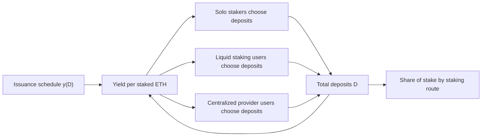

ACP-285 lowers the minimum consumption rate, so the Foundation needs to know which stakers leave when rewards fall, not only how many. This paper answers that question for Ethereum. It models solo stakers, users of liquid staking, and users of centralized providers as separate suppliers of stake, and finds that an issuance cut changes the market's composition as well as its size.

## Citation

Juan Beccuti, Thunj Chantramonklasri, Matthias Hafner, and Nicolas Oderbolz. 2025. Towards a Formal Framework of the Ethereum Staking Market. arXiv:2503.14385, version 2, 20 July 2025. Center for Cryptoeconomics. <https://arxiv.org/abs/2503.14385>. Version 1, of 18 March 2025, also lists Noé Arnold as an author.

## Question and method

The paper asks how each type of Ethereum staker sets its deposit, and how a change to the issuance schedule shifts the mix of stakers. It is a game between three types of staker. Each type is homogeneous, and each agent chooses only the size of its deposit. The market is segmented, so no agent switches between staking methods. The equilibrium is a Nash equilibrium in deposits.

| Type | Staking route | Number modeled | Extra terms in profit |
| --- | --- | --- | --- |
| Expert | Solo validator | 25,000 | No provider fee |
| Techie | Decentralized provider with a liquid staking token | 200,000 | DeFi yield $y_d$ on the token, provider fee $f_d$ |
| Retailer | Centralized provider | 925,000 | Provider fee $f_c$ |

Issuance per unit of total deposits $D$ follows Ethereum's schedule, $y_i(D) = 2.6 \cdot 64 / \sqrt{D}$. The alternative schedule the paper tests is $y_i'(D) = 2.6 \cdot 64 / \left(\sqrt{D}\,(1 + kD)\right)$ with $k = 2^{-25}$. Each type pays a cost $C + c\,d^{\alpha}$ that is convex in its deposit $d$. A retailer, for example, solves

$$\Pi_r = \max_{\hat d_r}\;(1 - f_c)\left[y_i(D)\,\hat d_r + y_v P_r(D)\right] - \left(C_r + c_r\,\hat d_r^{\alpha_r}\right),$$

where $y_v P_r(D)$ is the expected block-proposal income. The authors calibrate the cost parameters by hand. They report that fitting them by simulated moments "does not provide a stable best fit".

## Main result

Under the alternative schedule, the baseline calibration lowers total stake by 25.4%. Deposits fall by 17.8% for solo stakers, 20.6% for liquid staking users, and 31.5% for centralized provider users. Solo stakers' profit per ETH falls by 75%. When solo stakers are risk-averse to the variance of proposal income, their deposits fall by 24.6% and their profit falls by 100%. When the liquid staking provider sets its fee with market power, it raises the fee from 10% to 13% and total stake falls by 22.7%.

The empirical section estimates the elasticity of stake supply to yield. With network upgrades as instruments, two-stage least squares gives 0.464, with a first-stage F of 428.2, against 0.209 by ordinary least squares. With gas fees as the instrument on daily data from December 2020 to June 2024, the elasticity is 1.184 for solo stakers and 1.078 for all stakers. The calibration is weak by the authors' own account, since it is set by hand, so the simulated percentages show direction and relative size rather than forecasts.

## What it gives this research

1. A typed supply model for deliverable [1.3](/Phase-II/Milestones/Milestone-1/1-3-Staking-Model-Spec/). Each staker type has its own cost curvature and its own route to rewards, which is the structure Avalanche needs for validators, delegators, and stake routed through intermediaries.
2. An instrument for deliverable [1.4](/Phase-II/Milestones/Milestone-1/1-4-Behavioral-Calibration/). Protocol upgrades shift yield for reasons unrelated to a staker's own costs. Avalanche's upgrade periods, and the ACP-285 ramp in particular, can serve the same role in estimating how stake responds to the reward rate.
3. A composition measure for deliverable [2.8](/Phase-II/Milestones/Milestone-2/2-8-Collaborative-Mechanism-Design/). The share of stake by staking route, before and after a change to the consumption rate, is a quantity a comparison of reward mechanisms should report beside total stake.

## Limits for Avalanche

Ethereum pays one issuance rate on total deposits. Avalanche fixes a reward per commitment from its stake, duration, and consumption rate, so a validator's yield does not fall as other validators join. Avalanche validators receive no transaction fees or proposal income, because fees are burned, so the terms for proposal income drop out. The model has no entry, exit, or switching between routes, which the authors call short-run. The mapping of the three types onto Avalanche has to come from the chain: validators with the 2,000 AVAX minimum self-stake, delegators from the 25 AVAX minimum, and stake routed through the BENQI liquid staking protocol, which appears on the P-Chain as delegations.
